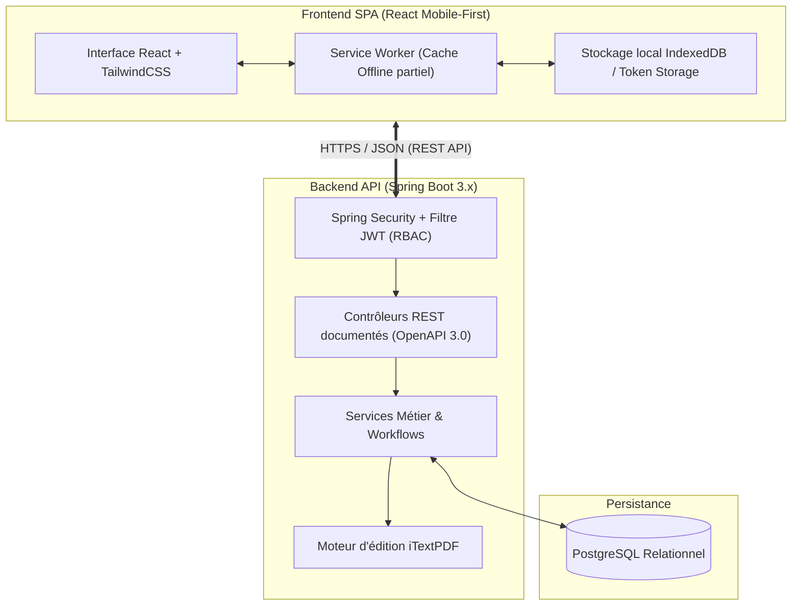

# CareerTrack, Plateforme RH de Gestion des Carrières

Projet Fil Rouge · Groupe 3

  Stack technique : <strong>Spring Boot · React · PostgreSQL · iTextPDF</strong>
  Sécurité : <strong>JWT · RBAC</strong>
  Enseignant responsable : <strong>M. Khalifa GAYE</strong>
  Conception : <strong>OpenAPI 3.0 · Mobile-First · PWA</strong>

---

## 1. Contexte et Problématique Métier

Dans le tissu économique sénégalais, les **Petites et Moyennes Entreprises (PME de 50 à 500 salariés)** souffrent d'une gestion des Ressources Humaines morcelée et manuelle. Les informations relatives au personnel sont dispersées entre des classeurs physiques, des dizaines de feuilles de calcul Excel hétérogènes et des échanges informels d'emails. 

Cette situation engendre de multiples écueils opérationnels :
- **Perte de traçabilité et risques juridiques** : difficultés à respecter le formalisme du Code du Travail sénégalais (droits aux congés payés, contrats, avenants, motifs de sanctions).
- **Opacité dans le pilotage des compétences** : impossibilité d'identifier rapidement les talents internes pour des promotions ou des mobilités, évaluations annuelles souvent non formalisées ou non archivées.
- **Lenteur des processus administratifs** : les demandes de congés ou d'attestations prennent plusieurs jours en circuit papier.
- **Ruptures de communication** : absence d'organigramme à jour et méconnaissance des objectifs d'équipe.

**CareerTrack** résout cette équation en fournissant une solution web et mobile unifiée, sécurisée et ergonomique, spécialement conçue pour moderniser les processus RH tout en restant accessible aux structures ne disposant pas d'un budget pour un ERP international.

---

## 2. Architecture Technique et Contraintes d'Ingénierie

### Contraintes obligatoires respectées

1. **Authentification & Droits d'Accès (JWT & RBAC)** :
   - Signature sécurisée des jetons stateless HMAC-SHA256 avec durée de vie limitée (1 heure) et jeton de rafraîchissement (Refresh Token).
   - Quatre profils strictement cloisonnés :
     - **DRH** : administration globale, gestion contractuelle, salaires, paramétrage des campagnes.
     - **Manager** : validation des congés de son équipe (N-1), notation des évaluations SMART, entretiens.
     - **Employé** : consultation de son dossier, saisie de ses congés, auto-évaluation, consultation de l'organigramme.
     - **Direction** : accès analytique en lecture seule aux tableaux de bord RH et KPIs stratégiques.
2. **Standard d'API OpenAPI 3.0 / Swagger** : contrat d'interface rigoureusement spécifié avant implémentation, facilitant le travail découplé entre développeurs frontend et backend.
3. **Conception Mobile-First et Résilience Offline** :
   - Prise en charge des écrans tactiles mobiles pour les employés et managers en déplacement.
   - Enregistrement d'un Service Worker permettant la consultation hors-ligne des soldes de congés et des coordonnées d'équipe.

---

## 3. Démarche Méthodologique Hybride Retenue

Le projet applique une méthodologie sur mesure combinant le meilleur des approches prédictives et agiles :

| Module CareerTrack | Démarche retenue | Justification |
|---|:-:|---|
| **Dossier Employé & Contrats** | **Cycle en V** | Règles administratives figées, conformité juridique, fort besoin de recette formelle. |
| **Gestion des Congés & Absences** | **Cycle en V** | Calculs mathématiques et plafonds légaux déterministes (Code du Travail). |
| **Campagnes d'Évaluation SMART** | **Scrum (Sprints de 2 sem.)** | Ergonomie des formulaires itérative, intégration progressive de la signature PDF. |
| **Formations & Compétences** | **Scrum (Sprints de 2 sem.)** | Fonctionnalité évolutive selon les retours des managers et DRH pilotes. |
| **Tableaux de bord & Décisionnel** | **Scrum (Sprints de 2 sem.)** | Ajustement continu des graphiques décisionnels demandés par la direction. |
| **Pipeline de Recrutement** | **Kanban** | Flux continu d'opportunités, forte variabilité du volume de candidatures. |

---

## 4. Product Backlog Priorisé (82 Points)

Le backlog global de CareerTrack est composé de **15 User Stories (US-01 à US-15)** pour un total de **82 points d'effort**, estimé selon la suite de Fibonacci :

| ID | Intitulé & Description | Priorité (MoSCoW) | Module | Effort (pts) |
|:--:|---|:--:|---|:--:|
| **US-01** | En tant que **DRH**, je veux créer et modifier le dossier administratif d'un employé afin de centraliser ses données et documents contractuels | **Must** | Dossier employé | **8** |
| **US-02** | En tant qu'**utilisateur**, je veux visualiser l'organigramme interactif afin de situer les liens hiérarchiques de l'entreprise | **Should** | Organigramme | **5** |
| **US-03** | En tant qu'**employé**, je veux soumettre une demande de congé avec calcul automatique de mon solde restant afin d'anticiper mes absences | **Must** | Congés & absences | **5** |
| **US-04** | En tant que **manager**, je veux valider ou rejeter avec motif les demandes de congés de mon équipe afin d'assurer la continuité de service | **Must** | Congés & absences | **3** |
| **US-05** | En tant que **DRH / Manager**, je veux initialiser une campagne d'évaluation avec des objectifs SMART afin de mesurer la performance annuelle | **Must** | Évaluation annuelle | **8** |
| **US-06** | En tant qu'**employé**, je veux compléter mon auto-évaluation avant l'entretien afin de préparer la discussion avec mon responsable | **Should** | Évaluation annuelle | **3** |
| **US-07** | En tant que **DRH**, je veux générer un bilan d'évaluation au format PDF téléchargeable et signable (iTextPDF) pour officialiser l'archivage | **Must** | Évaluation annuelle | **8** |
| **US-08** | En tant que **DRH**, je veux publier un plan annuel de formation avec dates, prérequis et budgets afin de développer les compétences internes | **Should** | Formations | **5** |
| **US-09** | En tant qu'**employé**, je veux postuler à une session de formation du catalogue afin de progresser dans mon parcours professionnel | **Could** | Formations | **3** |
| **US-10** | En tant que **DRH / Direction**, je veux saisir les propositions d'évolution indiciaire et de promotions pour simuler leur impact sur la masse salariale | **Should** | Promotions & salaires | **5** |
| **US-11** | En tant que **recruteur**, je veux déplacer les candidatures sur un tableau Kanban à 5 colonnes afin de fluidifier les recrutements en cours | **Must** | Recrutement | **8** |
| **US-12** | En tant que **Direction / DRH**, je veux consulter les KPIs clés (turnover, pyramide des âges, absentéisme) pour piloter la stratégie sociale | **Should** | Tableaux de bord RH | **8** |
| **US-13** | En tant qu'**utilisateur**, je veux m'authentifier via un formulaire sécurisé et obtenir un jeton JWT afin d'accéder aux fonctionnalités selon mon rôle | **Must** | Sécurité transverse | **5** |
| **US-14** | En tant qu'**utilisateur mobile**, je veux naviguer sur une interface responsive adaptée aux smartphones afin d'utiliser la plateforme sur le terrain | **Must** | UX / Frontend | **3** |
| **US-15** | En tant qu'**employé**, je veux consulter mes informations de base et mes congés sans connexion grâce au Service Worker afin de rester autonome | **Could** | PWA / Offline | **5** |
| **TOTAL** | **15 User Stories couvrant l'ensemble des exigences du projet CareerTrack** | — | — | **82 pts** |

---

## 5. Planification des Sprints et Indicateurs Cibles

### Découpage des itérations Scrum
- **Sprint 1 (Durée : 2 semaines · 21 points)** : socle architectural et noyau administratif.
  - US-13 : Authentification JWT & rôles RBAC (5 pts)
  - US-01 : Dossier employé complet & persistance PostgreSQL (8 pts)
  - US-02 : Organigramme hiérarchique réactif (5 pts)
  - US-14 : Socle responsive mobile-first (3 pts)
- **Sprint 2 (Durée : 2 semaines · 27 points)** : modules métier prioritaires.
  - US-03 & US-04 : Workflow complet de congés (8 pts)
  - US-05, US-06 & US-07 : Évaluation annuelle SMART & génération iTextPDF (19 pts)
- **Sprint 3 (Durée : 2 semaines · 21 points)** : flux de recrutement, compétences et dashboards.
  - US-11 : Pipeline Kanban de recrutement (8 pts)
  - US-08 & US-09 : Plan et inscriptions aux formations (8 pts)
  - US-10 : Promotions et revalorisations (5 pts)
- **Sprint 4 (Durée : 2 semaines · 13 points)** : décisionnel, optimisation et offline.
  - US-12 : Tableaux de bord RH et indicateurs graphiques (8 pts)
  - US-15 : Service Worker et cache offline partiel (5 pts)

### Indicateurs cibles de performance (KPIs)
- **Vélocité d'équipe** : 20 à 25 points par sprint de 2 semaines.
- **Lead Time moyen** : < 2 jours calendaires entre la prise en charge d'une story et sa mise en revue.
- **Cycle Time de développement** : < 1,5 jour par tâche technique unitaire.
- **WIP limite (Travail en cours)** : maximum 3 tâches actives par personne simultanément pour préserver la qualité.

---

## 6. Pipeline Kanban de Recrutement

Le sous-module de recrutement (US-11) implémente un flux tiré strict avec limitation du travail en cours (WIP) pour prévenir la surcharge des recruteurs et accélérer le délai moyen d'embauche :

  

    
1. Reçu12

    
<strong>Dev Java Spring</strong> · Babacar D.

    
<strong>Comptable</strong> · Fatou N.

    
<strong>RH Généraliste</strong> · Amadou B.

    
+ 9 autres candidatures

  

  

    
2. Présélectionné8

    
<strong>Frontend React</strong> · Mariama S.

    
<strong>Chef de Projet IT</strong> · Ousmane T.

    
+ 6 dossiers validés RH

  

  

    
3. Entretien (WIP 2)2 / 2

    
<strong>Lead Tech Fullstack</strong> · Idrissa K.

    
<strong>Admin Système / DBA</strong> · Aïssatou D.

  

  

    
4. Offre émise (WIP 2)2 / 2

    
<strong>Ingénieur DevOps</strong> · Cheikh M.

    
<strong>Spécialiste Paie</strong> · Ndèye F.

  

  

    
5. Embauché / Clôturé2

    
<strong>Dev Backend</strong> · Mouctar S. (Signé)

    
<strong>Analyste RH</strong> · Khady P. (Signé)

  

  <em>État actuel du pipeline : 12 reçus · 8 présélectionnés · 2 en entretien (WIP saturé à 2) · 2 en offre (WIP saturé à 2) · 2 embauchés · 3 candidatures refusées et archivées avec notification légale.</em>

---

## 7. Organisation de l'Équipe Projet (Groupe 3)

| Membre | Rôles et responsabilités sur CareerTrack | Domaines de contribution technique |
|---|---|---|
| **Eric Joel Manga** | Responsable Modélisation & Conception | Architecture relationnelle PostgreSQL, conception UML, module Dossier employé et Organigramme |
| **Assete Faye** | Responsable Qualité Logicielle & Spécifications | Assurance qualité, plan de tests JUnit/Mockito, validation des critères d'acceptation, DoR / DoD |
| **Mouhamed Fam** | Responsable Planification & Gestion des Risques | Ordonnancement WBS/PERT/Gantt, cartographie des risques P×I, suivi budgétaire EVM |
| **Soxna** | Responsable Analyse Agile & Processus Métier | Animation des cérémonies Scrum, backlog grooming, module Évaluation annuelle et Formations |
| **Ibrahima Diallo** | Lead Technique & Coordination Projet | Sécurité Spring Security JWT, architecture d'intégration continue, module Recrutement Kanban et iTextPDF |

---

## 8. Livrables Attendus pour l'Évaluation Finale

1. **Dépôt Git structuré** : branches `main` (production), `develop` (intégration continue) et `feature/*` (développements isolés).
2. **Documentation d'ingénierie logicielle** : README exhaustif, diagrammes de classes et de séquence UML, spécification interactive OpenAPI 3.0.
3. **Batterie de tests automatisés** : taux de couverture de code unitaire et d'intégration supérieur ou égal à **60 %**.
4. **Déploiement en ligne** : instance cloud accessible publiquement avec base de données managée.
5. **Démonstration orale de 10 minutes** : 5 minutes de scénario utilisateur réel (création employé → demande de congé → évaluation SMART générée en PDF) et 5 minutes d'échange technique avec le jury.
