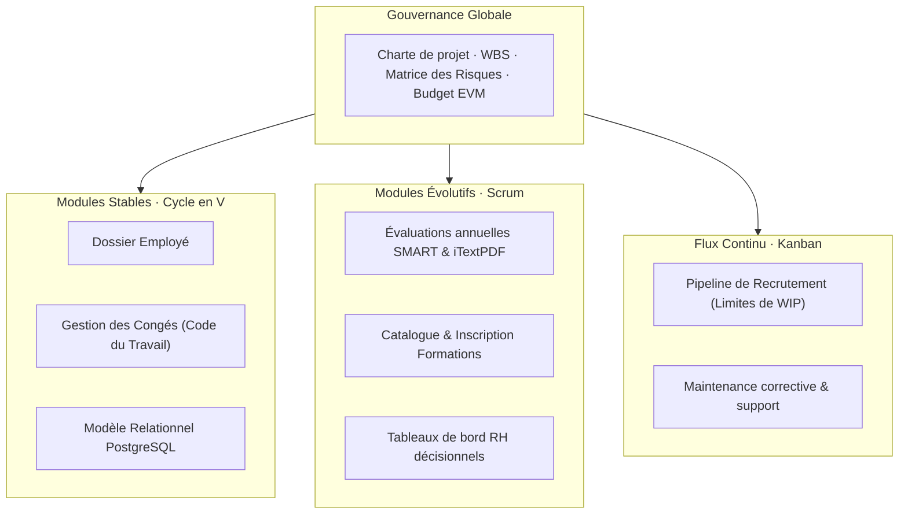

# Notre Groupe & Projet CareerTrack

Groupe 3 · L3 Ingénierie Informatique

  Établissement : <strong>UASZ (Université Assane Seck de Ziguinchor)</strong>
  UFR : <strong>Sciences et Technologies</strong>
  Département : <strong>Informatique</strong>
  Enseignant responsable : <strong>M. Khalifa GAYE</strong>

---

## 1. Membres du Groupe 3

Le Groupe 3 est composé de cinq étudiants inscrits en **Licence 3 Ingénierie Informatique** au sein de l'**UFR Sciences et Technologies** de l'**Université Assane Seck de Ziguinchor (UASZ)**.

| Nom complet | Établissement | Formation | Module |
|---|---|---|---|
| **Eric Joel Manga** | UASZ · UFR Sciences et Technologies | Licence 3 Ingénierie Informatique | Gestion de Projet Informatique Avancée |
| **Assete Faye** | UASZ · UFR Sciences et Technologies | Licence 3 Ingénierie Informatique | Gestion de Projet Informatique Avancée |
| **Mouhamed Fam** | UASZ · UFR Sciences et Technologies | Licence 3 Ingénierie Informatique | Gestion de Projet Informatique Avancée |
| **Soxna** | UASZ · UFR Sciences et Technologies | Licence 3 Ingénierie Informatique | Gestion de Projet Informatique Avancée |
| **Ibrahima Diallo** | UASZ · UFR Sciences et Technologies | Licence 3 Ingénierie Informatique | Gestion de Projet Informatique Avancée |

---

## 2. Le Module : Gestion de Projet Informatique Avancée

Ce module professionnalisant vise à doter les futurs ingénieurs informaticiens des compétences théoriques et pratiques nécessaires au pilotage de projets logiciels complexes, couvrant l'ensemble du cycle de vie d'un produit numérique :
- **Gouvernance et cadrage stratégique** : charte de projet, analyse de faisabilité, gestion rigoureuse des parties prenantes.
- **Modèles de cycle de vie** : maîtrise des démarches classiques prédictives (Cycle en V, Waterfall) et adaptatives (Scrum, Kanban).
- **Ingénierie de la planification et du budget** : WBS, réseaux PERT avec calcul du chemin critique, diagrammes de Gantt, pilotage par la valeur acquise (EVM).
- **Maîtrise des risques et de la qualité** : cartographie des risques (P×I), plans d'assurance qualité, pyramide de tests logicielle (ISO/IEC 25010), politiques d'intégration continue.
- **Leadership et capitalisation** : matrice RACI, dynamique d'équipe, gestion constructive des conflits, bilan de clôture et retour d'expérience (REX).

---

## 3. Projet Fil Rouge : CareerTrack

### Fiche d'identité du projet

  

Cible

PME

50 à 500 employés au Sénégal

  

Approche

Mixte

Cycle en V + Scrum + Kanban

  

Backlog

82 pts

15 User Stories priorisées

  

Qualité

≥ 60 %

Couverture de tests exigée

| Rubrique | Caractéristiques du projet CareerTrack |
|---|---|
| **Intitulé** | **CareerTrack** — Plateforme RH unifiée de gestion des carrières en entreprise |
| **Cible métier** | PME sénégalaises employant entre 50 et 500 collaborateurs |
| **Problématique résolue** | Rupture avec la gestion RH morcelée (fichiers Excel multiples, dossiers papier, emails non tracés) et mise en conformité avec la législation sociale (Code du Travail sénégalais) |
| **Architecture logicielle** | Backend API REST **Spring Boot**, Frontend **React (SPA)**, Base de données relationnelle **PostgreSQL**, moteur de génération documentaire **iTextPDF** |
| **Sécurité & Accès** | Authentification sans état via jetons **JWT** et contrôle d'accès basé sur les rôles (**RBAC**) : `DRH`, `Manager`, `Employé`, `Direction` |
| **Contraintes d'ingénierie** | Spécification **OpenAPI 3.0 / Swagger**, conception responsive **Mobile-First**, résilience réseau avec **mode hors-ligne partiel** (Service Worker / PWA) |

---

## 4. Modules Fonctionnels de la Plateforme

CareerTrack s'articule autour de 7 briques fonctionnelles majeures, conçues pour couvrir l'intégralité du parcours collaborateur :

1. **Dossier Collaborateur & Gestion Administrative** : centralisation des informations personnelles, contrats de travail, fiches de poste, historique de carrière et archivage sécurisé des pièces justificatives.
2. **Organigramme d'Entreprise Dynamique** : représentation hiérarchique interactive des départements, équipes et liaisons de subordination N/N+1.
3. **Gestion des Congés & Absences** : calcul automatisé des droits légaux, formulaire de demande mobile, workflow d'approbation managérial et calendrier partagé d'équipe.
4. **Campagnes d'Évaluation Annuelle** : définition d'objectifs SMART, auto-évaluation collaborative collaborateur/manager, calcul d'indicateurs de performance et génération automatique d'un compte-rendu PDF émargé.
5. **Plan de Développement des Compétences & Formations** : catalogue de sessions de montée en compétences, inscriptions supervisées, suivi du budget pédagogique et attestations.
6. **Promotions & Politique Salariale** : traçabilité des revalorisations, simulations d'impact budgétaire et historique des promotions internes.
7. **Recrutement & Gestion des Candidatures** : pipeline de suivi visuel au format **Kanban** assurant une progression fluide des talents (Reçu → Présélectionné → Entretien → Offre → Embauché / Refusé).
8. **Tableaux de Bord RH & Pilotage Stratégique** : indicateurs clés d'aide à la décision (pyramide des âges, taux de rotation/turnover, parité, évolution de la masse salariale).

---

## 5. Justification de l'Approche Méthodologique Hybride

Pour garantir la réussite de CareerTrack, le Groupe 3 applique une **démarche méthodologique hybride concertée**, alliant rigueur contractuelle et réactivité logicielle :

- **Cycle en V pour le socle stable** : le modèle de données, les règles légales de calcul des congés et les dossiers administratifs obéissent à des normes juridiques strictes et stables nécessitant une spécification rigoureuse et une traçabilité ascendante des tests.
- **Scrum pour les modules innovants et itératifs** : les campagnes d'évaluation, le catalogue de formation et les dashboards requièrent des ajustements fréquents basés sur les retours utilisateurs ; ils sont développés par sprints de 2 semaines.
- **Kanban pour le recrutement et le flux opérationnel** : le traitement des candidatures et le support technique reposent sur un flux tiré à capacité limitée (WIP strict) pour éviter les goulots d'étranglement.
