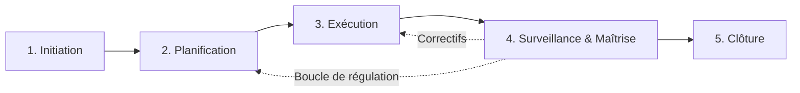
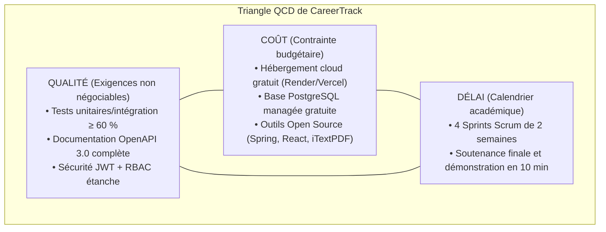

Thème 1 / 12

# Fondements de la Gestion de Projet Informatique

  Présenté par : <strong>Groupe 3</strong> (Eric Joel Manga, Assete Faye, Mouhamed Fam, Soxna, Ibrahima Diallo)
  Établissement : <strong>UASZ · UFR Sciences et Technologies · L3 Ingénierie Informatique</strong>
  Statut : <strong style="color:var(--ok);">Terminé</strong>

---

## Sommaire Numéroté

1. [Introduction : Pourquoi les fondements de gestion de projet pour CareerTrack ?](#_1-introduction-pourquoi-ce-theme-pour-careertrack)
2. [Partie Théorique : Les Notions Fondamentales](#_2-partie-theorique-les-notions-fondamentales)
   - 2.1 Définition et caractéristiques universelles d'un projet
   - 2.2 Cycle de vie d'un projet logiciel
   - 2.3 Typologie et gestion des parties prenantes
   - 2.4 Le triangle QCD (Qualité, Coût, Délai) et ses arbitrages
   - 2.5 Distinction fondamentale entre projet et opération
3. [Partie Pratique : Études de Cas et Retours d'Expérience](#_3-partie-pratique-etudes-de-cas-et-retours-d-experience)
   - 3.1 Analyse approfondie d'un échec célèbre : Le système de paie Louvois
   - 3.2 Facteurs clés de succès dans l'ingénierie logicielle
   - 3.3 Cadre d'analyse de retour d'expérience (REX structuré)
4. [Application Concrète au Projet CareerTrack](#_4-application-concrete-au-projet-careertrack)
   - 4.1 Cartographie d'influence des parties prenantes de CareerTrack
   - 4.2 Triangle QCD appliqué au contexte sénégalais
5. [Conclusion et Perspectives](#_5-conclusion-et-perspectives)
6. [Sources de Référence](#_6-sources-de-reference)

---

## 1. Introduction : Pourquoi ce thème pour CareerTrack ?

Tout projet informatique débute dans un état d'incertitude élevé. Dans le cadre de **CareerTrack**, concevoir une plateforme RH pour les PME sénégalaises ne consiste pas uniquement à empiler des contrôleurs Spring Boot ou des composants React : il s'agit avant tout de transformer une idée stratégique en un système d'information pérenne, conforme à la législation locale et adopté par ses utilisateurs.

Comprendre les **fondements de la gestion de projet informatique** permet à notre équipe d'étudiants de :
- Poser les limites temporelles et fonctionnelles du produit pour éviter l'éparpillement.
- Identifier d'emblée l'ensemble des acteurs (DRH, managers, employés, direction) pour répondre à leurs véritables besoins sans biais technologique.
- Maîtriser le compromis fondamental entre qualité technique, contraintes de calendrier universitaire et gratuité des infrastructures cloud retenues.

---

## 2. Partie Théorique : Les Notions Fondamentales

### 2.1 Définition et caractéristiques universelles d'un projet

Selon le standard international **ISO 21500** et le guide **PMBOK du PMI**, un projet est une *entreprise temporaire initiée dans le but de créer un produit, un service ou un résultat unique*.

Un projet informatique se distingue par cinq caractéristiques majeures :
1. **Unicité** : le livrable n'a jamais été produit exactement sous cette forme, dans ce contexte ou avec cette équipe. CareerTrack répond spécifiquement aux règles du Code du Travail sénégalais.
2. **Temporalité délimitée** : il possède une date d'initiation formelle et une date de clôture contractuelle.
3. **Contraintes et interdépendances** : il est borné par des ressources humaines limitées, un budget alloué et des exigences techniques non négociables.
4. **Degré d'incertitude et de risque** : la part immatérielle du logiciel rend son estimation et sa visibilité plus complexes que dans l'industrie physique.
5. **Évolution progressive (élaboration par vagues)** : le produit s'affine au fur et à mesure que la compréhension du besoin progresse.

### 2.2 Cycle de vie d'un projet logiciel

Le cycle de vie standard structure le déroulement chronologique d'un projet informatique à travers cinq groupes de processus fondamentaux :

- **Initiation** : formalisation de l'opportunité d'affaires, rédaction de la charte de projet, identification préliminaire des parties prenantes.
- **Planification** : décomposition du travail (WBS), ordonnancement (Gantt, PERT), estimation des charges, budgétisation et identification des risques.
- **Exécution** : mobilisation des développeurs, écriture du code source, configuration des environnements et production des livrables.
- **Surveillance et Maîtrise** : suivi continu de l'avancement, calcul des écarts (EVM, burndown chart) et mise en œuvre d'actions correctives.
- **Clôture** : recette fonctionnelle, archivage documentaire, passation aux équipes de maintenance et capitalisation du retour d'expérience.

### 2.3 Typologie et gestion des parties prenantes

Une **partie prenante** (ou *stakeholder*) désigne tout individu, groupe ou organisation susceptible d'affecter, d'être affecté ou de se sentir affecté par une décision ou un résultat du projet. En génie logiciel, on distingue :
- **Les parties prenantes internes** : l'équipe de développement (Groupe 3), le Product Owner, le Scrum Master, le tuteur académique.
- **Les parties prenantes externes** : les directions des PME clientes, les responsables RH, les employés bénéficiaires, les auditeurs légaux et l'inspection du travail.

La gestion des parties prenantes consiste à cartographier leurs intérêts et leur pouvoir d'influence afin de construire une stratégie d'engagement proactive évitant tout rejet lors de la mise en production.

### 2.4 Le triangle QCD (Qualité, Coût, Délai) et ses arbitrages

Le triangle QCD (ou *Triple Contrainte de Barnes*) illustre la relation systémique d'interdépendance liant les trois dimensions clés d'un projet :

| Axe | Définition technique | Conséquence directe si l'axe est dégradé |
|---|---|---|
| **Qualité** | Respect strict du cahier des charges, de la robustesse architecturale, de l'ergonomie et de la couverture de tests (ISO/IEC 25010). | Apparition de dette technique, instabilité logicielle, failles de sécurité et rejet massif par les utilisateurs. |
| **Coût** | Volume des charges financières mobilisées (salaires de l'équipe, licences logicielles, hébergement cloud, serveurs). | Rupture de trésorerie, impossibilité de maintenir l'infrastructure en ligne et échec économique du produit. |
| **Délai** | Échéance calendaire contractuelle fixée pour la livraison opérationnelle du logiciel. | Pénalités de retard, perte d'avantage concurrentiel et décalage avec les obligations réglementaires ou universitaires. |

> **Principe d'arbitrage** : Il est mathématiquement et humainement impossible de maximiser simultanément les trois sommets du triangle. Si le délai est raccourci sans budget supplémentaire, le périmètre ou la qualité technique doit être réajusté.

### 2.5 Distinction fondamentale entre projet et opération

| Critère d'analyse | Activité en Mode Projet | Activité en Mode Opérationnel (Run) |
|---|---|---|
| **Objectif premier** | Introduire une rupture, concevoir un nouvel actif logiciel unique. | Assurer la continuité d'un service existant de manière stable et répétitive. |
| **Horizon temporel** | Temporaire avec un début et une fin formellement actés. | Continu, sans échéance de fin prédéterminée tant que le service a une valeur. |
| **Structure d'équipe** | Équipe pluridisciplinaire temporaire (Groupe 3). | Organisation hiérarchique permanente (Support informatique, équipe RH). |
| **Nature du risque** | Élevé, lié à l'inconnu, à l'innovation et aux choix techniques. | Faible à modéré, maîtrisé par des processus et procédures établis (SLA/ITIL). |
| **Exemple CareerTrack** | Développer le module de génération des évaluations iTextPDF. | Traiter chaque matin les tickets d'assistance et réinitialiser les mots de passe des employés. |

---

## 3. Partie Pratique : Études de Cas et Retours d'Expérience

### 3.1 Analyse approfondie d'un échec célèbre : Le système de paie Louvois

Pour comprendre l'importance critique de la gouvernance, l'étude d'un cas d'échec emblématique documenté est indispensable.

| Rubrique d'analyse | Éléments documentés du cas Louvois (France) |
|---|---|
| **Projet étudié** | **Louvois** (Logiciel Unique à Vocation Interarmées de la Solde). |
| **Contexte et objectifs** | Remplacer les 7 systèmes historiques disparates de paie des forces armées françaises par un moteur unique de liquidation de la solde pour plus de 250 000 militaires. |
| **Budget et délais : prévus vs réels** | Budget initial estimé à **80 millions d'euros** pour une livraison en 2007. Résultat réel : plus de **480 millions d'euros** engagés, des années de retard et abandon définitif du logiciel en 2013 par le ministre de la Défense. |
| **Causes techniques d'échec** | Sous-estimation de la complexité combinatoire (174 types de primes différentes, changements permanents de statuts opérationnels), architecture monolithique rigide, absence flagrante d'un environnement de pré-production représentatif des données réelles. |
| **Causes humaines et organisationnelles** | Absence de formation suffisante des opérateurs RH, rupture de confiance avec les utilisateurs de terrain (militaires privés de solde ou obligés de rembourser des trop-perçus fictifs), dilution complète des responsabilités entre la maîtrise d'ouvrage ministérielle et les prestataires extérieurs. |
| **Leçons apprises pour l'ingénierie logicielle** | 1. Refuser le déploiement « Big Bang » sur un système critique : privilégier un déploiement progressif par vagues. 2. Réaliser des campagnes de tests d'intégration en conditions réelles prolongées. 3. Aligner la complexité réglementaire avec des modules logiciels découplés. |

### 3.2 Facteurs clés de succès dans l'ingénierie logicielle

En miroir des causes d'échec, quatre facteurs clés de succès (FCS) conditionnent la réussite d'une application d'entreprise :

| Facteur Clé de Succès | Pourquoi c'est indispensable | Application concrète sur CareerTrack |
|---|---|---|
| **Soutien actif des sponsors** | Sans engagement de la direction, les blocages transversaux et les arbitrages budgétaires paralysent le projet. | Implication continue des tuteurs académiques et validation systématique des jalons contractuels. |
| **Objectifs clairs et mesurables** | Une exigence floue garantit une dérive des coûts et une contestation lors de la recette fonctionnelle. | Définition de 15 User Stories précises (82 points) avec des critères d'acceptation univoques (Given-When-Then). |
| **Maîtrise stricte du périmètre (Scope)** | Le *Scope Creep* (ajout anarchique de fonctionnalités en cours de route) est la cause première de dépassement de planning. | Approche hybride : sanctuariser le socle stable (congés, dossier employé) et itérer uniquement sur les modules évolutifs. |
| **Communication transparente** | L'absence de visibilité engendre des suppositions erronées et masque les difficultés techniques jusqu'au point de non-retour. | Rituels Scrum bimensuels, synchronisations quotidiennes (Daily de 15 min) et partage du backlog sur Git. |

### 3.3 Cadre d'analyse de retour d'expérience (REX structuré)

| Composante du REX | Analyse réflexive appliquée à la gestion de projet |
|---|---|
| **Situation rencontrée** | Dispersion initiale des priorités techniques entre l'envie de coder directement l'interface React et le besoin de cadrer la modélisation des données relationnelles PostgreSQL. |
| **Ce qui s'est passé** | Découverte de dépendances masquées entre la gestion des congés et les statuts contractuels des employés, risquant de rendre le code backend instable. |
| **Cause racine** | Volonté de démarrer l'implémentation avant d'avoir validé formellement la charte et la cohérence fonctionnelle des modules. |
| **Leçon tirée** | La rigueur de l'étape d'initiation et de conception n'est pas un frein mais un accélérateur majeur pour les phases de codage et de test. |
| **Recommandation adoptée** | Validation obligatoire des spécifications OpenAPI 3.0 et du schéma relationnel avant d'entamer les sprints de développement. |

---

## 4. Application Concrète au Projet CareerTrack

### 4.1 Cartographie d'influence des parties prenantes de CareerTrack

Dans le contexte des PME sénégalaises de 50 à 500 employés ciblées par CareerTrack, les parties prenantes présentent des niveaux de pouvoir et d'intérêt très contrastés :

| Partie Prenante | Rôle et attentes principales | Niveau d'influence | Stratégie d'engagement retenue |
|---|---|:---:|---|
| **Directeurs RH (DRH)** | Utilisateurs clés : recherchent la conformité au Code du Travail, la centralisation des dossiers et des reportings fiables. | **Forte** | **Gérer de près** : co-conception des formulaires d'évaluation et validation des workflows d'absence. |
| **Direction Générale** | Vision globale : attend des tableaux de bord synthétiques (turnover, masse salariale) sans complexité opérationnelle. | **Forte** | **Satisfaire** : mise à disposition d'un profil lecture seule avec indicateurs décisionnels instantanés. |
| **Managers opérationnels** | Acteurs de terrain : souhaitent valider rapidement les congés de leur équipe et mener les entretiens annuels sans lourdeur. | **Moyenne** | **Maintenir informés et impliqués** : ergonomie mobile intuitive et rappels automatiques des échéances. |
| **Employés collaborateurs** | Utilisateurs quotidiens : veulent consulter leur solde de congés en temps réel et compléter facilement leur auto-évaluation. | **Moyenne** | **Tenir informés** : interface mobile-first claire, réactive et consultation accessible hors-ligne. |
| **Inspection du Travail** | Autorité de régulation sénégalaise : exige le respect des quotas de congés payés et la traçabilité des contrats. | **Forte** | **Surveiller la conformité** : paramétrage de règles d'arrondi et d'acquisition de droits conformes aux textes de loi. |
| **Enseignant responsable & Jury (M. Khalifa GAYE)** | Évaluateur académique : exige une rigueur méthodologique, un code testé (≥ 60 %) et une architecture moderne documentée. | **Forte** | **Gérer de près** : traçabilité intégrale, respect des 12 thèmes du portfolio et démonstration sans faille. |

### 4.2 Triangle QCD appliqué au contexte sénégalais

- **Arbitrage retenu par le Groupe 3** : Le budget financier étant contraint à **0 FCFA** (exploitation exclusive des tiers gratuits d'hébergement cloud) et le délai académique étant strictement fixe, notre variable d'ajustement réside dans le **périmètre fonctionnel**. Nous sécurisons en priorité absolue le MVP (Minimum Viable Product de 82 points d'effort) en écartant toute fonctionnalité superflue (comme un moteur de paie complexe) afin de garantir une qualité d'ingénierie irréprochable.

---

## 5. Conclusion et Perspectives

Ce premier thème ancre CareerTrack dans la réalité professionnelle de l'ingénierie logicielle : un projet n'est pas une simple succession d'instructions de code, mais une aventure humaine et méthodologique encadrée par des contraintes réelles.

**Ce que ce thème apporte à CareerTrack :**
- La sanctuarisation d'un périmètre clair centré sur les vraies priorités des PME locales.
- Une conscience aiguë des risques de dérive grâce aux enseignements tirés de grands échecs de l'histoire informatique.
- Une stratégie de pilotage adaptée, basée sur l'arbitrage lucide du triangle QCD.

**Prochaine étape :**
Traduire ces fondements en un engagement contractuel formel à travers le [Thème 2 : Cadrage et Initialisation du Projet](/theme-02).

> **Phrase de synthèse :** *« Maîtriser les fondements du projet informatique, c'est s'assurer de concevoir le bon produit, de la bonne manière, tout en sachant arbitrer sereinement entre contraintes de temps, de budget et d'excellence technique. »*

---

## 6. Sources de Référence

1. **Project Management Institute (PMI)**, *A Guide to the Project Management Body of Knowledge (PMBOK Guide)*, 7ème édition, 2021.
2. **Organisation Internationale de Normalisation**, *Norme ISO 21500:2021 — Management des projets, des programmes et des portefeuilles*, ISO, Genève.
3. **Cour des Comptes (France)**, *Rapport public thématique sur le système de paie Louvois des armées*, Éditions des Journaux officiels, 2016.
4. **Steve McConnell**, *Rapid Development: Taming Wild Software Schedules*, Microsoft Press, 1996 (Ouvrage de référence sur les causes d'échec et les facteurs de succès en ingénierie logicielle).

---

  
  <a href="/theme-02">Thème 2 : Cadrage et Initialisation du Projet &rarr;</a>

