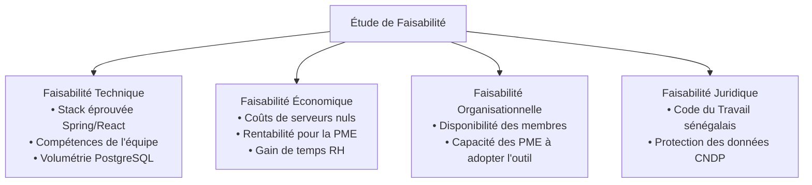
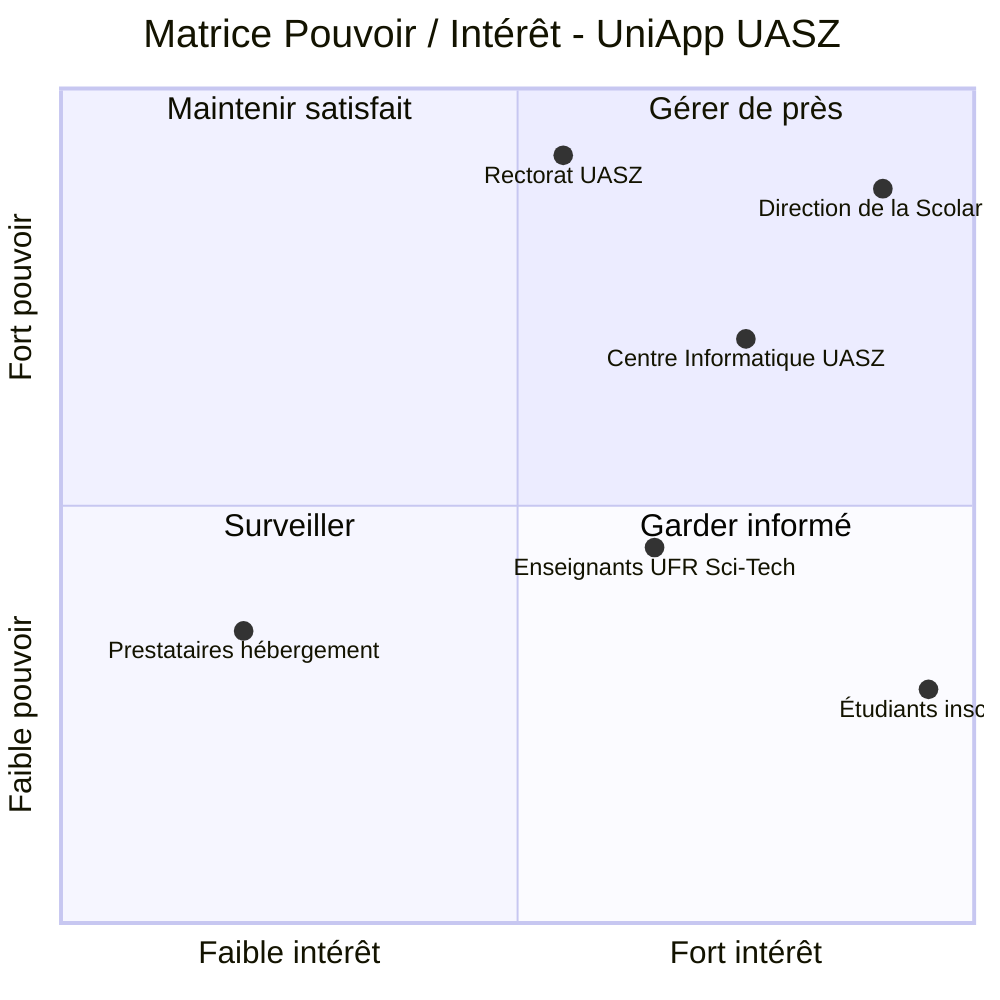
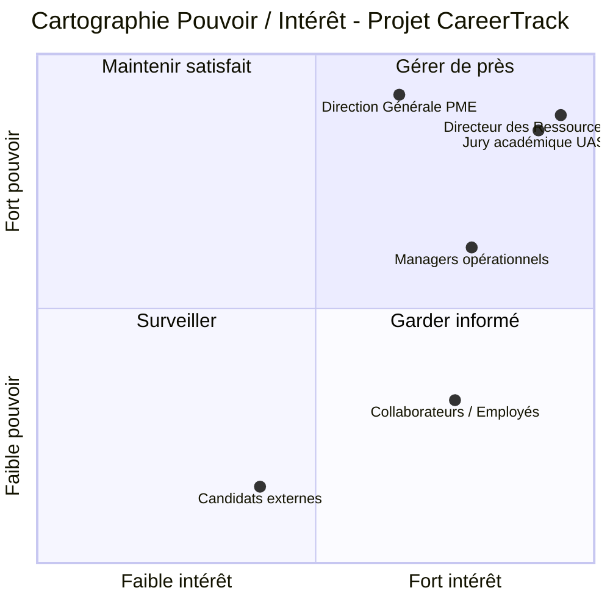

Thème 2 / 12

# Cadrage et Initialisation du Projet

  Présenté par : <strong>Groupe 3</strong> (Eric Joel Manga, Assete Faye, Mouhamed Fam, Soxna, Ibrahima Diallo)
  Établissement : <strong>UASZ · UFR Sciences et Technologies · L3 Ingénierie Informatique</strong>
  Statut : <strong style="color:var(--ok);">Terminé</strong>

---

## Sommaire Numéroté

1. [Introduction : Pourquoi cadrer rigoureusement CareerTrack ?](#_1-introduction-pourquoi-cadrer-rigoureusement-careertrack)
2. [Partie Théorique : Les Outils Fondamentaux du Cadrage](#_2-partie-theorique-les-outils-fondamentaux-du-cadrage)
   - 2.1 La charte de projet (Project Charter) : rôle et composantes
   - 2.2 L'étude de faisabilité multidimensionnelle (technique, financière, légale)
   - 2.3 Méthodes de recueil et d'expression des exigences logicielles
   - 2.4 Structure et règles de rédaction d'un cahier des charges rigoureux
   - 2.5 La matrice Pouvoir / Intérêt des parties prenantes
3. [Partie Pratique : Cadrage d'une Application Universitaire (UniApp UASZ)](#_3-partie-pratique-cadrage-d-une-application-universitaire-uniapp-uasz)
   - 3.1 Charte de projet complète : UniApp Mobile UASZ
   - 3.2 Matrice Pouvoir / Intérêt et plan d'engagement UniApp
   - 3.3 Analyse systématique des contraintes et hypothèses projet
4. [Application Concrète au Projet CareerTrack](#_4-application-concrete-au-projet-careertrack)
   - 4.1 Charte formelle d'initialisation de CareerTrack
   - 4.2 Matrice Pouvoir / Intérêt des acteurs de la gestion RH
5. [Conclusion et Perspectives](#_5-conclusion-et-perspectives)
6. [Sources de Référence](#_6-sources-de-reference)

---

## 1. Introduction : Pourquoi cadrer rigoureusement CareerTrack ?

Un projet mal cadré est un projet condamné dès ses premières lignes de code. Dans l'écosystème entrepreneurial sénégalais, les PME expriment souvent des besoins généraux (« nous voulons moderniser nos RH »), sans mesurer la complexité sous-jacente des obligations légales, des hiérarchies de validation et des flux d'approbation.

Pour **CareerTrack**, la phase de cadrage et d'initialisation remplit trois fonctions capitales :
1. **Établir le périmètre d'action officiel** : définir avec une précision chirurgicale ce qui est inclus (dossiers, congés, évaluations, recrutement, tableaux de bord) et ce qui est formellement exclu (gestion de la paie brute, déclarations fiscales complexes).
2. **Autoriser formellement l'utilisation des ressources** : légitimer l'action de l'équipe étudiante et formaliser les responsabilités de chacun.
3. **Aligner la vision des acteurs** : s'assurer qu'un Directeur Général, un DRH et un employé partagent exactement la même définition des fonctionnalités attendues.

---

## 2. Partie Théorique : Les Outils Fondamentaux du Cadrage

### 2.1 La charte de projet (Project Charter) : rôle et composantes

La **charte de projet** est le document contractuel d'initiation émis par le commanditaire (sponsor) qui autorise formellement l'existence du projet et octroie au chef de projet l'autorité d'engager les ressources organisationnelles.

Elle contient obligatoirement huit rubriques clés :
- **Justification stratégique** : problème métier à résoudre et valeur ajoutée attendue (analyse de rentabilité).
- **Objectifs mesurables (SMART)** : cibles Spécifiques, Mesurables, Atteignables, Réalistes et Temporellement définies.
- **Périmètre de haut niveau** : frontières explicites des livrables (In-Scope vs Out-of-Scope).
- **Principaux jalons calendaires** : dates butoirs des phases d'analyse, d'architecture, de tests et de livraison.
- **Budget prévisionnel et enveloppe de ressources** : moyens humains et financiers alloués.
- **Évaluation des risques initiaux majeurs** : menaces potentielles identifiées dès la phase amont.
- **Critères de succès de la recette** : conditions quantitatives validant l'acceptation finale du produit.
- **Rôles de gouvernance** : désignation formelle du sponsor, du chef de projet et des comités décisionnels.

### 2.2 L'étude de faisabilité multidimensionnelle

Avant d'engager des moyens techniques, l'étude de faisabilité évalue la viabilité du projet selon quatre dimensions complémentaires :

- **Faisabilité technique** : l'équipe maîtrise-t-elle les technologies cibles ? Existe-t-il des verrous d'infrastructure (connectivité Internet instable au Sénégal, d'où le choix du mode offline) ?
- **Faisabilité économique** : les gains d'efficacité (suppression des pertes de dossiers, calcul instantané des soldes) justifient-ils l'effort d'ingénierie ?
- **Faisabilité opérationnelle** : les utilisateurs cibles (employés sur smartphone, DRH sur poste fixe) ont-ils la maturité numérique nécessaire ?
- **Faisabilité juridique** : conformité stricte avec la Commission de Protection des Données Personnelles (CDP Sénégal) et le Code du Travail local.

### 2.3 Méthodes de recueil et d'expression des exigences logicielles

Selon la norme **ISO/IEC/IEEE 29148**, les exigences doivent être catégorisées méthodiquement :
- **Exigences fonctionnelles** : ce que le système doit faire (ex. *« Le système doit décrémenter le solde de congés payés dès que le manager valide la demande »*).
- **Exigences non-fonctionnelles (qualité)** : contraintes de performance, sécurité, ergonomie et disponibilité (ex. *« Le temps de génération du PDF d'évaluation via iTextPDF ne doit pas excéder 1,5 seconde »*).

Les techniques de recueil combinent des **interviews semi-directives** avec des responsables RH, des **ateliers de co-conception de maquettes (UI/UX)** et la formalisation d'exigences sous forme de **User Stories** standardisées :
$$\text{En tant que } [\text{rôle}], \text{ je veux } [\text{action/fonctionnalité}], \text{ afin de } [\text{bénéfice métier attendu}].$$

### 2.4 Structure et règles de rédaction d'un cahier des charges

Le **Cahier des Charges Fonctionnel et Technique (CDC)** matérialise l'engagement mutuel entre la maîtrise d'ouvrage (métier) et la maîtrise d'œuvre (développeurs) :
1. **Contexte général et glossaire métier** (définition des termes RH : solde légal, N+1, période d'essai).
2. **Description de l'existant et des dysfonctionnements constatés**.
3. **Spécification des cas d'utilisation (Use Cases)** et diagrammes d'activité UML.
4. **Exigences architecturales et de sécurité** (chiffrement TLS, stockage salarial sécurisé).
5. **Modalités de recette et procédures de validation (DoD)**.

### 2.5 La matrice Pouvoir / Intérêt des parties prenantes

Initialement modélisée par **Mendelow (1991)**, cette matrice classe les parties prenantes selon deux dimensions d'analyse notées de faible à fort, définissant quatre stratégies de gouvernance opérationnelle :

| Quadrant | Niveau de Pouvoir | Niveau d'Intérêt | Stratégie d'action préconisée |
|---|:---:|:---:|---|
| **Quadrant 1** | **Fort** | **Fort** | **Gérer de près (Manage Closely)** : collaboration étroite, participation aux comités de pilotage, arbitrage direct. |
| **Quadrant 2** | **Fort** | **Faible** | **Maintenir satisfait (Keep Satisfied)** : communication synthétique, s'assurer que leurs exigences fondamentales sont respectées sans les saturer de détails. |
| **Quadrant 3** | **Faible** | **Faible** | **Surveiller (Monitor)** : suivi périodique sans mobilisation de ressources excessives. |
| **Quadrant 4** | **Faible** | **Fort** | **Garder informé (Keep Informed)** : canal de communication régulier, recueil de feedbacks terrain pour assurer l'adhésion. |

---

## 3. Partie Pratique : Cadrage d'une Application Universitaire (UniApp UASZ)

### 3.1 Charte de projet complète : UniApp Mobile UASZ

Dans le cadre des travaux pratiques du module, nous simulons l'initialisation de l'application mobile officielle des étudiants de l'UASZ : **UniApp UASZ**.

| Rubrique de la Charte | Contenu contractuel du projet UniApp UASZ |
|---|---|
| **Intitulé du projet** | **UniApp UASZ** — Application mobile étudiante de gestion du campus et de la scolarité |
| **Sponsor institutionnel** | Direction de la Scolarité et Rectorat de l'Université Assane Seck de Ziguinchor |
| **Chef de projet** | Groupe 3 (Représentant étudiant en ingénierie logicielle) |
| **Justification & Contexte** | Les étudiants de l'UASZ subissent de longues files d'attente pour obtenir leurs relevés de notes, attestations et plannings de cours affichés physiquement sur les tableaux d'affichage de l'UFR Sciences et Technologies. |
| **Objectifs SMART** | 1. Réduire de 85 % les déplacements physiques à la scolarité d'ici le second semestre universitaire. 2. Permettre la consultation en temps réel des notes et emplois du temps pour 100 % des étudiants inscrits. 3. Distribuer les alertes de cours (annulations, reports) en moins de 30 secondes via notifications push. |
| **Périmètre inclus (In-Scope)** | Authentification par numéro INE étudiant, consultation des notes/cours, téléchargement d'attestations certifiées avec QR Code, notifications push en cas d'urgence sur le campus. |
| **Périmètre exclu (Out-of-Scope)** | Paiement direct des droits d'inscription bancaires (gérés par le portail national Campusen), gestion des bourses nationales. |
| **Jalons calendaires** | J1 : Validation de la charte et des maquettes (M1) · J2 : Déploiement de l'API REST de scolarité (M2) · J3 : Version bêta mobile Android (M3) · J4 : Recette finale et lancement officiel (M4). |
| **Budget prévisionnel** | 0 FCFA d'investissement logiciel (utilisation des infrastructures informatiques existantes du Centre de Calcul de l'UASZ et de technologies open source). |
| **Risques majeurs identifiés** | 1. Saturation du serveur central lors de la publication simultanée des résultats d'examens. 2. Non-disponibilité temporaire des données de la scolarité centrale. |
| **Critères de succès** | Note de satisfaction étudiante ≥ 4,2/5 sur le magasin d'applications ; disponibilité du service garantie à 99 % durant les périodes d'examens. |

### 3.2 Matrice Pouvoir / Intérêt et plan d'engagement UniApp

### 3.3 Analyse systématique des contraintes et hypothèses projet

| Type d'élément | Description détaillée de l'élément | Impact direct si l'élément se révèle faux ou non respecté |
|---|---|---|
| **Contrainte** | L'application doit obligatoirement fonctionner sur des smartphones Android d'entrée de gamme (Android 8.0+). | Exclusion de plus de 40 % des étudiants de l'UASZ disposant d'appareils de puissance modeste. |
| **Contrainte** | Déploiement impératif avant l'ouverture de la session d'examens du premier semestre. | Impossibilité de tester la charge réelle et report de l'adoption du service d'une année universitaire. |
| **Hypothèse** | L'API de la scolarité centrale sera accessible en HTTPS avec une documentation à jour. | Blocage complet du développement de la couche d'accès aux données et obligation de créer des mocks. |
| **Hypothèse** | Les étudiants disposent au minimum d'une connexion Internet 3G/Wi-Fi campus ponctuelle pour synchroniser l'application. | Nécessité absolue d'implémenter un cache local persistant SQLite/IndexedDB pour une utilisation hors-ligne. |

---

## 4. Application Concrète au Projet CareerTrack

### 4.1 Charte formelle d'initialisation de CareerTrack

| Rubrique de la Charte | Spécifications contractuelles du projet CareerTrack |
|---|---|
| **Intitulé du projet** | **CareerTrack** — Système d'Information RH et Pilotage des Carrières en Entreprise |
| **Commanditaire / Sponsor** | M. Khalifa GAYE (Enseignant responsable du module GPIA) · Direction des PME partenaires au Sénégal |
| **Équipe de réalisation** | **Groupe 3** (Eric Joel Manga, Assete Faye, Mouhamed Fam, Soxna, Ibrahima Diallo) |
| **Justification métier** | Combler le vide technologique entre les tableurs Excel artisanaux et les progiciels de gestion intégrés inaccessibles financièrement, tout en digitalisant le respect du Code du Travail sénégalais. |
| **Objectifs chiffrés** | 1. Réduire de 5 jours à moins de 2 heures le délai moyen de validation d'un congé payé. 2. Atteindre 100 % de traçabilité numérique sur les entretiens annuels d'évaluation avec PV signés (iTextPDF). 3. Livrer une application mobile-first réactive avec un temps de réponse moyen aux requêtes API < 300 ms. |
| **Périmètre inclus (In-Scope)** | 7 modules : Dossier employé, Organigramme, Congés, Évaluations SMART, Formations, Promotions, Recrutement Kanban, Dashboards RH. Sécurité JWT/RBAC, documentation OpenAPI 3.0, Service Worker offline. |
| **Périmètre exclu (Out-of-Scope)** | Moteur de calcul de la paie brute et des cotisations IPRES/CSS (périmètre renvoyé à un logiciel comptable dédié), interfaçage badgeuse biométrique physique. |
| **Budget alloué** | **0 FCFA** de frais de licence ou de serveur (utilisation d'instances cloud tierces gratuites : Render, Vercel, Supabase PostgreSQL, outils Git open source). |
| **Jalons d'exécution** | Sprint 1 : Socle technique, JWT, Dossier employé (Semaines 1-2) · Sprint 2 : Congés, Évaluations, PDF (Semaines 3-4) · Sprint 3 : Formations, Salaires, Kanban (Semaines 5-6) · Sprint 4 : Dashboards, Offline, Recette finale (Semaines 7-8). |
| **Critères d'acceptation** | Taux de couverture de tests automatisés ≥ 60 % ; validation sans anomalie bloquante du parcours collaborateur complet lors de la soutenance orale finale. |

### 4.2 Matrice Pouvoir / Intérêt des acteurs de la gestion RH

- **Stratégie pour les DRH et la Direction (Quadrant 1)** : Organiser des revues de démonstration en fin de sprint pour valider la conformité des maquettes d'évaluation annuelle et des indicateurs de tableau de bord.
- **Stratégie pour les Managers (Quadrant 1 / 2)** : Garantir une ergonomie mobile épurée permettant de traiter les approbations de congés en deux clics sans friction administrative.
- **Stratégie pour les Employés (Quadrant 4)** : Former et informer via une interface mobile-first intuitive ne nécessitant aucun manuel d'utilisation complexe.

---

## 5. Conclusion et Perspectives

La démarche de cadrage a permis de convertir une intention générale en un **cadre d'ingénierie contractuel rigoureux et délimité**. Grâce à la charte et à la matrice des parties prenantes, le Groupe 3 dispose d'une feuille de route claire, éliminant les risques d'incompréhension fonctionnelle.

**Ce que ce thème apporte à CareerTrack :**
- Une définition formelle des frontières du produit évitant toute dispersion sur des fonctionnalités de paie non maîtrisées.
- Une compréhension claire des profils utilisateurs et de leurs prérogatives de sécurité (RBAC).
- Une justification méthodique de la gratuité budgétaire et des contraintes d'infrastructure.

**Prochaine étape :**
Déterminer la méthodologie de réalisation la plus adaptée pour exécuter ce cadrage à travers le [Thème 3 : Méthodes Classiques (Cycle en V et Waterfall)](/theme-03).

> **Phrase de synthèse :** *« Bien cadrer un projet logiciel, ce n'est pas simplement écrire un document d'intention, c'est sceller le contrat de confiance entre le besoin métier et l'engagement technique de l'équipe de réalisation. »*

---

## 6. Sources de Référence

1. **Project Management Institute (PMI)**, *A Guide to the Project Management Body of Knowledge (PMBOK Guide)*, 7ème édition, 2021 (Chapitre dédié au Cadrage et à l'Initialisation).
2. **ISO/IEC/IEEE 29148:2018**, *Systems and software engineering — Life cycle processes — Requirements engineering*, IEEE Computer Society.
3. **Aubry Mendelow**, *Stakeholder Mapping: Proceedings of the 2nd International Conference on Information Systems*, Cambridge, MA, 1991.
4. **Christian Thiry**, *Le cadrage préalable des projets informatiques : méthode, outils et livrables*, Éditions Dunod, Paris, 2018.

---

  <a href="/theme-01">&larr; Thème 1 : Fondements</a>
  <a href="/theme-03">Thème 3 : Méthodes Classiques &rarr;</a>

