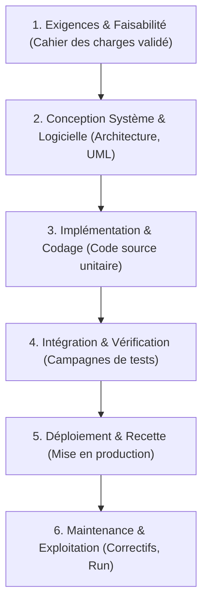
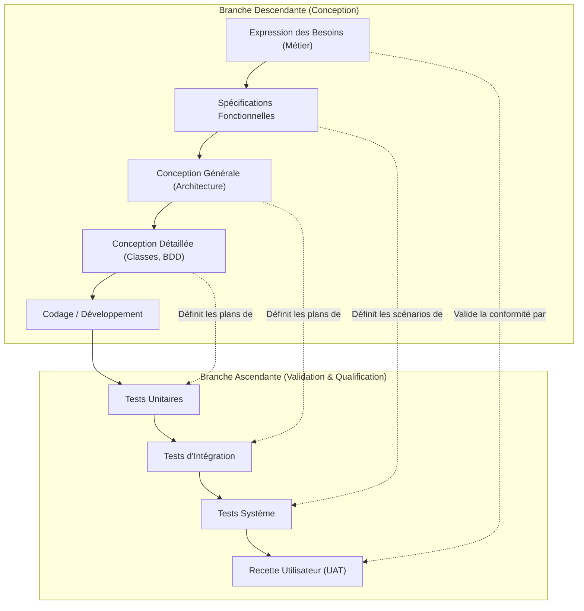
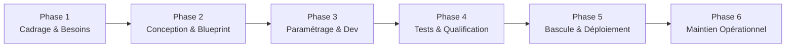
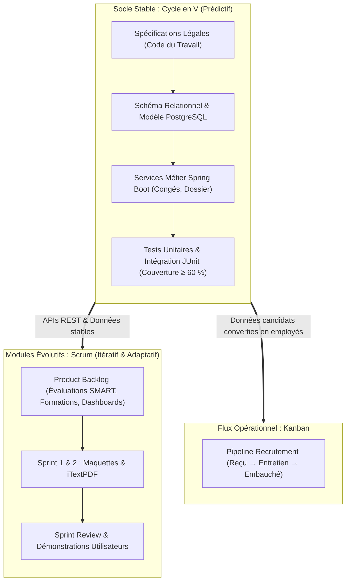

Thème 3 / 12

# Méthodes Classiques : Cycle en V et Waterfall

  Présenté par : <strong>Groupe 3</strong> (Eric Joel Manga, Assete Faye, Mouhamed Fam, Soxna, Ibrahima Diallo)
  Établissement : <strong>UASZ · UFR Sciences et Technologies · L3 Ingénierie Informatique</strong>
  Statut : <strong style="color:var(--ok);">Terminé</strong>

---

## Sommaire Numéroté

1. [Introduction : Pourquoi les méthodes classiques pour CareerTrack ?](#_1-introduction-pourquoi-les-methodes-classiques-pour-careertrack)
2. [Partie Théorique : Les Modèles Prédictifs Séquentiels](#_2-partie-theorique-les-modèles-predictifs-sequentiels)
   - 2.1 Le modèle en cascade (Waterfall) : principes, phases et livrables
   - 2.2 Le modèle du Cycle en V : la symétrie conception / qualification
   - 2.3 Avantages, limites et domaines d'application privilégiés
   - 2.4 Ingénierie des exigences et matrice de traçabilité ascendante
   - 2.5 Analyse comparative rigoureuse : Waterfall vs Cycle en V
3. [Partie Pratique : Planification Séquentielle d'un Progiciel ERP](#_3-partie-pratique-planification-sequentielle-d-un-progiciel-erp)
   - 3.1 Plan directeur séquentiel pour l'implémentation d'un ERP
   - 3.2 Analyse des risques inhérents aux approches séquentielles et parades
4. [Application Concrète au Projet CareerTrack](#_4-application-concrete-au-projet-careertrack)
   - 4.1 Justification du Cycle en V pour les modules réglementaires stables
   - 4.2 Matrice de traçabilité exigences / tests du module Congés & Dossiers
   - 4.3 Intégration du Cycle en V dans l'architecture méthodologique mixte
5. [Conclusion et Perspectives](#_5-conclusion-et-perspectives)
6. [Sources de Référence](#_6-sources-de-reference)

---

## 1. Introduction : Pourquoi les méthodes classiques pour CareerTrack ?

À l'ère de l'agilité omniprésente, il serait tentant de reléguer les méthodes classiques (Waterfall, Cycle en V) au rang de reliques du passé. Ce serait une grave erreur d'ingénierie logicielle. 

Pour **CareerTrack**, certaines briques du système d'information ne tolèrent aucune ambiguïté ni approximation itérative :
- La gestion administrative des **dossiers employés** (état civil, numéros de sécurité sociale IPRES/CSS, contrats CDI/CDD) relève d'obligations légales strictes et immuables.
- Le calcul des **congés et absences** est régi de manière déterministe par le **Code du Travail de la République du Sénégal** (loi n° 97-17). Un jour de congé mal comptabilisé ou un arrondi erroné expose directement l'employeur à des sanctions juridiques.

Le Groupe 3 a fait le choix délibéré d'une **gouvernance méthodologique mixte** : mobiliser la rigueur prédictive du **Cycle en V** pour sécuriser ces modules juridiques et contractuels stables, tout en réservant l'agilité Scrum aux fonctionnalités évolutives.

---

## 2. Partie Théorique : Les Modèles Prédictifs Séquentiels

### 2.1 Le modèle en cascade (Waterfall) : principes, phases et livrables

Introduit formellement par **Winston W. Royce en 1970**, le modèle en cascade décompose le cycle de vie du logiciel en une succession linéaire et séquentielle de phases distinctes. Chaque phase ne commence que lorsque la précédente est formellement clôturée et validée par un jalon contractuel (*Gate review*) :

- **Principe fondamental** : *« Write before code, test before ship »*. Toute décision d'ingénierie doit être documentée avant d'être programmée.
- **Livrables types** : Spécification des Exigences Logicielles (SRS), Document d'Architecture Logicielle (SAD), Dossier de Conception Détaillée (DCD), Procès-verbal de Recette Fonctionnelle.

### 2.2 Le modèle du Cycle en V : la symétrie conception / qualification

Conçu dans les années 1980 en Allemagne et formalisé dans la norme française **AFNOR GAM-T-17**, le **Cycle en V** comble la faiblesse majeure du Waterfall en instaurant une correspondance univoque entre chaque niveau de conception descendante et son niveau de test ascendant :

> **Règle d'or du Cycle en V** : *Les plans et scénarios de tests ne sont pas rédigés à la fin du projet, mais préparés en parallèle de la phase de conception correspondante.* Dès que l'expression des besoins est écrite, les critères de recette finale sont d'ores et déjà figés.

### 2.3 Avantages, limites et domaines d'application privilégiés

| Dimension | Points Forts du Cycle en V | Limites et Risques Inhérents |
|---|---|---|
| **Gouvernance & Clarté** | Structure claire, jalons précis, responsabilités univoques, documentation exhaustive. | Rigidité face aux changements : toute modification de périmètre exige un avenant contractuel lourd. |
| **Qualité & Fiabilité** | Préparation précoce des tests réduisant drastiquement les anomalies de régression. | *Effet tunnel* : l'utilisateur final ne voit le logiciel fonctionner qu'au moment de la recette finale. |
| **Budget & Délais** | Engagements financiers et calendaires prédictibles dès la signature du contrat. | Coût astronomique si une erreur de conception initiale n'est découverte qu'en phase de test système. |
| **Domaines d'application** | Systèmes critiques embarqués (aéronautique, ferroviaire, santé), logiciels bancaires, modules fiscaux/RH. | Projets web/mobile innovants à forte incertitude d'usage, startups, interfaces exploratoires. |

### 2.4 Ingénierie des exigences et matrice de traçabilité ascendante

La **traçabilité des exigences** (norme **CMMI-DEV**) garantit que chaque besoin formulé par le client est traduit dans l'architecture, implémenté dans le code et couvert par un test automatisé.

La **Matrice de Traçabilité des Exigences (RTM)** répond à deux questions fondamentales :
1. *Traçabilité avant (Forward)* : Pourquoi cette ligne de code ou cette table PostgreSQL existe-t-elle ? À quelle exigence métier répond-elle ?
2. *Traçabilité arrière (Backward)* : Cette exigence réglementaire du client est-elle bien testée et vérifiée ?

### 2.5 Analyse comparative rigoureuse : Waterfall vs Cycle en V

| Critère d'évaluation | Modèle en Cascade (Waterfall) | Modèle du Cycle en V |
|---|---|---|
| **Philosophie de test** | Tests considérés comme une phase isolée en toute fin de parcours. | Qualification continue : les tests sont formalisés dès la phase de conception symétrique. |
| **Détection des anomalies** | Tardive : les erreurs d'analyse se découvrent lors du déploiement. | Précoce : relecture et validation des critères de test dès les étapes amont. |
| **Niveau de traçabilité** | Faible à moyen : les liens entre exigences et tests sont souvent documentés a posteriori. | Très élevé : alignement rigoureux de chaque niveau d'abstraction avec son niveau de vérification. |
| **Coût des anomalies de conception** | Très élevé (effet cumulatif d'erreurs en cascade). | Maîtrisé grâce à la validation croisée continue des spécifications. |

---

## 3. Partie Pratique : Planification Séquentielle d'un Progiciel ERP

Pour concrétiser les concepts classiques, nous modélisons le plan directeur d'implémentation d'un progiciel de gestion intégré (ERP) de gestion d'entreprise.

### 3.1 Plan directeur séquentiel pour l'implémentation d'un ERP

| Phase | Documents d'entrée requis | Livrables de sortie formels | Jalon contractuel d'arbitrage |
|---|---|---|---|
| **1. Cadrage & Besoins** | Lettre de cadrage, cartographie des processus métiers existants. | Cahier des charges fonctionnel, matrice des exigences métiers. | **J1** : Approbation formelle du périmètre par le COPIL. |
| **2. Conception & Blueprint** | Cahier des charges validé. | Dossier de conception générale, schéma de données, plan de recette. | **J2** : Signature du Business Blueprint. |
| **3. Paramétrage & Dév.** | Blueprint signé, spécifications techniques. | Modules ERP configurés, connecteurs API Spring Boot, code documenté. | **J3** : Validation de la fin des développements unitaires. |
| **4. Tests & Qualification** | Code source, jeux d'essais réels. | Rapports d'exécution des tests d'intégration, procès-verbal de recette UAT. | **J4** : Accord de mise en production (*Go / No-Go*). |
| **5. Bascule & Déploiement** | PV de recette signé sans anomalie bloquante. | Données migrées, manuel utilisateur, environnement de production actif. | **J5** : Démarrage officiel du système (*Go-Live*). |
| **6. Support & Garantie** | Système en production. | Journal des incidents résolus, passage de relais à l'équipe de Run. | **J6** : Fin de la période de garantie contractuelle. |

### 3.2 Analyse des risques inhérents aux approches séquentielles et parades

| Risque identifié de l'approche séquentielle | Conséquence opérationnelle directe | Parade méthodologique et technique obligatoire |
|---|---|---|
| **Interprétation erronée des exigences découverte en recette finale** | Nécessité de réécrire des pans entiers de code, explosion des délais de livraison. | Instauration de revues formelles de spécifications avec maquettes d'écrans statiques dès la phase 2. |
| **Évolution du cadre légal ou fiscal en cours de projet** | Invalidation de pans entiers de conception prédictive figée plusieurs mois auparavant. | Procédure de gestion des modifications (*Change Request*) avec réévaluation contractuelle du coût et du délai. |
| **Régression masquée lors de l'intégration globale** | Dysfonctionnements croisés imprévus entre modules développés en silos. | Automatisation quotidienne des tests d'intégration au niveau de la plateforme d'intégration continue (CI/CD). |

---

## 4. Application Concrète au Projet CareerTrack

### 4.1 Justification du Cycle en V pour les modules réglementaires stables

Dans **CareerTrack**, nous appliquons rigoureusement le **Cycle en V** aux briques suivantes :
1. **Module Dossier Employé (US-01)** : La gestion des contrats (CDI, CDD, stagiaires), des matricules uniques, des adresses et des pièces d'identité ne varie pas d'une semaine à l'autre. Elle requiert une modélisation relationnelle PostgreSQL stricte (clés étrangères, contraintes d'intégrité, unicité des matricules) validée dès l'analyse.
2. **Module Congés & Absences (US-03, US-04)** : Conformément aux articles L.148 et suivants du Code du Travail sénégalais, le droit à congé s'acquiert à raison de **2 jours ouvrables par mois de service effectif**. Le calcul du solde, la déduction des jours fériés légaux et le workflow d'approbation N+1 sont des règles mathématiques prédictibles.

> **Décision d'architecture méthodologique** : L'approche séquentielle nous permet d'écrire l'intégralité des jeux d'essais JUnit pour les congés et les dossiers administratifs avant même d'avoir finalisé l'interface utilisateur React.

### 4.2 Matrice de traçabilité exigences / tests du module Congés & Dossiers

| Réf. Exigence | Description de l'exigence fonctionnelle | Composant d'implémentation | Classe de Test Unitaire & Intégration | Scénario de Recette (UAT) |
|:---:|---|---|---|---|
| **REQ-ADM-01** | Un matricule employé unique au format `EMP-YYYY-NNNN` doit être généré à la création d'un dossier. | `EmployeeService.java` `EmployeeRepository.java` | `EmployeeServiceTest#shouldGenerateUniqueMatricule` | Vérification de l'auto-génération du matricule lors de l'enregistrement d'un collaborateur par le DRH. |
| **REQ-ADM-02** | Un contrat de travail actif doit être rattaché à chaque collaborateur avec date de début valide. | Table `contracts` `ContractValidator.java` | `ContractValidationTest#shouldRejectNullStartDate` | Tentative de création d'un dossier sans contrat : message d'erreur bloquant. |
| **REQ-CONG-01** | L'acquisition des congés s'effectue à raison de 2,0 jours par mois de travail accompli. | `LeaveBalanceService.java` | `LeaveCalculatorTest#shouldComputeTwoDaysPerMonth` | Audit d'un collaborateur ayant 6 mois d'ancienneté : vérification du crédit de 12,0 jours. |
| **REQ-CONG-02** | Une demande de congé ne peut être soumise si le nombre de jours demandés excède le solde disponible. | `LeaveRequestController.java` | `LeaveRequestTest#shouldThrowWhenInsufficientBalance` | Saisie d'une demande de 15 jours avec un solde de 10 jours : rejet automatique avant envoi au manager. |
| **REQ-CONG-03** | La validation par le manager N+1 décrémente immédiatement le solde et met à jour le calendrier. | `LeaveWorkflowService.java` | `LeaveWorkflowIntegrationTest#shouldDecrementBalanceOnApproval` | Connexion du manager, clic sur « Approuver » : vérification de la décrémentation et du statut `APPROVED`. |

### 4.3 Intégration du Cycle en V dans l'architecture méthodologique mixte

Le schéma d'orchestration globale de CareerTrack articule la rigueur du Cycle en V avec l'agilité :

---

## 5. Conclusion et Perspectives

Les méthodes classiques ne sont pas les ennemies de la modernité : elles sont les garantes de la **robustesse, de la sécurité juridique et de la traçabilité** des briques centrales d'un système d'information.

**Ce que ce thème apporte à CareerTrack :**
- La sanctuarisation mathématique et juridique des calculs de congés et des dossiers administratifs.
- Une couverture de tests automatisée rigoureuse grâce à la symétrie du Cycle en V.
- Une articulation sans faille avec l'agilité, permettant au Groupe 3 de construire un produit équilibré.

**Prochaine étape :**
Découvrir comment animer le développement des modules évolutifs et du recrutement à travers le [Thème 4 : Méthodes Agiles (Scrum et Kanban)](/theme-04).

> **Phrase de synthèse :** *« Le Cycle en V offre la certitude architecturale et juridique sur laquelle l'agilité peut ensuite s'épanouir pour concevoir des fonctionnalités innovantes et proches de l'utilisateur. »*

---

## 6. Sources de Référence

1. **Winston W. Royce**, *Managing the Development of Large Software Systems*, Proceedings of IEEE WESCON, août 1970 (Article fondateur formalisant le modèle en cascade).
2. **AFNOR / Ministère de la Défense**, *Standard GAM-T-17 : Guide pour le management des projets informatiques et le cycle de vie en V*, Paris.
3. **CMMI Institute**, *Capability Maturity Model Integration (CMMI-DEV v2.0)*, Information Systems Audit and Control Association (ISACA), 2018 (Norme internationale sur la traçabilité des exigences).
4. **République du Sénégal**, *Loi n° 97-17 du 1er décembre 1997 portant Code du Travail*, Journal Officiel de la République du Sénégal (Dispositions légales sur les congés payés et le contrat de travail).

---

  <a href="/theme-02">&larr; Thème 2 : Cadrage & Initialisation</a>
  <a href="/theme-04">Thème 4 : Méthodes Agiles &rarr;</a>

