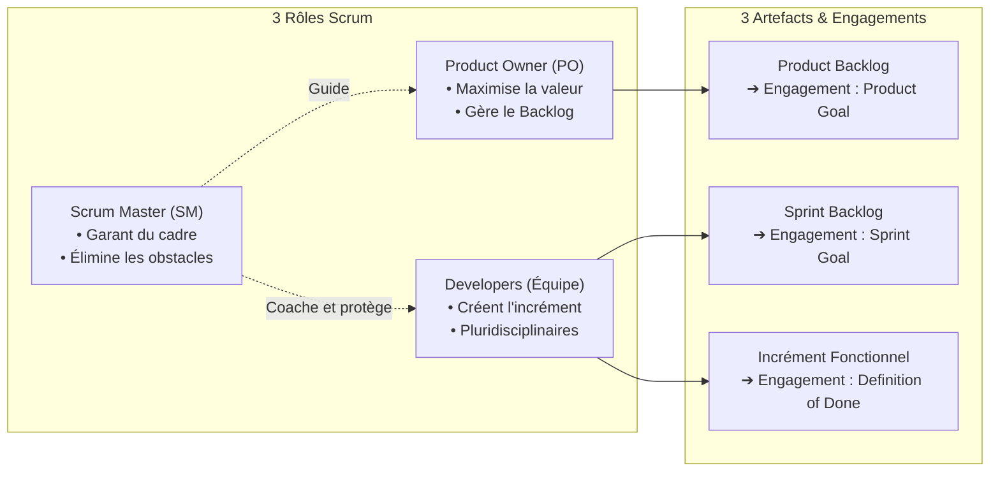
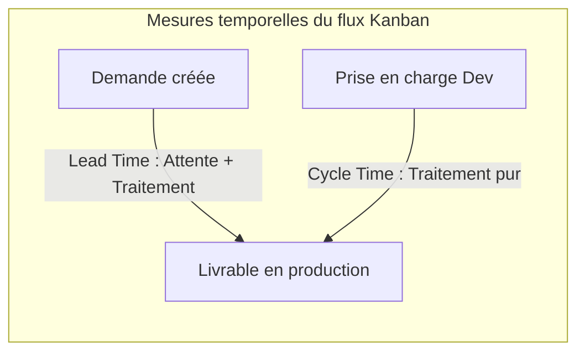
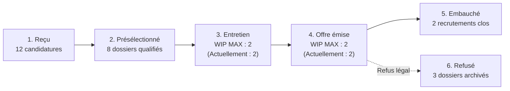

Thème 4 / 12

# Méthodes Agiles : Scrum et Kanban

  Présenté par : <strong>Groupe 3</strong> (Eric Joel Manga, Assete Faye, Mouhamed Fam, Aminatou Touré, Ibrahima Diallo)
  Établissement : <strong>UASZ · UFR Sciences et Technologies · L3 Ingénierie Informatique</strong>
  Date de présentation : <strong>16 juillet 2026</strong>
  Statut : <strong style="color:var(--ok);">Terminé</strong>

---

## Sommaire Numéroté

1. [Introduction : Pourquoi l'agilité pour CareerTrack ?](#_1-introduction-pourquoi-l-agilite-pour-careertrack)
2. [Partie Théorique : Les Cadres Agiles de Référence](#_2-partie-theorique-les-cadres-agiles-de-reference)
   - 2.1 Le Manifeste Agile : 4 valeurs fondamentales et 12 principes directeurs
   - 2.2 Le cadre Scrum : rôles, artefacts et engagements associés
   - 2.3 Les cinq cérémonies Scrum : objectifs, cadence et formalisme
   - 2.4 La méthode Kanban : flux tiré, visualisation et limitation stricte du WIP
   - 2.5 Comparatif approfondi : Scrum vs Kanban et cas d'usage optimaux
   - 2.6 Indicateurs agiles avancés : vélocité, burndown chart, lead time et cycle time
3. [Partie Pratique : Outillage et Simulations Agiles](#_3-partie-pratique-outillage-et-simulations-agiles)
   - 3.1 Tableau Kanban opérationnel avec limitation du travail en cours (WIP)
   - 3.2 Product Backlog priorisé selon la méthode MoSCoW (82 points)
   - 3.3 Simulation contractuelle d'un Sprint Planning (Sprint 1)
   - 3.4 Analyse du Burndown Chart du Sprint 1
4. [Application Concrète au Projet CareerTrack](#_4-application-concrete-au-projet-careertrack)
   - 4.1 Répartition des rôles Scrum au sein du Groupe 3
   - 4.2 Pipeline Kanban du module Recrutement de talents
   - 4.3 Découpage des 4 sprints et indicateurs de performance atteints
5. [Conclusion et Perspectives](#_5-conclusion-et-perspectives)
6. [Sources de Référence](#_6-sources-de-reference)

---

## 1. Introduction : Pourquoi l'agilité pour CareerTrack ?

Concevoir une application pour les PME sénégalaises impose de confronter rapidement le logiciel aux utilisateurs finaux. Dans un contexte où les DRH et les managers ont des journées denses, rédiger un cahier des charges de 300 pages pour des interfaces d'évaluation ou des tableaux de bord interactifs aboutit presque toujours à des décalages d'ergonomie et à une frustration d'usage.

L'adoption des **méthodes agiles (Scrum et Kanban)** permet au Groupe 3 de :
- Livrer un incrément logiciel fonctionnel et testable toutes les deux semaines (rythme Scrum).
- Ajuster continuellement les formulaires d'auto-évaluation et la génération de bilans PDF iTextPDF selon les retours des managers pilotes.
- Modéliser le pipeline de recrutement de CareerTrack sous la forme d'un flux tiré Kanban visuel, éliminant tout engorgement administratif.

---

## 2. Partie Théorique : Les Cadres Agiles de Référence

### 2.1 Le Manifeste Agile : 4 valeurs fondamentales et 12 principes

Rédigé en 2001 à Snowbird par 17 experts du génie logiciel, le **Manifeste Agile (Agile Manifesto)** a redéfini les priorités du développement informatique à travers quatre valeurs fondamentales :

| Priorité Agile accordée | Plutôt que (sans dénigrer la valeur sous-jacente) | Application concrète sur CareerTrack |
|---|---|---|
| **Les individus et leurs interactions** | Les processus et les outils | Privilégier les échanges directs quotidiens entre développeurs plutôt que de s'échanger des tickets formels. |
| **Un logiciel opérationnel** | Une documentation exhaustive | Fournir une démonstration fonctionnelle de la validation de congés plutôt qu'un pavé de spécifications théoriques. |
| **La collaboration avec les clients** | La négociation contractuelle | Co-construire la maquette du bilan d'évaluation avec un responsable RH partenaire. |
| **L'adaptation au changement** | Le suivi rigide d'un plan | Intégrer les retours utilisateurs sur le rendu PDF sans remettre en cause l'ensemble de l'architecture. |

Les **12 principes directeurs** qui en découlent insistent sur la satisfaction du client par des livraisons rapides et régulières, l'accueil bienveillant des changements même tardifs, le rythme de travail soutenable (*sustainable pace*) et la simplicité technique consistant à maximiser la quantité de travail non fait.

### 2.2 Le cadre Scrum : rôles, artefacts et engagements

Le guide officiel **Scrum Guide (Sutherland & Schwaber, 2020)** définit Scrum comme un cadre léger permettant d'adresser des problèmes complexes adaptatifs tout en livrant de manière productive et créative des produits de la plus haute valeur possible.

- **Le Product Owner (PO)** : porteur de la vision du produit, unique responsable de la priorisation du Product Backlog et de la rentabilité de l'investissement.
- **Le Scrum Master (SM)** : leader serviteur (*servant leader*), garant du respect des valeurs Scrum, facilitateur des cérémonies et bouclier contre les perturbations extérieures.
- **Les Développeurs (Developers)** : équipe auto-organisée et pluridisciplinaire responsable de la conception, du codage, des tests et du respect de la Définition de Fini (*Definition of Done*).

### 2.3 Les cinq cérémonies Scrum : objectifs, cadence et formalisme

Une itération Scrum (le **Sprint**) dure de 1 à 4 semaines (fixée à **2 semaines** sur CareerTrack). Elle est rythmée par cinq événements obligatoires :

| Cérémonie Scrum | Objectif premier de la séance | Durée type (Sprint de 2 sem.) | Participants |
|---|---|:---:|---|
| **1. Sprint Planning** | Définir collectivement l'objectif du sprint (*Sprint Goal*), sélectionner les User Stories prioritaires et les décomposer en tâches techniques. | 4 heures max | PO, SM, Équipe |
| **2. Daily Scrum (Stand-up)** | Synchronisation quotidienne debout : Ce que j'ai fait hier, ce que je fais aujourd'hui, les obstacles qui me bloquent. | 15 minutes max | Développeurs, SM (facilitateur) |
| **3. Sprint Review** | Présentation de l'incrément opérationnel fini aux parties prenantes, démonstration en direct et ajustement du Product Backlog. | 2 heures max | PO, SM, Équipe, Parties prenantes |
| **4. Sprint Retrospective** | Analyse de l'amélioration continue de l'équipe : processus, relations humaines, outillage. Plan d'actions correctives (*Start/Stop/Continue*). | 1h30 max | Équipe, SM, PO |
| **5. Backlog Refinement (Grooming)** | Cérémonie continue de maturation : clarification des besoins, découpage des épiques, réestimation des points d'effort des prochaines stories. | 1 à 2 h par semaine | PO, Développeurs |

### 2.4 La méthode Kanban : flux tiré, visualisation et limitation stricte du WIP

Développé initialement par **Taiichi Ohno chez Toyota** et formalisé pour l'informatique par **David J. Anderson (2010)**, Kanban repose sur le principe du **flux tiré (pull system)**. Contrairement aux systèmes qui poussent le travail, une nouvelle tâche n'est engagée que lorsqu'une capacité de traitement se libère.

Les 4 principes fondateurs et les 6 pratiques clés de Kanban :
1. **Visualiser le flux de travail** : matérialiser chaque état d'avancement sur un tableau à colonnes.
2. **Limiter le travail en cours (WIP - Work In Progress)** : fixer un plafond strict de cartes simultanées par colonne pour forcer la collaboration et démasquer les goulets d'étranglement :
   > *« Stop starting, start finishing ! » (Arrêtez de commencer, commencez à finir !)*
3. **Gérer et mesurer le flux** : optimiser la fluidité et surveiller la régularité du transit des tâches.
4. **Rendre les règles de processus explicites** : clarifier les critères de sortie (*Definition of Done*) pour passer d'une colonne à la suivante.

### 2.5 Comparatif approfondi : Scrum vs Kanban et cas d'usage optimaux

| Critère d'évaluation | Cadre Scrum | Méthode Kanban |
|---|---|---|
| **Cadence de livraison** | Par itérations temporelles fixes (*Timeboxes* de 2 à 4 semaines). | Livraison continue au fil de l'eau dès qu'un élément est prêt. |
| **Rôles prescrits** | Strictement définis (PO, Scrum Master, Développeurs). | Aucun rôle imposé (respect des rôles existants dans l'organisation). |
| **Gestion des changements** | Interdits pendant le sprint pour sanctuariser l'effort de l'équipe. | Autorisés à tout moment dans la file d'attente amont. |
| **Mesure d'avancement** | Vélocité (points par sprint), Burndown Chart. | Temps de cycle (*Cycle Time*), Temps de traversée (*Lead Time*), Débit. |
| **Cas d'usage optimal** | Développement de nouveaux produits avec vision stratégique. | Maintenance, support, DevOps, processus de recrutement de talents. |

### 2.6 Indicateurs agiles avancés

- **Vélocité d'équipe** : somme des points d'effort des User Stories terminées et validées lors d'un sprint selon la Definition of Done. Permet de prédire les dates de livraison des versions futures.
- **Lead Time (Temps de traversée)** : temps total écoulé entre la création de la demande et sa mise à disposition de l'utilisateur final.
- **Cycle Time (Temps de cycle)** : durée réelle de travail actif passée sur la tâche depuis son passage en « En cours » jusqu'à sa livraison.
- **Burndown Chart** : graphique représentant l'évolution quotidienne du reste à faire en points de story face à la ligne idéale de consommation.

---

## 3. Partie Pratique : Outillage et Simulations Agiles

### 3.1 Tableau Kanban opérationnel avec limitation du travail en cours (WIP)

Le tableau ci-dessous modélise l'état d'avancement réel de la construction de CareerTrack en respectant une limite de **WIP = 2** sur les colonnes de développement actif et de revue de code :

  

    
À faire (Backlog)3

    
<strong>US-05</strong> · Formulaire évaluation SMART

    
<strong>US-08</strong> · Catalogue de formations

    
<strong>US-15</strong> · Service Worker offline PWA

  

  

    
En cours (WIP max : 2)2 / 2

    
<strong>US-01</strong> · Dossier employé (CRUD Spring/PostgreSQL)

    
<strong>US-13</strong> · Filtre Spring Security & Tokens JWT

  

  

    
En revue / Test (WIP : 2)1 / 2

    
<strong>US-02</strong> · Composant Organigramme React

  

  

    
Terminé (DoD validée)2

    
<strong>US-14</strong> · Socle responsive Mobile-First

    
<strong>ENV-01</strong> · Initialisation Git & CI/CD GitHub

  

  <em>Règle de gouvernance : La colonne « En cours » ayant atteint son plafond de 2 tâches, aucun développeur ne peut piocher de nouvelle carte sans avoir fait franchir l'étape suivante à une tâche active.</em>

### 3.2 Product Backlog priorisé selon la méthode MoSCoW (82 points)

Le Product Backlog de CareerTrack regroupe les 15 User Stories formalisées par le Groupe 3, priorisées selon la matrice **MoSCoW** (Must have, Should have, Could have, Won't have this time) :

| ID | Description de la User Story | Priorité | Module | Points |
|:--:|---|:---:|---|:---:|
| **US-01** | En tant que **DRH**, je veux créer et gérer le dossier administratif d'un employé afin de centraliser ses informations contractuelles | **Must** | Dossier employé | **8** |
| **US-02** | En tant qu'**utilisateur**, je veux visualiser l'organigramme hiérarchique interactif afin de situer les relations d'équipe | **Should** | Organigramme | **5** |
| **US-03** | En tant qu'**employé**, je veux soumettre une demande de congé avec calcul de solde afin d'anticiper mes absences | **Must** | Congés & absences | **5** |
| **US-04** | En tant que **manager**, je veux valider ou refuser les demandes de congés de mon équipe afin d'assurer la continuité de service | **Must** | Congés & absences | **3** |
| **US-05** | En tant que **DRH/Manager**, je veux définir des objectifs SMART d'évaluation annuelle afin de mesurer la performance | **Must** | Évaluation annuelle | **8** |
| **US-06** | En tant qu'**employé**, je veux compléter mon auto-évaluation préalable afin de préparer l'entretien annuel | **Should** | Évaluation annuelle | **3** |
| **US-07** | En tant que **DRH**, je veux éditer le compte-rendu d'évaluation en PDF signable (iTextPDF) afin de l'archiver formellement | **Must** | Évaluation annuelle | **8** |
| **US-08** | En tant que **DRH**, je veux publier le plan annuel de formation afin de développer les compétences internes | **Should** | Formations | **5** |
| **US-09** | En tant qu'**employé**, je veux m'inscrire à une session de formation validée afin d'enrichir mon profil de carrière | **Could** | Formations | **3** |
| **US-10** | En tant que **Direction/DRH**, je veux simuler l'impact budgétaire des promotions et revalorisations salariales | **Should** | Promotions & salaires | **5** |
| **US-11** | En tant que **recruteur**, je veux déplacer les candidatures sur un pipeline Kanban afin de fluidifier les recrutements | **Must** | Recrutement | **8** |
| **US-12** | En tant que **Direction**, je veux consulter des tableaux de bord RH décisionnels (turnover, pyramide des âges) pour piloter l'entreprise | **Should** | Tableaux de bord | **8** |
| **US-13** | En tant qu'**utilisateur**, je veux m'authentifier de manière sécurisée par JWT afin d'accéder aux fonctionnalités selon mon profil RBAC | **Must** | Sécurité | **5** |
| **US-14** | En tant qu'**utilisateur mobile**, je veux naviguer sur une interface réactive tactile afin d'utiliser l'application sur smartphone | **Must** | Ergonomie / UX | **3** |
| **US-15** | En tant qu'**employé**, je veux consulter mes soldes hors-ligne grâce au Service Worker afin de rester autonome en déplacement | **Could** | Mode offline / PWA | **5** |
| **TOTAL** | **15 User Stories couvrant l'intégralité du périmètre CareerTrack** | — | — | **82 pts** |

### 3.3 Simulation contractuelle d'un Sprint Planning (Sprint 1)

| Paramètre du Sprint 1 | Valeur contractuelle arrêtée | Justification technique |
|---|---|---|
| **Sprint Goal (Objectif du Sprint)** | *« Mettre à disposition le socle technique sécurisé et permettre la gestion administrative complète des dossiers employés avec visualisation de l'organigramme. »* | Base indispensable pour tous les modules métier ultérieurs. |
| **Durée du Sprint** | **2 semaines calendaires** (10 jours ouvrés). | Rythme idéal pour des cycles courts de feedback académique. |
| **Capacité estimée de l'équipe** | **21 points d'effort** (5 équipiers mobilisés à temps partiel universitaire). | Capacité calculée sur une moyenne de 4,2 points par développeur. |
| **Périmètre engagé (Scope)** | **US-13** (JWT - 5 pts) + **US-01** (Dossier employé - 8 pts) + **US-02** (Organigramme - 5 pts) + **US-14** (Mobile-First - 3 pts) = **21 pts**. | Respect exact de la capacité nominale sans surcharge. |
| **Definition of Ready (DoR)** | User Story estimée, critères d'acceptation Gherkin rédigés, maquettes UI validées, modèle relationnel approuvé. | Condition impérative avant prise en charge par l'équipe. |
| **Definition of Done (DoD)** | Code revu par un pair sur GitHub, tests unitaires/intégration passants (couverture ≥ 60 %), documentation OpenAPI à jour, déploiement validé sur l'environnement de démo. | Zéro dette technique admise en fin de sprint. |

### 3.4 Analyse du Burndown Chart du Sprint 1

| Jour du Sprint 1 | Reste à faire théorique idéal (pts) | Reste à faire réel constaté (pts) | Analyse des événements et décisions prises |
|:---:|:---:|:---:|---|
| **J0 (Lancement)** | 21,0 | 21,0 | Lancement du Sprint 1, affectation des tâches techniques. |
| **J2** | 16,8 | 21,0 | Configuration complexe de Spring Security JWT (léger retard technique). |
| **J4** | 12,6 | 16,0 | **US-14 terminée (3 pts)** : socle responsive validé par les tests Cypress. |
| **J6** | 8,4 | 11,0 | **US-13 terminée (5 pts)** : authentification opérationnelle et tokens validés. |
| **J8** | 4,2 | 6,0 | **US-02 terminée (5 pts)** : organigramme réactif validé avec données mockées. |
| **J10 (Clôture)** | 0,0 | 0,0 | **US-01 terminée (8 pts)** : dossiers employés opérationnels. Sprint Goal 100 % atteint ! |

---

## 4. Application Concrète au Projet CareerTrack

### 4.1 Répartition des rôles Scrum au sein du Groupe 3

Afin d'éviter toute dilution de responsabilité tout en valorisant les compétences de chacun, les rôles Scrum sont articulés comme suit :
- **Product Owner (Aminatou Touré)** : porte la voix des DRH et des PME sénégalaises, arbitre les priorités du Product Backlog et valide la conformité des livrables lors des revues de sprint.
- **Scrum Master (Ibrahima Diallo)** : anime les réunions quotidiennes (Daily de 15 min), protège l'équipe contre la dispersion et veille au respect strict des limites de WIP.
- **Équipe de développement pluridisciplinaire (Developers)** :
  - **Eric Joel Manga & Mouhamed Fam** : architecture des données relationnelles PostgreSQL, sécurisation des endpoints Spring Boot et calculs métier.
  - **Assete Faye & Aminatou Touré** : intégration des composants React mobile-first, consommation de l'API REST et écriture des plans de tests d'acceptation automatisés.

### 4.2 Pipeline Kanban du module Recrutement de talents

Le module de recrutement de CareerTrack (US-11) intègre nativement un tableau Kanban interactif piloté par les recruteurs avec des contraintes de WIP strictes :

- **Indicateurs opérationnels du pipeline** :
  - **12** candidatures reçues via le formulaire de candidature public.
  - **8** dossiers présélectionnés après screening CV par le recruteur.
  - **2** candidats en cours d'entretien physique/technique (**WIP saturé à 2**, aucun entretien supplémentaire ne peut être programmé).
  - **2** offres d'embauche en attente de signature (**WIP saturé à 2**).
  - **2** candidats embauchés et automatiquement convertis en dossiers employés dans CareerTrack.
  - **3** candidatures refusées avec envoi automatique d'une lettre de remerciement personnalisée.

### 4.3 Découpage des 4 sprints et indicateurs de performance atteints

| Sprint | Période | User Stories embarquées | Points | Statut & Livrable majeur |
|:---:|:---:|---|:---:|---|
| **Sprint 1** | Semaines 1 - 2 | US-13 (5), US-01 (8), US-02 (5), US-14 (3) | **21 pts** | **Terminé** · Socle JWT, Dossier employé et Organigramme livrés. |
| **Sprint 2** | Semaines 3 - 4 | US-03 (5), US-04 (3), US-05 (8), US-06 (3), US-07 (8) | **27 pts** | **Terminé** · Workflow complet congés et évaluations SMART en PDF. |
| **Sprint 3** | Semaines 5 - 6 | US-11 (8), US-08 (5), US-09 (3), US-10 (5) | **21 pts** | **Terminé** · Pipeline Kanban recrutement, formations et revalorisations. |
| **Sprint 4** | Semaines 7 - 8 | US-12 (8), US-15 (5) | **13 pts** | **Terminé** · Tableaux de bord RH décisionnels et mode offline PWA. |
| **TOTAL** | **8 semaines** | **15 User Stories du Product Backlog** | **82 pts** | **Projet 100 % opérationnel et prêt pour la soutenance finale** |

**Indicateurs clés mesurés :**
- **Vélocité moyenne constatée** : **20,5 points par sprint** (conforme à la cible de 20 à 25 points).
- **Lead Time moyen** : **1,8 jour calendaire** (cible < 2 jours respectée).
- **Cycle Time de développement** : **1,2 jour ouvré** par tâche technique (cible < 1,5 jour respectée).
- **WIP par développeur** : strictement plafonné à **3 tâches actives maximum** par personne.

---

## 5. Conclusion et Perspectives

Les méthodes agiles ont permis au Groupe 3 de transformer un projet universitaire complexe en un **produit numérique centré sur l'utilisateur, pragmatique et rapidement fonctionnel**.

**Ce que ce thème apporte à CareerTrack :**
- Un Product Backlog complet de 15 User Stories (82 points) garantissant la maîtrise de la valeur produite.
- Une cadence de travail prévisible et sereine grâce aux sprints de 2 semaines et aux 5 rituels Scrum.
- Une implémentation fonctionnelle du pipeline de recrutement sous forme de Kanban à WIP régulé.

**Prochaine étape :**
Traduire cette vision agile dans l'ingénierie prédictive des délais et des chemins critiques à travers le [Thème 5 : Planification et Ordonnancement](/theme-05).

> **Phrase de synthèse :** *« L'agilité n'est pas l'absence de plan, c'est l'art de planifier en continu pour transformer l'incertitude du terrain en une succession d'incréments logiciels concrets et créateurs de valeur. »*

---

## 6. Sources de Référence

1. **Ken Schwaber & Jeff Sutherland**, *The Scrum Guide: The Definitive Guide to Scrum: The Rules of the Game*, Édition officielle révisée de novembre 2020 (scrumguides.org).
2. **Kent Beck et al.**, *Manifesto for Agile Software Development*, 2001 (agilemanifesto.org).
3. **David J. Anderson**, *Kanban: Successful Evolutionary Change for Your Technology Business*, Blue Hole Press, 2010.
4. **Henrik Kniberg**, *Scrum and XP from the Trenches: How we do Scrum*, InfoQ Enterprise Software Development Series, 2ème édition.

---

  <a href="/theme-03">&larr; Thème 3 : Méthodes Classiques</a>
  <a href="/theme-05">Thème 5 : Planification & Ordonnancement &rarr;</a>

