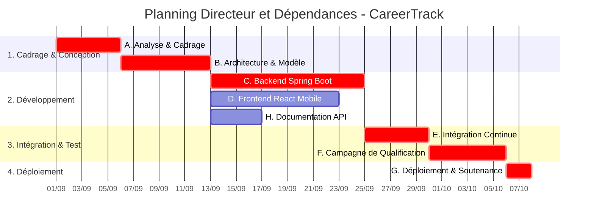
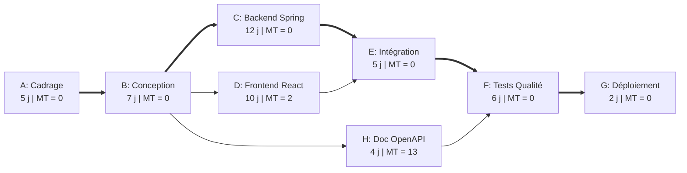

Thème 5 / 12

# Planification et Ordonnancement

  Présenté par : <strong>Groupe 3</strong> (Eric Joel Manga, Assete Faye, Mouhamed Fam, Soxna, Ibrahima Diallo)
  Établissement : <strong>UASZ · UFR Sciences et Technologies · L3 Ingénierie Informatique</strong>
  Statut : <strong style="color:var(--ok);">Terminé</strong>

---

## Sommaire Numéroté

1. [Introduction : Pourquoi planifier et ordonnancer CareerTrack ?](#_1-introduction-pourquoi-planifier-et-ordonnancer-careertrack)
2. [Partie Théorique : Les Outils de l'Ordonnancement](#_2-partie-theorique-les-outils-de-l-ordonnancement)
   - 2.1 La décomposition arborescente du travail (WBS) et la règle des 100 %
   - 2.2 Le diagramme de Gantt : construction temporelle et visualisation des jalons
   - 2.3 Le réseau PERT : calcul formel des dates et des marges
   - 2.4 La méthode du chemin critique (CPM)
   - 2.5 Typologie des dépendances entre tâches (FS, SS, FF, SF) et avances/retards
3. [Partie Pratique : Décomposition et Calculs Mathématiques](#_3-partie-pratique-decomposition-et-calculs-mathematiques)
   - 3.1 Structure de Décomposition du Travail (WBS) du projet CareerTrack
   - 3.2 Diagramme de Gantt opérationnel multi-phases
   - 3.3 Tableau de calcul complet du réseau PERT (Dates ES, EF, LS, LF et Marges)
   - 3.4 Analyse systématique de l'impact des retards sur le chemin critique
4. [Application Concrète au Projet CareerTrack](#_4-application-concrete-au-projet-careertrack)
   - 4.1 Planification globale articulée sur 37 jours ouvrés
   - 4.2 Matrice d'allocation des charges par membre du Groupe 3
5. [Conclusion et Perspectives](#_5-conclusion-et-perspectives)
6. [Sources de Référence](#_6-sources-de-reference)

---

## 1. Introduction : Pourquoi planifier et ordonnancer CareerTrack ?

Un projet sans planification rigoureuse se résume à une suite d'urgences mal maîtrisées. Dans le cadre du développement de **CareerTrack**, notre équipe universitaire fait face à un calendrier contraint par les sessions académiques et les soutenances de fin de semestre à l'UASZ.

La planification et l'ordonnancement fournissent l'assise mathématique indispensable pour :
- **Identifier la séquence critique des tâches** dont le moindre retard compromettrait directement la date de soutenance finale.
- **Quantifier les marges de manœuvre disponibles** sur les développements secondaires (comme la documentation ou certaines interfaces frontend) sans impacter la livraison globale.
- **Répartir harmonieusement les charges de travail** entre les membres du Groupe 3 pour éviter toute surcharge ponctuelle.

---

## 2. Partie Théorique : Les Outils de l'Ordonnancement

### 2.1 La décomposition arborescente du travail (WBS) et la règle des 100 %

La **Structure de Décomposition du Travail (WBS - Work Breakdown Structure)**, normalisée par la norme **ISO 21511**, est une décomposition hiérarchique descendante orientée livrables de l'ensemble du travail à accomplir par l'équipe projet.

Deux règles d'ingénierie fondamentales régissent le WBS :
1. **La règle des 100 %** : le WBS doit englober 100 % du périmètre défini dans la charte de projet, sans omission ni ajout superflu. La somme du travail des éléments enfants doit être strictement égale au travail de l'élément parent.
2. **Le lot de travail (Work Package)** : situé au niveau le plus bas de l'arborescence, il représente une unité de travail indivisible, assignable à un responsable unique, dont la durée et le coût peuvent être estimés avec précision.

### 2.2 Le diagramme de Gantt : construction et lecture

Conçu par **Henry Gantt en 1910**, ce diagramme temporel représente les activités sous forme de barres horizontales positionnées sur un calendrier calendaire. Il matérialise :
- La date de début au plus tôt et la date de fin prévue de chaque activité.
- Les liaisons de dépendance entre les activités (flèches d'antécédence).
- Les **jalons (milestones)** : événements clés sans durée (durée = 0) marquant l'atteinte d'un résultat capital ou la validation d'un comité (ex. *Signature du cahier des charges*, *Mise en production*).

### 2.3 Le réseau PERT : calcul formel des dates et des marges

Mis au point en 1958 pour le programme de missiles Polaris de l'US Navy, le **PERT (Program Evaluation and Review Technique)** modélise les tâches sous la forme d'un réseau orienté (graphe sans circuit). 

Pour chaque tâche $i$, on calcule méthodiquement quatre grandeurs temporelles :
- **Date de début au plus tôt (ES)** : date minimale à laquelle la tâche peut démarrer, conditionnée par l'achèvement de tous ses prédécesseurs :
  - `ES = max(EF des prédécesseurs)` ; `ES₁ = 0` pour la première tâche.
- **Date de fin au plus tôt (EF)** :
  - `EF = ES + Durée`
- **Date de fin au plus tard (LF)** : date maximale à laquelle la tâche doit s'achever sans retarder la fin du projet :
  - `LF = min(LS des successeurs)` ; `LF_final = EF_final`.
- **Date de début au plus tard (LS)** :
  - `LS = LF − Durée`

À partir de ces valeurs, on en déduit deux marges fondamentales :
- **Marge Totale (MT)** : retard maximal d'une tâche sans retarder la fin du projet :
  - `MT = LS − ES = LF − EF`
- **Marge Libre (ML)** : retard maximal sans retarder le début au plus tôt d'une tâche suivante :
  - `ML = min(ES successeurs) − EF`

### 2.4 La méthode du chemin critique (CPM)

Le **Chemin Critique (Critical Path Method)** est la séquence continue de tâches dépendantes reliant le début à la fin du projet dont la somme des durées est la plus longue. 

> **Propriété mathématique** : Toutes les activités situées sur le chemin critique possèdent une **marge totale nulle ($MT = 0$)**. Tout retard pris sur une activité critique se répercute jour pour jour sur l'échéance finale du projet.

### 2.5 Typologie des dépendances entre tâches

| Type de liaison | Intitulé officiel | Règle d'ordonnancement | Exemple concret sur CareerTrack |
|:---:|---|---|---|
| **FS** | Fin à Début (*Finish-to-Start*) | La tâche B ne peut commencer tant que la tâche A n'est pas terminée. | On ne peut pas commencer les tests d'intégration (B) avant d'avoir compilé le backend Spring Boot (A). |
| **SS** | Début à Début (*Start-to-Start*) | La tâche B ne peut commencer que lorsque la tâche A a commencé. | L'écriture de la documentation technique (B) débute dès l'amorce de la conception détaillée (A). |
| **FF** | Fin à Fin (*Finish-to-Finish*) | La tâche B ne peut s'achever que lorsque la tâche A est achevée. | La recette fonctionnelle (B) ne peut être clôturée tant que les derniers correctifs d'anomalies (A) ne sont pas finis. |
| **SF** | Début à Fin (*Start-to-Finish*) | La tâche B ne peut s'achever avant que la tâche A n'ait commencé. | Remplacement d'équipe : l'ancien serveur de test ne peut être éteint (B) tant que le nouveau cluster (A) n'a pas démarré. |

---

## 3. Partie Pratique : Décomposition et Calculs Mathématiques

### 3.1 Structure de Décomposition du Travail (WBS) du projet CareerTrack

```mermaid
flowchart TD
  P["CareerTrack (100 %)"] --> G["1. Pilotage & Gestion (15 %)"]
  P --> C["2. Spécification & Conception (20 %)"]
  P --> D["3. Développement Fullstack (35 %)"]
  P --> T["4. Qualification & Sécurité (20 %)"]
  P --> L["5. Déploiement & Clôture (10 %)"]

  G --> G1["1.1 Charte & WBS"]
  G --> G2["1.2 Suivi des Sprints & Risques"]

  C --> C1["2.1 Modèle Relationnel PostgreSQL"]
  C --> C2["2.2 Spécification OpenAPI 3.0"]
  C --> C3["2.3 Maquettes UI React Mobile"]

  D --> D1["3.1 Socle Spring Boot & JWT"]
  D --> D2["3.2 Modules Stables (Congés, Dossier)"]
  D --> D3["3.3 Modules Évolutifs (Éval, Formations)"]
  D --> D4["3.4 Moteur d'édition iTextPDF"]

  T --> T1["4.1 Tests Unitaires & Intégration JUnit"]
  T --> T2["4.2 Tests E2E Cypress & Audit RBAC"]

  L --> L1["5.1 Déploiement Cloud PaaS"]
  L --> L2["5.2 Manuel Utilisateur & Soutenance"]
```

### 3.2 Diagramme de Gantt opérationnel multi-phases

Le diagramme de Gantt ci-dessous représente la chronologie des phases de réalisation de CareerTrack :

### 3.3 Tableau de calcul complet du réseau PERT

Le tableau ci-dessous formalise l'intégralité du calcul des dates au plus tôt, des dates au plus tard et des marges pour un total de **37 jours ouvrés** :

| Tâche | Intitulé de l'activité | Durée ($D$) | Prédécesseurs | $ES$ | $EF$ | $LS$ | $LF$ | Marge Totale ($MT$) | Marge Libre ($ML$) | Statut critique |
|:---:|---|:---:|:---:|:---:|:---:|:---:|:---:|:---:|:---:|:---:|
| **A** | Analyse des besoins & Cadrage | 5 j | Aucun | 0 | 5 | 0 | 5 | **0 j** | **0 j** | **Critique** |
| **B** | Conception générale & Modèle relationnel | 7 j | A | 5 | 12 | 5 | 12 | **0 j** | **0 j** | **Critique** |
| **C** | Développement Backend (Spring Boot, JWT, BDD) | 12 j | B | 12 | 24 | 12 | 24 | **0 j** | **0 j** | **Critique** |
| **D** | Développement Frontend (React, Mobile-first) | 10 j | B | 12 | 22 | 14 | 24 | **2 j** | **2 j** | Non critique |
| **H** | Rédaction Documentation technique & OpenAPI | 4 j | B | 12 | 16 | 25 | 29 | **13 j** | **13 j** | Non critique |
| **E** | Intégration continue & Moteur iTextPDF | 5 j | C, D | 24 | 29 | 24 | 29 | **0 j** | **0 j** | **Critique** |
| **F** | Campagne de tests automatisés (≥ 60 %) | 6 j | E, H | 29 | 35 | 29 | 35 | **0 j** | **0 j** | **Critique** |
| **G** | Déploiement cloud & Préparation soutenance | 2 j | F | 35 | 37 | 35 | 37 | **0 j** | **0 j** | **Critique** |

> **Chemin Critique identifié : A → B → C → E → F → G**
> **Durée minimale incompressible du projet** : 5 + 7 + 12 + 5 + 6 + 2 = **37 jours ouvrés**.

### 3.4 Analyse systématique de l'impact des retards sur le chemin critique

Grâce aux calculs des marges, le Groupe 3 dispose d'une matrice prédictive d'aide à la décision en cas d'aléa de calendrier :

| Scénario d'aléa opérationnel | Analyse de l'impact sur la marge | Conséquence sur le délai final (37 j) | Décision de pilotage corrective |
|---|---|---|---|
| **Retard de 3 jours sur le Backend (Tâche C)** | La tâche C est sur le chemin critique ($MT = 0$). Tout retard consomme du temps négatif. | **Retard net de 3 jours** (fin reportée à J+40). | **Crashing** : affecter immédiatement un développeur frontend en binôme pour accélérer les contrôleurs Spring. |
| **Retard de 2 jours sur le Frontend (Tâche D)** | La tâche D dispose d'une marge totale $MT = 2$ jours. | **Aucun impact** (fin maintenue à 37 jours). | Absorption normale par la marge tampon ; surveillance pour ne pas dépasser J24. |
| **Retard de 5 jours sur le Frontend (Tâche D)** | Le retard de 5 jours dépasse la marge disponible ($5 - 2 = 3$). | **Retard net de 3 jours** sur le projet global. | D devient critique à partir du 3ème jour de dérive. Arbitrage : simplifier les animations CSS. |
| **Retard de 10 jours sur la Documentation (Tâche H)** | La tâche H dispose d'une marge confortable $MT = 13$ jours. | **Aucun impact** (marge résiduelle de 3 jours). | Aucun impact bloquant sur le chemin critique de livraison technique. |

---

## 4. Application Concrète au Projet CareerTrack

### 4.1 Planification globale articulée sur 37 jours ouvrés

L'ordonnancement théorique de 37 jours ouvrés correspond exactement aux **8 semaines effectives** de notre semestre universitaire (à raison de 4 à 5 jours ouvrés utiles par semaine).

Cette durée globale est articulée avec les **4 Sprints Scrum de 2 semaines** décrits au Thème 4 :
- **Semaines 1 & 2 (J0 à J10)** : Cadrage (A) + Architecture (B) + Démarrage Backend/Frontend (C, D) $\rightarrow$ *Sprint 1*.
- **Semaines 3 & 4 (J11 à J20)** : Poursuite Backend/Frontend $\rightarrow$ *Sprint 2*.
- **Semaines 5 & 6 (J21 à J30)** : Fin Backend (C) + Intégration (E) + Début Tests (F) $\rightarrow$ *Sprint 3*.
- **Semaines 7 & 8 (J31 à J37)** : Fin des Tests Qualité (F) + Déploiement Cloud & Clôture (G) $\rightarrow$ *Sprint 4*.

### 4.2 Matrice d'allocation des charges par membre du Groupe 3

| Membre du Groupe 3 | Tâches principales assignées | Volume de jours/homme | Rôle clé sur le chemin critique |
|---|---|:---:|---|
| **Eric Joel Manga** | Modélisation relationnelle (B), Services Backend (C) | 19 j/h | Développeur principal sur l'axe critique B $\rightarrow$ C. |
| **Assete Faye** | Conception des cas d'essais (B), Campagne de tests JUnit (F) | 16 j/h | Responsable de la tâche critique de qualification F. |
| **Mouhamed Fam** | Cadrage initial (A), Ordonnancement PERT, Intégration (E) | 17 j/h | Responsable de la tâche critique A et de l'intégration E. |
| **Soxna** | Spécifications fonctionnelles (A), Maquettes & UI React (D) | 15 j/h | Pilote de la tâche D (Frontend, gestion de la marge de 2 j). |
| **Ibrahima Diallo** | Architecture globale (B), Sécurité JWT (C), Déploiement (G) | 18 j/h | Pilote de la tâche finale critique de déploiement cloud G. |

---

## 5. Conclusion et Perspectives

La planification rigoureuse par WBS, Gantt et PERT apporte au Groupe 3 une vision d'ingénierie prédictive indispensable. L'identification formelle du **chemin critique de 37 jours** nous prémunit contre l'illusion d'un temps infini et canalise notre concentration sur les activités non négociables.

**Ce que ce thème apporte à CareerTrack :**
- Un découpage WBS arborescent exhaustif couvrant 100 % du périmètre sans ambiguïté.
- La quantification exacte des marges de manœuvre (Frontend à 2 jours, Documentation à 13 jours).
- Une sécurisation mathématique de la date de livraison finale pour la soutenance universitaire.

**Prochaine étape :**
Protéger cet ordonnancement contre les aléas et les menaces à travers le [Thème 6 : Gestion des Risques](/theme-06).

> **Phrase de synthèse :** *« Planifier n'est pas prédire l'avenir avec certitude, mais calculer précisément ses marges de liberté pour savoir exactement où porter son effort quand survient l'inévitable imprévu. »*

---

## 6. Sources de Référence

1. **Project Management Institute (PMI)**, *Practice Standard for Work Breakdown Structures*, 3ème édition, PMI, 2019.
2. **Organisation Internationale de Normalisation**, *Norme ISO 21511:2018 — Management des projets, programmes et portefeuilles — Organigramme des tâches (WBS)*, Genève.
3. **James E. Kelley & Morgan R. Walker**, *Critical-Path Planning and Scheduling*, Proceedings of the Eastern Joint Computer Conference, 1959 (Article fondateur du CPM).
4. **Henry L. Gantt**, *Work, Wages, and Profits*, The Engineering Magazine Co., New York, 1916 (Ouvrage historique sur l'ordonnancement visuel).

---

  <a href="/theme-04">&larr; Thème 4 : Méthodes Agiles</a>
  <a href="/theme-06">Thème 6 : Gestion des Risques &rarr;</a>

