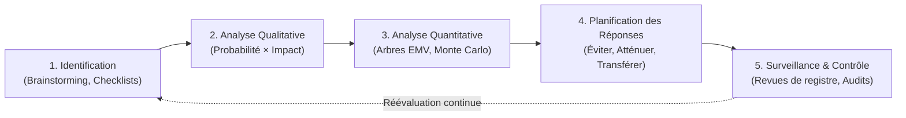

Thème 6 / 12

# Gestion des Risques

  Présenté par : <strong>Groupe 3</strong> (Eric Joel Manga, Assete Faye, Mouhamed Fam, Soxna, Ibrahima Diallo)
  Établissement : <strong>UASZ · UFR Sciences et Technologies · L3 Ingénierie Informatique</strong>
  Statut : <strong style="color:var(--ok);">Terminé</strong>

---

## Sommaire Numéroté

1. [Introduction : Pourquoi gérer les risques sur CareerTrack ?](#_1-introduction-pourquoi-gerer-les-risques-sur-careertrack)
2. [Partie Théorique : Le Processus de Maîtrise des Risques](#_2-partie-theorique-le-processus-de-maitrise-des-risques)
   - 2.1 Le cycle de gestion des risques selon la norme ISO 31000
   - 2.2 Analyse qualitative : matrice Probabilité × Impact et score d'exposition
   - 2.3 Analyse quantitative : arbres de décision (EMV) et simulations Monte Carlo
   - 2.4 Typologie des stratégies de traitement face aux menaces et opportunités
   - 2.5 Surveillance continue, signaux précurseurs et plans de contingence
3. [Partie Pratique : Registre et Cartographie d'un Projet de Migration Cloud](#_3-partie-pratique-registre-et-cartographie-d-un-projet-de-migration-cloud)
   - 3.1 Registre des risques d'une migration d'infrastructure cloud d'entreprise
   - 3.2 Matrice visuelle de criticité Probabilité × Impact
   - 3.3 Hiérarchisation de l'exposition et gouvernance des plans de réponse
4. [Application Concrète au Projet CareerTrack](#_4-application-concrete-au-projet-careertrack)
   - 4.1 Registre des risques critiques du projet CareerTrack
   - 4.2 Matrice P×I de criticité spécifique à CareerTrack
   - 4.3 Plan de contingence opérationnel pour l'hébergement cloud gratuit
5. [Conclusion et Perspectives](#_5-conclusion-et-perspectives)
6. [Sources de Référence](#_6-sources-de-reference)

---

## 1. Introduction : Pourquoi gérer les risques sur CareerTrack ?

Un risque en ingénierie logicielle est un *événement ou une condition incertaine qui, s'il se produit, a un impact positif ou négatif sur un ou plusieurs objectifs du projet* (délai, coût, qualité, sécurité). Dans le contexte de **CareerTrack**, développer une plateforme RH traitant de données personnelles sensibles (salaires, évaluations de performance, pièces d'identité) avec une équipe d'étudiants sur des infrastructures cloud gratuites comporte des vulnérabilités majeures.

Gérer proactivement les risques permet au Groupe 3 de :
- **Anticiper les écueils techniques** (latence ou mise en veille des hébergeurs gratuits, complexité de la génération iTextPDF) avant qu'ils ne se transforment en crises ouvertes.
- **Sécuriser la confidentialité et l'intégrité des données RH** conformément aux directives de la Commission de Protection des Données Personnelles du Sénégal (CDP).
- **Protéger le calendrier académique** contre les aléas humains (périodes d'examens, indisponibilité temporaire d'un membre).

---

## 2. Partie Théorique : Le Processus de Maîtrise des Risques

### 2.1 Le cycle de gestion des risques selon la norme ISO 31000

La norme internationale **ISO 31000:2018** et le standard **PMBOK** structurent le management du risque en cinq étapes itératives continues :

- **Identification** : recueil exhaustif des menaces potentielles via des revues de code, analyses architecturales et retours d'expérience.
- **Analyse qualitative** : qualification de la vraisemblance d'apparition et de la sévérité des conséquences pour ordonner les priorités.
- **Analyse quantitative** : modélisation mathématique et probabiliste des impacts financiers et calendaires cumulés.
- **Planification des réponses** : définition d'actions préventives (diminution du risque en amont) et de plans de contingence (mesures de secours si le risque survient).
- **Surveillance continue** : réévaluation hebdomadaire de l'état des risques et détection des signaux précurseurs (*early warning indicators*).

### 2.2 Analyse qualitative : matrice Probabilité × Impact et score d'exposition

L'évaluation qualitative positionne chaque risque sur une échelle standard graduée de 1 à 5 :
- **Probabilité ($P$)** : 1 (Très improbable < 10 %) à 5 (Quasi certain > 80 %).
- **Impact ($I$)** : 1 (Négligeable) à 5 (Critique / Bloquant).

Le **Score d'Exposition (E)** est calculé selon la relation : **E = P × I**, avec E ∈ [1, 25].

| Plage de score | Niveau de criticité | Seuil de gouvernance imposé |
|:---:|:---:|---|
| **$1 \le E \le 5$** | **Faible (Vert)** | Acceptation passive ; surveillance périodique sans mobilisation de budget dédié. |
| **$6 \le E \le 9$** | **Modéré (Jaune)** | Atténuation standard ; désignation d'un responsable et plan d'action préventif. |
| **$10 \le E \le 25$** | **Élevé (Rouge)** | Traitement prioritaire obligatoire ; plan d'évitement ou plan de contingence formel validé en COPIL. |

### 2.3 Analyse quantitative : arbres de décision (EMV) et simulations Monte Carlo

Pour les projets à fort enjeu financier, l'analyse quantitative dépasse le score subjectif pour chiffrer l'impact économique :
- **Valeur Monétaire Espérée (EMV - Expected Monetary Value)** :
  - `EMV = Σ (Probabilité_k × Impact Financier_k)`
  Permet d'arbitrer rationnellement entre plusieurs choix d'architecture ou de sous-traitance à l'aide d'arbres de décision.
- **Simulations de Monte Carlo** : exécution de milliers de simulations informatiques combinant des distributions de probabilité (Beta-PERT, Triangulaire) sur les durées de chaque tâche pour calculer la probabilité exacte d'achever le projet à une date donnée.

### 2.4 Typologie des stratégies de traitement des risques

Face à une menace (risque négatif), le chef de projet dispose de quatre stratégies éprouvées :

| Stratégie de réponse | Définition méthodologique | Exemple appliqué à l'ingénierie logicielle |
|---|---|---|
| **1. Évitement (Avoid)** | Éliminer totalement la cause racine du risque en modifiant le plan ou le périmètre. | Supprimer une fonctionnalité bancaire complexe du MVP pour écarter tout risque d'agrément juridique. |
| **2. Atténuation (Mitigate)** | Réduire préventivement la probabilité de survenance ou l'impact des conséquences. | Écrire une suite de tests unitaires automatisés (JUnit) et mettre en place des sauvegardes quotidiennes. |
| **3. Transfert (Transfer)** | Transférer la charge financière ou opérationnelle des conséquences à un tiers. | Souscrire une assurance cyber-risque ou confier l'hébergement hautement sécurisé à un opérateur infogéré (SLA). |
| **4. Acceptation (Accept)** | Reconnaître le risque sans agir en amont : soit passivement, soit activement en provisionnant une réserve budgétaire. | Prévoir une marge calendaire tampon de 2 jours sur les développements frontend en cas d'imprévu CSS. |

### 2.5 Surveillance continue, signaux précurseurs et plans de contingence

Un risque ne se déclenche jamais sans alertes préalables. La surveillance active repose sur l'identification des **déclencheurs de risques (*Risk Triggers*)** :
- *Signal précurseur de retard* : une User Story reste plus de 48 heures dans la colonne « En cours » sans commit Git.
- *Signal de faille de sécurité* : alertes de vulnérabilité émises par l'outil d'analyse statique Dependabot sur GitHub.
- *Plan de contingence* : ensemble prédéfini d'actions exécutées immédiatement dès lors qu'un déclencheur franchit un seuil critique prédéterminé.

---

## 3. Partie Pratique : Registre et Cartographie d'un Projet de Migration Cloud

### 3.1 Registre des risques d'une migration d'infrastructure cloud d'entreprise

Le tableau ci-dessous formalise le registre d'un projet de migration d'un système d'information historique vers un environnement Cloud (IaaS/PaaS) :

| ID | Intitulé & Description du Risque | P (1-5) | I (1-5) | Exposition $P \times I$ | Stratégie retenue | Action préventive & Plan de contingence |
|:---:|---|:---:|:---:|:---:|:---:|---|
| **R2** | **Indisponibilité prolongée des services métier (Downtime)** | 3 | 4 | **12** (Élevé) | Atténuation | Migration progressive par lots durant un week-end ; contingence : procédure de retour arrière (*Rollback*) vers l'ancien serveur en moins de 30 min. |
| **R4** | **Déficit de compétences Cloud / DevOps au sein de l'équipe** | 4 | 3 | **12** (Élevé) | Transfert / Atténuation | Formation intensive des ingénieurs certifiante + appui d'un consultant expert externe en renfort ponctuel. |
| **R1** | **Perte ou corruption irrémédiable de données lors de la bascule** | 2 | 5 | **10** (Élevé) | Atténuation | Sauvegarde à froid complète vérifiée avant migration + répétition en environnement de pré-production (*Dry Run*). |
| **R5** | **Faille de sécurité ou fuite de données lors du transfert réseau** | 2 | 5 | **10** (Élevé) | Atténuation | Chiffrement systématique de bout en bout (TLS 1.3 / AES-256), tunnels VPN dédiés et audit de conformité CDP. |
| **R3** | **Dépassement du budget cloud (consommation non maîtrisée)** | 3 | 3 | **9** (Modéré) | Atténuation | Configuration de plafonds de dépenses stricts, alertes d'extinction automatique des instances hors des heures ouvrées. |
| **R6** | **Dépendance excessive envers le fournisseur (Vendor Lock-in)** | 3 | 2 | **6** (Modéré) | Acceptation | Choix d'architectures conteneurisées avec Docker et de bases de données relationnelles standards (PostgreSQL). |

### 3.2 Matrice visuelle de criticité Probabilité × Impact

  <table class="rmatrix">
    <thead>
      <tr>
        <th class="corner">Proba ↓ / Impact →</th>
        <th>1 (Minime)</th>
        <th>2 (Faible)</th>
        <th>3 (Modéré)</th>
        <th>4 (Majeur)</th>
        <th>5 (Critique)</th>
      </tr>
    </thead>
    <tbody>
      <tr>
        <th>5 (Très fort)</th>
        <td class="rmed"></td>
        <td class="rhigh"></td>
        <td class="rhigh"></td>
        <td class="rhigh"></td>
        <td class="rhigh"></td>
      </tr>
      <tr>
        <th>4 (Fort)</th>
        <td class="rlow"></td>
        <td class="rmed"></td>
        <td class="rhigh"><strong>R4</strong></td>
        <td class="rhigh"></td>
        <td class="rhigh"></td>
      </tr>
      <tr>
        <th>3 (Moyen)</th>
        <td class="rlow"></td>
        <td class="rmed"><strong>R6</strong></td>
        <td class="rmed"><strong>R3</strong></td>
        <td class="rhigh"><strong>R2</strong></td>
        <td class="rhigh"></td>
      </tr>
      <tr>
        <th>2 (Faible)</th>
        <td class="rlow"></td>
        <td class="rlow"></td>
        <td class="rmed"></td>
        <td class="rmed"></td>
        <td class="rhigh"><strong>R1 · R5</strong></td>
      </tr>
      <tr>
        <th>1 (Très faible)</th>
        <td class="rlow"></td>
        <td class="rlow"></td>
        <td class="rlow"></td>
        <td class="rlow"></td>
        <td class="rmed"></td>
      </tr>
    </tbody>
  </table>

  Criticité Faible (1-5)
  Criticité Modérée (6-9)
  Criticité Élevée (10-25)

### 3.3 Hiérarchisation de l'exposition et gouvernance des plans de réponse

L'ordre de priorité d'allocation des ressources découle directement du score d'exposition :
1. **Groupe Prioritaire Rouge ($E \ge 10$)** : **R2 (12)**, **R4 (12)**, **R1 (10)** et **R5 (10)**. Ces risques font l'objet d'un suivi spécifique en comité de pilotage avec réévaluation bimensuelle et plans de contingence testés.
2. **Groupe Secondaire Jaune ($6 \le E \le 9$)** : **R3 (9)** et **R6 (6)**. Maîtrisés par des règles d'exploitation standardisées (conteneurisation Docker, alertes FinOps).

---

## 4. Application Concrète au Projet CareerTrack

### 4.1 Registre des risques critiques du projet CareerTrack

Pour garantir la livraison sans faille de CareerTrack, le Groupe 3 a identifié et quantifié les 6 risques majeurs du projet :

| ID | Description détaillée de la menace | P | I | Exposition $P \times I$ | Stratégie | Plan de prévention & Plan de contingence |
|:---:|---|:---:|:---:|:---:|:---:|---|
| **C5** | **Périmètre fonctionnel trop étendu (7 modules complets)** | 4 | 4 | **16** (Élevé) | **Évitement** | Cadrage strict du MVP (82 pts) selon MoSCoW. Sanctuarisation du socle d'évaluation et de congés ; exclusion formelle de la paie brute. |
| **C3** | **Indisponibilité d'un membre (examens partiels à l'UASZ)** | 4 | 3 | **12** (Élevé) | **Acceptation active** | Travail systématique en binômes (*Pair Programming*) sur les composants critiques ; marge de 2 j intégrée sur le planning PERT. |
| **C1** | **Fuite ou compromission de données RH sensibles (salaires, CNI)** | 2 | 5 | **10** (Élevé) | **Atténuation** | Hachage BCrypt des mots de passe, contrôle d'accès étanche Spring Security RBAC, chiffrement des données et tokens JWT éphémères. |
| **C2** | **Complexité et lenteur de génération des bilans PDF (iTextPDF)** | 3 | 3 | **9** (Modéré) | **Atténuation** | Prototypage rapide du moteur d'édition dès le Sprint 1 avec modèles précompilés ; contingence : mise en cache mémoire des gabarits. |
| **C4** | **Mise en veille de l'instance cloud gratuite lors de la démo** | 3 | 2 | **6** (Modéré) | **Acceptation** | Planification d'un script de réveil automatisé (*Ping HTTP*) 15 minutes avant le passage devant le jury ; vidéo de démonstration locale prête en secours. |
| **C6** | **Conflits de fusion Git et régressions logicielles majeures** | 3 | 2 | **6** (Modéré) | **Atténuation** | Utilisation stricte de Gitflow (`feature/*` $\rightarrow$ `develop` $\rightarrow$ `main`), revues de code obligatoires par les pairs avant fusion et pipeline CI. |

### 4.2 Matrice P×I de criticité spécifique à CareerTrack

  <table class="rmatrix">
    <thead>
      <tr>
        <th class="corner">Proba ↓ / Impact →</th>
        <th>1 (Minime)</th>
        <th>2 (Faible)</th>
        <th>3 (Modéré)</th>
        <th>4 (Majeur)</th>
        <th>5 (Critique)</th>
      </tr>
    </thead>
    <tbody>
      <tr>
        <th>5 (Très fort)</th>
        <td class="rmed"></td>
        <td class="rhigh"></td>
        <td class="rhigh"></td>
        <td class="rhigh"></td>
        <td class="rhigh"></td>
      </tr>
      <tr>
        <th>4 (Fort)</th>
        <td class="rlow"></td>
        <td class="rmed"></td>
        <td class="rhigh"><strong>C3</strong></td>
        <td class="rhigh"><strong>C5</strong></td>
        <td class="rhigh"></td>
      </tr>
      <tr>
        <th>3 (Moyen)</th>
        <td class="rlow"></td>
        <td class="rmed"><strong>C4 · C6</strong></td>
        <td class="rmed"><strong>C2</strong></td>
        <td class="rhigh"></td>
        <td class="rhigh"></td>
      </tr>
      <tr>
        <th>2 (Faible)</th>
        <td class="rlow"></td>
        <td class="rlow"></td>
        <td class="rmed"></td>
        <td class="rmed"></td>
        <td class="rhigh"><strong>C1</strong></td>
      </tr>
      <tr>
        <th>1 (Très faible)</th>
        <td class="rlow"></td>
        <td class="rlow"></td>
        <td class="rlow"></td>
        <td class="rlow"></td>
        <td class="rmed"></td>
      </tr>
    </tbody>
  </table>

  Faible (1-5)
  Modéré (6-9)
  Élevé (10-25)

### 4.3 Plan de contingence opérationnel pour l'hébergement cloud gratuit

L'hébergement sur des plateformes gratuites (Render, Railway, Vercel) constitue une opportunité économique mais induit le risque **C4** : l'endormissement du conteneur après 15 minutes d'inactivité, provoquant un temps de réveil (*Cold Start*) de 30 à 60 secondes inacceptable lors d'une soutenance orale de 10 minutes.

**Procédure opérationnelle validée par le Groupe 3 :**
1. **Étape préventive (T-15 min)** : Lancement d'un script bash `curl -s https://careertrack-api.onrender.com/actuator/health` pour forcer le réveil des conteneurs Spring Boot et PostgreSQL avant l'entrée dans la salle d'examen.
2. **Étape de redondance (T-5 min)** : Lancement du serveur backend et de la base de données en local sur la machine portable de secours avec le profil Spring Boot `local`.
3. **Plan d'ultime secours** : En cas de défaillance complète du réseau Wi-Fi du campus de l'UASZ, bascule immédiate sur l'environnement local préchauffé sans interruption du discours oral.

---

## 5. Conclusion et Perspectives

La gestion des risques confère à notre projet une **résilience opérationnelle indispensable**. En anticipant les menaces de sécurité, les contraintes calendaires et les limites de l'hébergement gratuit, le Groupe 3 s'assure de ne jamais être pris au dépourvu lors des phases critiques de qualification et de soutenance.

**Ce que ce thème apporte à CareerTrack :**
- Une hiérarchisation lucide des menaces grâce à la matrice $P \times I$.
- Un plan d'évitement efficace du *scope creep* sanctuarisant le backlog de 82 points.
- Des procédures de secours rigoureusement testées pour la soutenance finale.

**Prochaine étape :**
Mesurer la performance financière et la rentabilité du projet à travers le [Thème 7 : Gestion des Coûts et du Budget](/theme-07).

> **Phrase de synthèse :** *« Gérer les risques en informatique, ce n'est pas avoir peur de l'incertitude, c'est concevoir en amont les parades techniques et organisationnelles qui transformeront chaque imprévu en un événement parfaitement maîtrisé. »*

---

## 6. Sources de Référence

1. **Organisation Internationale de Normalisation**, *Norme ISO 31000:2018 — Management du risque — Lignes directrices*, ISO, Genève.
2. **Project Management Institute (PMI)**, *Practice Standard for Project Risk Management*, PMI, Newtown Square, PA, 2019.
3. **Tom DeMarco & Timothy Lister**, *Waltzing With Bears: Managing Risk on Software Projects*, Dorset House Publishing, 2003 (Livre de référence mondial sur le risque logiciel).
4. **Commission de Protection des Données Personnelles du Sénégal (CDP)**, *Guide de sécurité des données à caractère personnel pour les responsables de traitement*, Dakar, 2021.

---

  <a href="/theme-05">&larr; Thème 5 : Planification</a>
  <a href="/theme-07">Thème 7 : Gestion des Coûts & Budget &rarr;</a>

