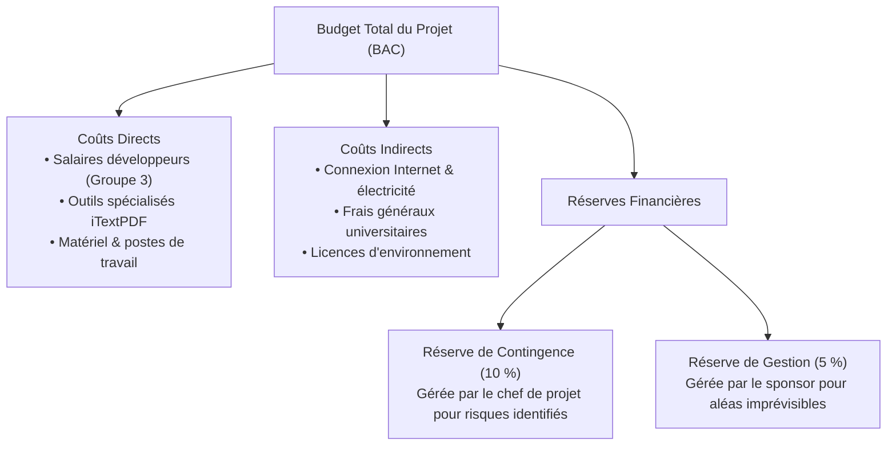
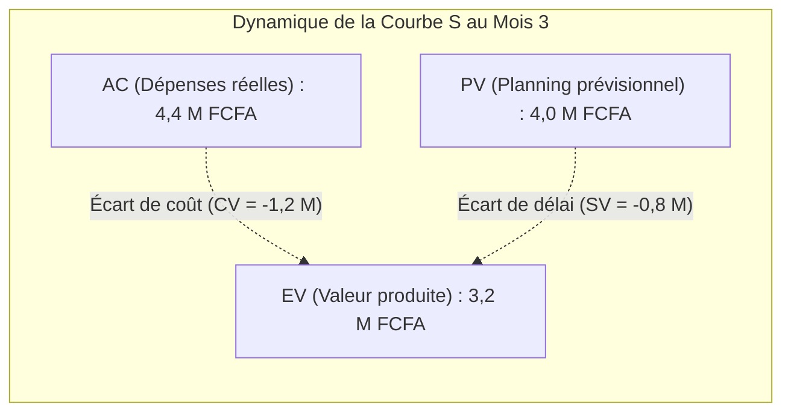

Thème 7 / 12

# Gestion des Coûts et du Budget

  Présenté par : <strong>Groupe 3</strong> (Eric Joel Manga, Assete Faye, Mouhamed Fam, Soxna, Ibrahima Diallo)
  Établissement : <strong>UASZ · UFR Sciences et Technologies · L3 Ingénierie Informatique</strong>
  Statut : <strong style="color:var(--ok);">Terminé</strong>

---

## Sommaire Numéroté

1. [Introduction : Pourquoi la maîtrise budgétaire pour CareerTrack ?](#_1-introduction-pourquoi-la-maitrise-budgetaire-pour-careertrack)
2. [Partie Théorique : Les Méthodes de Chiffrage et de Contrôle Financier](#_2-partie-theorique-les-methodes-de-chiffrage-et-de-controle-financier)
   - 2.1 Les techniques d'estimation des coûts : analogique, paramétrique et ascendante
   - 2.2 La structure de décomposition des coûts (CBS) et réserves financières
   - 2.3 Les principes fondamentaux de l'Earned Value Management (EVM)
   - 2.4 Les indicateurs d'efficacité et d'écart : CPI, SPI, CV et SV
   - 2.5 Les formules prédictives d'achèvement : EAC, ETC et VAC
3. [Partie Pratique : Simulation et Analyse d'une Dérive Budgétaire (EVM)](#_3-partie-pratique-simulation-et-analyse-d-une-derive-budgetaire-evm)
   - 3.1 Calcul exhaustif des grandeurs EVM sur un projet IT (en FCFA)
   - 3.2 Diagnostic des écarts et matrice de décisions correctives
   - 3.3 Modélisation temporelle de la Courbe en S (Baseline vs Réel)
4. [Application Concrète au Projet CareerTrack](#_4-application-concrete-au-projet-careertrack)
   - 4.1 Valorisation économique réelle du projet CareerTrack (CBS chiffré)
   - 4.2 Stratégie d'optimisation financière « Coût Réel Zéro »
5. [Conclusion et Perspectives](#_5-conclusion-et-perspectives)
6. [Sources de Référence](#_6-sources-de-reference)

---

## 1. Introduction : Pourquoi la maîtrise budgétaire pour CareerTrack ?

En gestion de projet informatique, le dépassement des coûts est l'une des causes premières d'abandon des systèmes d'information. Même lorsque les composants logiciels reposent sur des briques open source (Spring Boot, React, PostgreSQL) et des offres d'hébergement gratuites, **un projet n'est jamais gratuit** : il consomme du temps d'ingénierie hautement qualifié, des infrastructures de calcul, de l'électricité, des connexions réseau et de l'énergie humaine.

Comprendre la **gestion des coûts et du budget** permet au Groupe 3 de :
- Valoriser financièrement l'effort réel d'ingénierie fourni par les 5 étudiants sur les 37 jours ouvrés du projet.
- Maîtriser la méthodologie internationale de la **Valeur Acquise (EVM - Earned Value Management)**, standard universel de pilotage des contrats publics et privés.
- Quantifier avec précision les écarts budgétaires et temporels afin d'adopter des mesures correctives objectives avant toute dérive irréversible.

---

## 2. Partie Théorique : Les Méthodes de Chiffrage et de Contrôle Financier

### 2.1 Les techniques d'estimation des coûts

L'estimation financière d'un produit logiciel mobilise trois grandes familles méthodologiques :

| Méthode d'estimation | Principe technique | Précision constatée | Stade d'application optimal |
|---|---|:---:|---|
| **Estimation Analogique (Top-Down)** | Compare le projet à un projet antérieur similaire réalisé par l'équipe en appliquant un coefficient d'échelle. | Faible ($\pm 30$ %) | Phase de cadrage initial (Charte de projet), quand peu de détails sont connus. |
| **Estimation Paramétrique** | Applique un modèle statistique reliant un inducteur de coût à une grandeur mesurable (ex. Coût moyen par écran React ou par User Story). | Moyenne ($\pm 15$ %) | Phase de spécification générale une fois le périmètre macroscopique stabilisé. |
| **Estimation Ascendante (Bottom-Up)** | Estime unitairement le coût et la durée de chaque lot de travail du WBS, puis effectue la somme consolidée. | Élevée ($\pm 5$ %) | Phase de planification détaillée ; base indispensable pour établir la référence budgétaire (*Cost Baseline*). |

### 2.2 La structure de décomposition des coûts (CBS) et réserves financières

La **Structure de Décomposition des Coûts (CBS - Cost Breakdown Structure)** ventile le budget total en plusieurs catégories comptables étanches :

### 2.3 Les principes fondamentaux de l'Earned Value Management (EVM)

Normalisée par la norme américaine **ANSI/EIA-748** et le guide **PMBOK**, la méthode de la Valeur Acquise intègre simultanément le périmètre, le temps et le coût pour évaluer la santé d'un projet à une date d'état donnée (*Status Date*).

Elle repose sur quatre métriques financières fondamentales (exprimées ici en FCFA) :
- **Budget at Completion (BAC)** : enveloppe budgétaire totale prévisionnelle allouée au projet.
- **Planned Value (PV - Valeur Planifiée)** : budget du travail qui aurait dû être accompli à la date d'état selon le planning initial :
  $$PV = \text{Pourcentage prévu du travail} \times BAC$$
- **Earned Value (EV - Valeur Acquise)** : valeur budgétée du travail réellement accompli et validé à la date d'état selon les critères de terminaison :
  $$EV = \text{Pourcentage réellement réalisé} \times BAC$$
- **Actual Cost (AC - Coût Réel)** : montant financier effectivement dépensé et engagé pour exécuter le travail accompli.

### 2.4 Les indicateurs d'efficacité et d'écart

À partir de ces quatre grandeurs, le chef de projet calcule les écarts absolus et les indices relatifs de performance :

| Métrique | Formule formelle | Interprétation mathématique et seuil critique |
|---|:---:|---|
| **Cost Variance (CV)** | $$CV = EV - AC$$ | • $CV > 0$ : Économie budgétaire (favorable). • $CV < 0$ : Dépassement budgétaire (défavorable). |
| **Schedule Variance (SV)** | $$SV = EV - PV$$ | • $SV > 0$ : Avance sur le calendrier initial. • $SV < 0$ : Retard calendaire par rapport au plan. |
| **Cost Performance Index (CPI)** | $$CPI = \frac{EV}{AC}$$ | • $CPI > 1,0$ : Performance économique supérieure (chaque FCFA dépensé produit plus de 1 FCFA de valeur). • $CPI < 1,0$ : Surcoût d'exécution (défavorable). |
| **Schedule Performance Index (SPI)** | $$SPI = \frac{EV}{PV}$$ | • $SPI > 1,0$ : Rythme d'avancement supérieur aux prévisions. • $SPI < 1,0$ : Rythme d'avancement insuffisant (défavorable). |

### 2.5 Les formules prédictives d'achèvement

Lorsque des écarts apparaissent en cours de projet, l'EVM permet d'extrapoler mathématiquement l'atterrissage final :

- **Estimation à l'Achèvement (EAC - Estimate At Completion)** : projection du coût total final si la performance actuelle se poursuit :
  $$EAC = \frac{BAC}{CPI}$$
- **Estimation pour Achever (ETC - Estimate To Complete)** : montant restant à dépenser à partir de la date d'état pour terminer le projet :
  $$ETC = EAC - AC$$
- **Écart à l'Achèvement (VAC - Variance At Completion)** : excédent ou déficit financier prévisible lors de la clôture du projet :
  $$VAC = BAC - EAC$$
- **Indice de Performance pour Achever (TCPI - To-Complete Performance Index)** : efficacité économique que l'équipe doit obligatoirement atteindre sur le travail restant pour respecter le budget initial :
  $$TCPI = \frac{BAC - EV}{BAC - AC}$$

---

## 3. Partie Pratique : Simulation et Analyse d'une Dérive Budgétaire (EVM)

### 3.1 Calcul exhaustif des grandeurs EVM sur un projet IT (en FCFA)

Dans le cadre d'un audit de mi-parcours simulé d'un projet logiciel, les données financières constatées sont les suivantes :
- **Budget initial contractuel (BAC)** = **10 000 000 FCFA**
- **Valeur Planifiée à la date de revue (PV)** = **4 000 000 FCFA** (40 % du planning devait être réalisé)
- **Valeur Acquise constatée (EV)** = **3 200 000 FCFA** (seulement 32 % du produit est réellement validé)
- **Coût Réel engagé (AC)** = **4 400 000 FCFA** (dépenses effectives supérieures aux prévisions)

| Grandeur calculée | Formule de calcul | Valeur obtenue | Diagnostic rigoureux et lecture financière |
|:---:|:---:|:---:|---|
| **CV** | $EV - AC = 3\,200\,000 - 4\,400\,000$ | **$-1\,200\,000$ FCFA** | **Déficit budgétaire critique** : le projet a consommé 1,2 million de FCFA de plus que la valeur produite. |
| **SV** | $EV - PV = 3\,200\,000 - 4\,000\,000$ | **$-800\,000$ FCFA** | **Retard opérationnel** : l'équipe accuse un retard équivalent à 800 000 FCFA de travail non accompli. |
| **CPI** | $\frac{EV}{AC} = \frac{3\,200\,000}{4\,400\,000}$ | **0,73** | **Rendement financier médiocre** : chaque franc CFA engagé ne produit que 0,73 FCFA de valeur logicielle effective. |
| **SPI** | $\frac{EV}{PV} = \frac{3\,200\,000}{4\,000\,000}$ | **0,80** | **Rythme insuffisant** : l'équipe n'avance qu'à 80 % de la vitesse initialement planifiée. |
| **EAC** | $\frac{BAC}{CPI} = \frac{10\,000\,000}{0,72727}$ | **13 750 000 FCFA** | **Coût final prévisionnel catastrophique** : atterrissage final prévu à 13,75 millions au lieu des 10 millions. |
| **ETC** | $EAC - AC = 13\,750\,000 - 4\,400\,000$ | **9 350 000 FCFA** | **Reste à dépenser** : il faudra encore injecter 9,35 millions de FCFA pour finaliser le logiciel. |
| **VAC** | $BAC - EAC = 10\,000\,000 - 13\,750\,000$ | **$-3\,750\,000$ FCFA** | **Dépassement net projeté** : déficit final de 3,75 millions de FCFA si aucune correction n'est menée. |
| **TCPI** | $\frac{BAC - EV}{BAC - AC} = \frac{6\,800\,000}{5\,600\,000}$ | **1,21** | **Exigence irréaliste** : l'équipe devrait atteindre un CPI de 1,21 (+21 % de surproductivité) pour tenir le BAC. |

### 3.2 Diagnostic des écarts et matrice de décisions correctives

Face à ce double constat d'échec ($CPI = 0,73 < 1$ et $SPI = 0,80 < 1$), le chef de projet et le comité de pilotage disposent d'un arbre d'arbitrage méthodique :

| Constat d'écart | Causes racines probables identifiées | Décisions correctives recommandées |
|---|---|---|
| **$CPI = 0,73$ (Surcoût)** | Sous-estimation initiale de la complexité technique, turnover de développeurs, dette technique importante nécessitant des refactorisations non planifiées. | 1. **Réduction du périmètre (*Scope De-scoping*)** : transférer les User Stories non vitales (priorité Could/Won't) vers une version ultérieure. 2. **Renégociation budgétaire formelle** : demander une rallonge budgétaire au sponsor en s'appuyant sur l'EAC calculé. |
| **$SPI = 0,80$ (Retard)** | Goulots d'étranglement sur les validations client, dépendances externes non livrées à temps, blocages d'environnements de test. | 1. **Compression des délais par parallélisation (*Fast-Tracking*)** : lancer le développement frontend et backend en parallèle sur des mocks d'API. 2. **Renfort ciblé (*Crashing*)** : affecter des développeurs seniors supplémentaires sur les tâches du chemin critique. |

### 3.3 Modélisation temporelle de la Courbe en S (Baseline vs Réel)

La courbe en S illustre l'évolution cumulée des dépenses et de la valeur produite dans le temps (ici pour les 3 premiers mois d'exécution) :

| Mois d'avancement | Planned Value ($PV$) (millions FCFA) | Earned Value ($EV$) (millions FCFA) | Actual Cost ($AC$) (millions FCFA) | Situation relative |
|:---:|:---:|:---:|:---:|---|
| **Mois 1 (M1)** | 1,0 M FCFA | 0,8 M FCFA | 1,2 M FCFA | Léger surcoût initial lié à la phase de cadrage et aux formations. |
| **Mois 2 (M2)** | 2,5 M FCFA | 2,0 M FCFA | 3,0 M FCFA | Creusement de l'écart : le coût réel ($AC$) s'envole tandis que l'$EV$ décroche. |
| **Mois 3 (M3 - Audit)** | **4,0 M FCFA** | **3,2 M FCFA** | **4,4 M FCFA** | $AC > PV > EV$ : situation critique nécessitant un arbitrage immédiat du COPIL. |

---

## 4. Application Concrète au Projet CareerTrack

### 4.1 Valorisation économique réelle du projet CareerTrack (CBS chiffré)

Bien que CareerTrack ne nécessite aucun décaissement bancaire grâce à la gratuité des outils retenus, sa **valeur d'ingénierie économique réelle** est modélisée par le Groupe 3 selon la grille salariale locale d'une équipe de développement junior au Sénégal :

| Poste de coût (CBS) | Détail des hypothèses de calcul financier | Coût estimé (FCFA) | Pourcentage du budget |
|---|---|:---:|:---:|
| **Main-d'œuvre Ingénierie (Groupe 3)** | 5 étudiants-ingénieurs $\times$ 37 jours ouvrés = **185 jours/homme** valorisés au tarif journalier junior sénégalais de **25 000 FCFA / jour**. | **4 625 000 FCFA** | **78,4 %** |
| **Postes de travail & Matériel informatique** | Amortissement de 5 ordinateurs portables sur la durée du projet (8 semaines) : $5 \times 30\,000$ FCFA. | **150 000 FCFA** | **2,5 %** |
| **Environnements Cloud & Hébergement** | Offre Cloud Render (Backend Spring) + Vercel (Frontend React) + Supabase (PostgreSQL managé) : **Offres gratuites**. | **0 FCFA** | **0,0 %** |
| **Outils & Licences de développement** | Visual Studio Code, IntelliJ Community, Git/GitHub, Postman, iTextPDF (Licence AGPL Community) : **0 FCFA**. | **0 FCFA** | **0,0 %** |
| **Connectivité & Énergie campus** | Forfaits 4G de secours et électricité sur le campus de l'UASZ (5 membres $\times$ 20 000 FCFA). | **100 000 FCFA** | **1,7 %** |
| **Réserve de contingence (10 %)** | Provision obligatoire pour aléas techniques et prolongation de tests ($10 \text{ \%} \times 4\,875\,000$). | **487 500 FCFA** | **8,3 %** |
| **Réserve de gestion (Direction - 10 %)** | Marge de sécurité pour modifications fonctionnelles majeures ou certifications. | **536 250 FCFA** | **9,1 %** |
| **BUDGET GLOBAL TOTAL (BAC)** | **Valorisation financière complète du projet CareerTrack** | **5 898 750 FCFA** | **100,0 %** |

### 4.2 Stratégie d'optimisation financière « Coût Réel Zéro »

Pour une PME sénégalaise cliente, l'acquisition de CareerTrack représente une économie colossale face aux progiciels de paie internationaux du marché (SAP SuccessFactors ou Workday, dont le coût annuel dépasse 15 à 30 millions de FCFA) :
1. **Zéro coût de licence récurrent** : exploitation exclusive de composants sous licences permissives (Apache 2.0 pour Spring Boot et React, PostgreSQL Global Development Group).
2. **Dimensionnement cloud frugal** : architecture conçue pour fonctionner avec une mémoire vive minimale (moins de 512 Mo de RAM pour l'API Spring Boot grâce à une compilation optimisée), permettant de rester dans les quotas gratuits des hébergeurs PaaS modernes.
3. **Retour sur investissement immédiat (ROI)** : le gain de productivité administrative (calcul instantané des soldes de congés, suppression de l'archivage papier) rembourse l'intégration logicielle en moins de 3 mois d'exploitation.

---

## 5. Conclusion et Perspectives

La gestion des coûts et l'application méthodique de l'**Earned Value Management** transforment la perception de l'ingénierie logicielle : le code produit n'est plus seulement une entité abstraite, mais une valeur économique mesurable face aux ressources consommées.

**Ce que ce thème apporte à CareerTrack :**
- Une valorisation financière rigoureuse de notre travail estimée à près de **5,9 millions de FCFA**.
- La maîtrise des formules mathématiques internationales de surveillance de la performance ($CPI$, $SPI$, $EAC$).
- Un modèle économique frugal et ultra-compétitif adapté aux réalités des PME sénégalaises.

**Prochaine étape :**
Gérer et motiver l'équipe humaine qui produit cette valeur à travers le [Thème 8 : Gestion des Ressources Humaines et Leadership](/theme-08).

> **Phrase de synthèse :** *« Maîtriser le budget d'un projet logiciel, c'est savoir mesurer à chaque instant si chaque unité de temps et d'argent investie génère la juste valeur attendue par les utilisateurs et les commanditaires. »*

---

## 6. Sources de Référence

1. **Project Management Institute (PMI)**, *Practice Standard for Earned Value Management*, 3ème édition, PMI, Newtown Square, PA, 2019.
2. **National Defense Industrial Association (NDIA)**, *ANSI/EIA-748-D: Earned Value Management Systems Standard*, Arlington, VA, 2018.
3. **Quentin W. Fleming & Joel M. Koppelman**, *Earned Value Project Management*, 4ème édition, Project Management Institute, 2010.
4. **Steve McConnell**, *Software Estimation: Demystifying the Black Art*, Microsoft Press, Redmond, WA, 2006.

---

  <a href="/theme-06">&larr; Thème 6 : Gestion des Risques</a>
  <a href="/theme-08">Thème 8 : RH & Leadership &rarr;</a>

