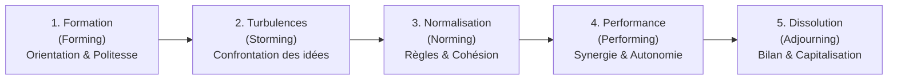
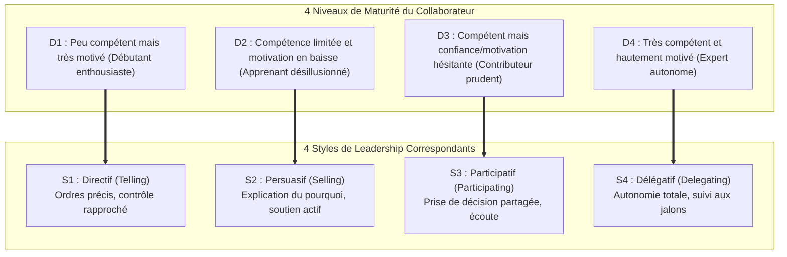

Thème 8 / 12

# Gestion des Ressources Humaines et Leadership

  Présenté par : <strong>Groupe 3</strong> (Eric Joel Manga, Assete Faye, Mouhamed Fam, Aminatou Touré, Ibrahima Diallo)
  Établissement : <strong>UASZ · UFR Sciences et Technologies · L3 Ingénierie Informatique</strong>
  Statut : <strong style="color:var(--ok);">Terminé</strong>

---

## Sommaire Numéroté

1. [Introduction : Pourquoi les compétences humaines pour CareerTrack ?](#_1-introduction-pourquoi-les-competences-humaines-pour-careertrack)
2. [Partie Théorique : Les Modèles Psycho-Organisationnels](#_2-partie-theorique-les-modèles-psycho-organisationnels)
   - 2.1 Le cycle de développement d'une équipe selon Bruce Tuckman
   - 2.2 La matrice des responsabilités RACI : principes et règles d'or
   - 2.3 Le leadership situationnel de Hersey & Blanchard (Styles S1 à S4)
   - 2.4 La gestion constructive des conflits : le modèle de Thomas-Kilmann
   - 2.5 Les théories fondamentales de la motivation : Maslow, Herzberg et McGregor
3. [Partie Pratique : Outils et Simulations Managériales](#_3-partie-pratique-outils-et-simulations-manageriales)
   - 3.1 Étude de cas et résolution de conflit : L'arbitrage architectural
   - 3.2 Matrice RACI opérationnelle avec les vrais membres du Groupe 3
   - 3.3 Diagnostic managérial selon le modèle de Hersey & Blanchard
   - 3.4 Plan de développement d'équipe adapté aux phases de Tuckman
4. [Application Concrète au Projet CareerTrack](#_4-application-concrete-au-projet-careertrack)
   - 4.1 Répartition opérationnelle des responsabilités au sein du Groupe 3
   - 4.2 Climat de travail, rituels d'entraide et cohésion d'équipe
5. [Conclusion et Perspectives](#_5-conclusion-et-perspectives)
6. [Sources de Référence](#_6-sources-de-reference)

---

## 1. Introduction : Pourquoi les compétences humaines pour CareerTrack ?

En génie logiciel, on a coutume de dire que *« les ordinateurs obéissent aux instructions, mais ce sont les êtres humains qui conçoivent les systèmes »*. Le développement de **CareerTrack** n'est pas uniquement un défi d'intégration technique entre Spring Boot et React : c'est avant tout une aventure collective menée par cinq étudiants de Licence 3 aux sensibilités, compétences et rythmes de travail complémentaires.

La maîtrise de la **gestion des ressources humaines et du leadership** permet au Groupe 3 de :
- Clarifier univoquement les responsabilités de chacun via une matrice RACI pour éliminer les zones d'ombre et les doublons d'effort.
- Résoudre méthodiquement les inévitables désaccords techniques (choix d'architecture, modélisation de base de données) sans altérer la cohésion humaine.
- Adapter le style de leadership aux différentes phases du projet afin de maintenir une motivation et un engagement sans faille jusqu'à la soutenance finale.

---

## 2. Partie Théorique : Les Modèles Psycho-Organisationnels

### 2.1 Le cycle de développement d'une équipe selon Bruce Tuckman

Modélisé par le psychologue **Bruce Tuckman en 1965** (complété en 1977), ce modèle démontre que toute équipe traverse obligatoirement cinq stades successifs avant d'atteindre son plein potentiel :

- **1. Formation (*Forming*)** : Les membres font connaissance, définissent les contours du projet avec réserve et cherchent des repères d'autorité.
- **2. Turbulences (*Storming*)** : Des frictions apparaissent sur les choix techniques, les méthodes de travail et le leadership. Phase normale et salutaire si elle est accompagnée.
- **3. Normalisation (*Norming*)** : L'équipe adopte des règles de vie communes (conventions Git, ponctualité aux réunions, rituels agiles).
- **4. Performance (*Performing*)** : La confiance est établie. L'équipe fonctionne en fluidité, s'auto-organise et résout les problèmes complexes en autonomie.
- **5. Dissolution (*Adjourning*)** : Clôture du projet, célébration des réussites et capitalisation des apprentissages.

### 2.2 La matrice des responsabilités RACI : principes et règles d'or

La matrice **RACI** est l'outil universel de clarification des rôles au sein d'un projet :

| Lettre | Rôle | Définition précise et engagement attendu |
|:---:|---|---|
| **R** | **Responsible (Réalisateur)** | Celui ou celle qui effectue concrètement le travail technique pour accomplir l'activité. |
| **A** | **Accountable (Approbateur / Décideur)** | L'unique personne qui valide le résultat et porte la responsabilité finale de la livraison devant le client/jury. |
| **C** | **Consulted (Consulté)** | Expert ou partie prenante sollicitée pour son avis bidirectionnel avant ou pendant la réalisation. |
| **I** | **Informed (Informé)** | Personne tenue au courant de l'avancement ou des décisions prises, par communication unidirectionnelle. |

> **Les deux règles d'or de la matrice RACI :**
> 1. *Il doit y avoir un et un seul **A** par ligne (activité)* : si la responsabilité finale est partagée, personne n'est véritablement responsable.
> 2. *Chaque ligne doit comporter au moins un **R*** : une activité sans réalisateur reste un vœu pieux.

### 2.3 Le leadership situationnel de Hersey & Blanchard

Développé par **Paul Hersey et Ken Blanchard**, ce modèle postule qu'il n'existe pas de « bon » style de leadership dans l'absolu, mais que le leader doit adapter son comportement au niveau de maturité professionnelle et d'autonomie du collaborateur face à une tâche spécifique :

### 2.4 La gestion des conflits : modèle Thomas-Kilmann

L'instrument de gestion des conflits de **Kenneth Thomas et Ralph Kilmann (TKI)** positionne les réactions face aux désaccords selon deux axes comportementaux : l'**assertivité** (capacité à faire valoir ses intérêts) et la **coopération** (volonté de satisfaire les intérêts d'autrui) :

| Mode de résolution | Assertivité | Coopération | Philosophie d'action | Quand l'utiliser en ingénierie logicielle |
|---|:---:|:---:|---|---|
| **Compétition (*Competing*)** | **Forte** | Faible | *« Je gagne, tu perds »* | Décision d'urgence vitale (ex. faille de sécurité critique à combler sans délai). |
| **Accommodation (*Accommodating*)** | Faible | **Forte** | *« Tu gagnes, je m'incline »* | Choix d'ordre cosmétique ou lorsque l'enjeu compte bien plus pour l'autre membre. |
| **Évitement (*Avoiding*)** | Faible | Faible | *« On verra plus tard »* | Tension passagère sur un point non bloquant, afin de laisser retomber l'émotion. |
| **Compromis (*Compromising*)** | Moyenne | Moyenne | *« Chacun cède la moitié »* | Solution rapide face à une contrainte de temps stricte (Sprint planning serré). |
| **Collaboration (*Collaborating*)** | **Forte** | **Forte** | *« Gagnant-Gagnant (Win-Win) »* | **Mode privilégié** : recherche conjointe d'une solution créative résolvant l'ensemble des contraintes techniques. |

### 2.5 Les théories fondamentales de la motivation

- **Hiérarchie des besoins de Maslow** : un développeur ne peut s'accomplir créativement (besoin d'accomplissement) si ses conditions matérielles de base (électricité, PC fonctionnel, sentiment de sécurité dans le groupe) ne sont pas satisfaites.
- **Théorie bi-factorielle d'Herzberg** : distingue les *facteurs d'hygiène* (qui éliminent l'insatisfaction : matériel convenable, respect mutuel) des *facteurs moteurs intrinsèques* (qui créent la véritable motivation : autonomie, intérêt intellectuel du code, reconnaissance des pairs).
- **Théories X et Y de Douglas McGregor** : rejeter la théorie X (supposant que l'équipier est paresseux et doit être surveillé en permanence) au profit de la **théorie Y**, postulant que l'ingénieur s'épanouit dans l'autonomie, l'auto-direction et la responsabilité partagée.

---

## 3. Partie Pratique : Outils et Simulations Managériales

### 3.1 Étude de cas et résolution de conflit : L'arbitrage architectural

Dans le cadre du développement de CareerTrack, une divergence d'ingénierie majeure est survenue entre deux membres du Groupe 3 :

| Élément de l'analyse | Contenu documenté du cas réel d'arbitrage |
|---|---|
| **Situation conflictuelle** | Désaccord tranché sur la stratégie de sécurisation des sessions utilisateurs : un membre préconisait une gestion d'état centralisée par cookies de session HTTP Stateful, tandis qu'un second exigeait des jetons JWT Stateless signés HMAC-SHA256. |
| **Acteurs en présence** | Développeur Backend A (favorable aux sessions classiques simples), Développeur Backend B (favorable au JWT moderne décentralisé), et le Lead Technique en médiateur. |
| **Mode Thomas-Kilmann mobilisé** | **Mode Collaboration (*Collaborating*)** : refus du passage en force autoritaire (Compétition) ou de l'abandon frustrant (Accommodation). |
| **Déroulement de la médiation** | Organisation d'un atelier technique de 45 minutes : confrontation objective des contraintes de la charte (exigence du mode offline partiel et API REST OpenAPI). Les sessions stateful empêchaient l'utilisation hors-ligne et saturaient la mémoire vive du serveur gratuit Render. |
| **Résolution obtenue et consensus** | Choix unanime du standard **JWT Stateless**, complété par une mise en cache locale des profils utilisateurs dans IndexedDB pour le mode hors-ligne. Les deux développeurs ont co-rédigé le filtre de sécurité Spring Security sans rancœur. |

### 3.2 Matrice RACI opérationnelle avec les vrais membres du Groupe 3

Le tableau ci-dessous formalise la répartition univoque des responsabilités pour l'ensemble des macro-activités du projet CareerTrack :

| Activités d'ingénierie logicielle | Eric Joel Manga | Assete Faye | Mouhamed Fam | Aminatou Touré | Ibrahima Diallo |
|---|:---:|:---:|:---:|:---:|:---:|
| **1. Cadrage & Charte de projet** | C | C | **A** | C | R |
| **2. Modélisation relationnelle PostgreSQL** | **A** | I | R | C | C |
| **3. Architecture Spring Boot & Sécurité JWT** | R | I | I | C | **A** |
| **4. Développement des interfaces React Mobile** | C | R | I | **A** | C |
| **5. Module Congés & Absences (Code du Travail)** | **A** | C | R | C | I |
| **6. Module Évaluations SMART & iTextPDF** | R | C | I | **A** | R |
| **7. Pipeline Kanban Recrutement & Formations** | I | R | I | C | **A** |
| **8. Stratégie de Tests Automatisés (≥ 60 %)** | C | **A** | I | C | R |
| **9. Déploiement Cloud & Intégration Continue** | I | I | R | I | **A** |
| **10. Rapport de Clôture & Préparation Soutenance** | C | C | C | C | **A** |

*Légende officielle : **R** = Réalise (Responsible) · **A** = Approuve / Décide (Accountable - unique par ligne) · **C** = Consulté · **I** = Informé.*

### 3.3 Diagnostic managérial selon le modèle de Hersey & Blanchard

| Activité confiée | Équipier(s) concerné(s) | Niveau de maturité constaté | Style de leadership appliqué | Justification de l'action managériale |
|---|---|:---:|:---:|---|
| **Intégration d'iTextPDF** | Équipier abordant la bibliothèque pour la première fois | **D1** (Motivé, compétence débutante) | **S1 : Directif (*Telling*)** | Fourniture d'un tutoriel pas-à-pas, définition stricte du format du tableau PDF et revue quotidienne du code. |
| **Configuration Docker / Cloud Render** | Équipier confronté à des erreurs de déploiement répétées | **D2** (Compétence moyenne, baisse de moral) | **S2 : Persuasif (*Selling*)** | Explication approfondie des erreurs de build, valorisation des progrès accomplis et binôme ponctuel (*Pair Programming*). |
| **Création des composants graphiques React** | Équipier maîtrisant React mais hésitant sur l'ergonomie mobile | **D3** (Compétent, confiance fluctuante) | **S3 : Participatif (*Participating*)** | Co-conception des maquettes lors de revues ergonomiques, valorisation de ses propositions de design. |
| **Modélisation relationnelle SQL** | Équipier expert en bases de données relationnelles | **D4** (Expert, autonome et motivé) | **S4 : Délégatif (*Delegating*)** | Carte blanche sur la normalisation en 3ème forme normale (3NF) et simple validation des scripts Flyway. |

### 3.4 Plan de développement d'équipe adapté aux phases de Tuckman

| Phase de Tuckman | Actions concrètes déployées par le Groupe 3 | Résultat opérationnel mesuré |
|---|---|---|
| **Formation (*Forming*)** | Réunion de cadrage initiale, formalisation de la charte de fonctionnement et création du canal Discord/WhatsApp. | Partage d'une vision commune et clarification des compétences individuelles. |
| **Turbulences (*Storming*)** | Définition conjointe des conventions de nommage Git, grille d'arbitrage Thomas-Kilmann et rituels quotidiens de 15 minutes. | Désamorçage immédiat des tensions d'architecture et renforcement de l'écoute mutuelle. |
| **Normalisation (*Norming*)** | Automatisation des revues de code (Pull Requests avec validation par au moins un pair) et Definition of Done partagée. | Fluidité du travail collaboratif et respect systématique des standards de qualité logicielle. |
| **Performance (*Performing*)** | Auto-organisation complète des sprints Scrum, soutien spontané entre membres et maintien d'une vélocité de 20 à 25 points. | Livraison des 15 User Stories dans les délais impartis avec une sérénité maximale. |

---

## 4. Application Concrète au Projet CareerTrack

### 4.1 Répartition opérationnelle des responsabilités au sein du Groupe 3

Sur **CareerTrack**, chaque membre du Groupe 3 a apporté sa valeur ajoutée sans chevauchement :
- **Eric Joel Manga** : Référent de la modélisation des données relationnelles PostgreSQL et du moteur de persistance des dossiers employés et congés légaux.
- **Assete Faye** : Garante de l'assurance qualité logicielle, autrice de la suite de tests automatisés JUnit/Mockito et auditrice des critères d'acceptation.
- **Mouhamed Fam** : Pilote de la planification prédictive, de l'ordonnancement PERT/Gantt et de la surveillance budgétaire EVM.
- **Aminatou Touré** : Product Owner, responsable de l'ergonomie de l'interface React mobile-first et du parcours collaborateur pour l'évaluation annuelle.
- **Ibrahima Diallo** : Coordinateur technique global, garant de la sécurité Spring Security JWT et de l'intégration continue GitHub Actions.

### 4.2 Climat de travail, rituels d'entraide et cohésion d'équipe

Pour maintenir un niveau d'engagement élevé tout au long des 8 semaines universitaires, le Groupe 3 a instauré des pratiques saines :
- **Le « Daily Stand-up » biquotidien** : synchronisation courte de 15 minutes chaque matinée de projet pour identifier immédiatement les blocages (*impediments*).
- **La règle du « Stop à 30 minutes »** : si un développeur reste bloqué plus d'une demi-heure sur un bogue technique (erreur Hibernate ou CSS), il a l'obligation formelle de solliciter un camarade pour résoudre le problème en binôme.
- **La célébration collective des jalons** : après chaque fin de sprint réussie, l'équipe partage un moment de convivialité pour fêter les User Stories closes.

---

## 5. Conclusion et Perspectives

Les compétences humaines et le leadership partagé ont constitué le véritable moteur de la réussite de CareerTrack. Aucune méthodologie prédictive ou agile ne peut compenser une défaillance humaine : c'est la **confiance mutuelle, la clarté des rôles (RACI) et la résolution bienveillante des conflits** qui ont permis au Groupe 3 de transformer un projet d'études en un système d'information professionnel.

**Ce que ce thème apporte à CareerTrack :**
- Une matrice RACI sans équivoque attribuant chaque brique logicielle à un responsable dédié.
- Un climat d'émulation intellectuelle et de respect mutuel tout au long du semestre.
- Une expérience concrète du travail d'ingénieur en équipe pluridisciplinaire.

**Prochaine étape :**
Canaliser l'information vers les parties prenantes et piloter l'avancement à travers le [Thème 9 : Communication et Reporting Projet](/theme-09).

> **Phrase de synthèse :** *« Le secret d'un projet informatique réussi ne réside pas dans l'absence de conflits, mais dans la capacité d'une équipe soudée à transformer chaque divergence technique en une opportunité d'excellence collective. »*

---

## 6. Sources de Référence

1. **Bruce W. Tuckman**, *Developmental sequence in small groups*, Psychological Bulletin, vol. 63, n° 6, 1965, p. 384-399.
2. **Paul Hersey & Kenneth H. Blanchard**, *Management of Organizational Behavior: Utilizing Human Resources*, Prentice Hall, Englewood Cliffs, NJ, 6ème édition, 1993.
3. **Kenneth W. Thomas & Ralph H. Kilmann**, *Thomas-Kilmann Conflict Mode Instrument (TKI)*, Xicom Inc., Tuxedo, NY, 1974.
4. **Frederick Herzberg**, *One More Time: How Do You Motivate Employees?*, Harvard Business Review, Best of HBR Classic, 2003.

---

  <a href="/theme-07">&larr; Thème 7 : Coûts & Budget</a>
  <a href="/theme-09">Thème 9 : Communication & Reporting &rarr;</a>

