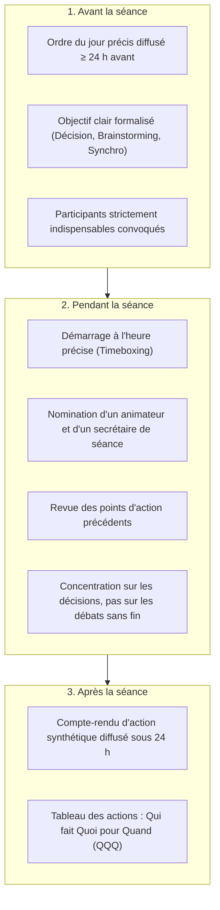
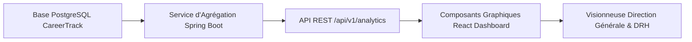

Thème 9 / 12

# Communication et Reporting Projet

  Présenté par : <strong>Groupe 3</strong> (Eric Joel Manga, Assete Faye, Mouhamed Fam, Aminatou Touré, Ibrahima Diallo)
  Établissement : <strong>UASZ · UFR Sciences et Technologies · L3 Ingénierie Informatique</strong>
  Statut : <strong style="color:var(--ok);">Terminé</strong>

---

## Sommaire Numéroté

1. [Introduction : Pourquoi la communication et le reporting pour CareerTrack ?](#_1-introduction-pourquoi-la-communication-et-le-reporting-pour-careertrack)
2. [Partie Théorique : Les Canaux et Outils de la Communication Projet](#_2-partie-theorique-les-canaux-et-outils-de-la-communication-projet)
   - 2.1 Théorie de l'information et matrice de communication projet
   - 2.2 Typologie des rapports de pilotage : avancement, risques, budget, qualité
   - 2.3 Méthodologie d'animation des réunions efficaces et comptes-rendus d'action
   - 2.4 Gestion proactive des attentes et stratégie face aux mauvaises nouvelles
   - 2.5 Écosystème des outils collaboratifs modernes et dashboards
3. [Partie Pratique : Dispositif de Pilotage et de Gouvernance](#_3-partie-pratique-dispositif-de-pilotage-et-de-gouvernance)
   - 3.1 Tableau de bord de pilotage exécutif du projet (KPIs)
   - 3.2 Rapport d'avancement hebdomadaire formalisé (Semaine S5)
   - 3.3 Simulation et compte-rendu d'un Comité de Pilotage (COPIL)
   - 3.4 Matrice complète du Plan de Communication projet
4. [Application Concrète au Projet CareerTrack](#_4-application-concrete-au-projet-careertrack)
   - 4.1 Le module Tableaux de Bord RH de CareerTrack (US-12)
   - 4.2 Architecture de diffusion et transparence de l'équipe étudiante
5. [Conclusion et Perspectives](#_5-conclusion-et-perspectives)
6. [Sources de Référence](#_6-sources-de-reference)

---

## 1. Introduction : Pourquoi la communication et le reporting pour CareerTrack ?

Selon les études du **Project Management Institute (PMI)**, plus de 75 % des échecs de projets informatiques sont directement imputables à des ruptures de communication : incompréhension des attentes métiers, rétention involontaire d'informations techniques, absence de visibilité sur les retards ou réunions improductives.

Pour **CareerTrack**, structurer la communication et le reporting répond à un double enjeu :
- **Un enjeu de gouvernance interne au Groupe 3** : synchroniser en continu cinq étudiants travaillant sur des modules complémentaires (Spring Boot, React, iTextPDF, PostgreSQL) pour garantir l'interopérabilité des composants.
- **Un enjeu de transparence externe** : rassurer les enseignants-évaluateurs de l'UASZ et les tuteurs grâce à des indicateurs d'avancement objectifs (KPIs), tout en concevant pour CareerTrack un module métier dédié au reporting RH d'entreprise.

---

## 2. Partie Théorique : Les Canaux et Outils de la Communication Projet

### 2.1 Théorie de l'information et matrice de communication projet

Le modèle classique de **Shannon et Weaver (1949)** illustre le parcours de l'information : un émetteur encode un message, le transmet via un canal à un récepteur qui le décode, sous l'influence constante de « bruits » parasites (ambiguïtés de vocabulaire technique, présupposés, surcharge cognitive).

En gestion de projet, le nombre de canaux potentiels de communication croît de façon exponentielle avec la taille de l'équipe selon la formule : **N = n × (n − 1) / 2**.
Pour notre équipe de **n = 5** membres, il existe **5 × 4 / 2 = 10 canaux directs**. Sans formalisation rigoureuse, les discussions éclatent sur des canaux parallèles non tracés.

Le **Plan de Communication** documente formellement pour chaque message : l'émetteur, le destinataire, l'objectif, le support de diffusion, la fréquence et le mode de rétroaction (*feedback loop*).

### 2.2 Typologie des rapports de pilotage

Un reporting efficace ne consiste pas à noyer les parties prenantes sous des détails superflus, mais à fournir l'information synthétique adaptée au niveau de décision du destinataire :

| Type de Rapport | Périodicité | Contenu informatif clé | Destinataires cibles |
|---|:---:|---|---|
| **Rapport d'Avancement (*Progress Report*)** | Hebdomadaire | Réalisations de la semaine, planning prévisionnel de la semaine suivante, jalons atteints. | Sponsor, Tuteur académique, Équipe |
| **Rapport des Risques (*Risk Report*)** | Bimensuel | Registre des risques actualisé ($P \times I$), alertes déclenchées (*triggers*), plans de contingence activés. | Comité de Pilotage (COPIL), Lead Tech |
| **Rapport Budgétaire & EVM** | Mensuel | Métriques de valeur acquise ($PV, EV, AC$), indices de performance ($CPI, SPI$), atterrissage ($EAC$). | Direction financière, Commanditaire |
| **Rapport Qualité & Anomalies** | À chaque fin de sprint | Taux de couverture de tests automatisés (≥ 60 %), nombre de bugs ouverts par sévérité, temps de résolution. | Product Owner, Équipe de développement |

### 2.3 Méthodologie d'animation des réunions efficaces

Pour éliminer la « réunionite » stérile, toute réunion au sein du Groupe 3 obéit à la règle stricte des **trois temps** :

### 2.4 Gestion proactive des attentes et stratégie face aux mauvaises nouvelles

La règle d'or de la gouvernance de projet est : **« Pas de mauvaise surprise en comité » (*No surprise rule*)**.

Lorsqu'un aléa technique majeur survient (ex. retard sur un composant critique ou bogue bloquant) :
1. **Ne jamais dissimuler le problème** dans l'espoir de le résoudre discrètement : le retard accumulé devient exponentiel.
2. **Annoncer immédiatement la situation** aux décideurs avec transparence, sans dramatisation ni excuse subjective.
3. **Venir avec des options de solutions chiffrées** : présenter systématiquement 2 à 3 alternatives concrètes d'arbitrage (ex. *Option A : réduire temporairement les animations du frontend ; Option B : reporter l'export Excel au sprint suivant*).

### 2.5 Écosystème des outils collaboratifs modernes

Le Groupe 3 exploite une suite outillée intégrée et interopérable :
- **GitHub Projects / Issues** : traçabilité unitaire des User Stories, gestion des bugs et revues de code via les Pull Requests.
- **Discord & WhatsApp Groupe 3** : canal temps réel pour les alertes urgentes et les échanges informels rapides.
- **OpenAPI / Swagger UI** : contrat d'interface vivant entre le frontend React et le backend Spring Boot.
- **VitePress** : documentation centralisée, versionnée et déployée automatiquement pour le portfolio académique.

---

## 3. Partie Pratique : Dispositif de Pilotage et de Gouvernance

### 3.1 Tableau de bord de pilotage exécutif du projet (KPIs)

Le tableau de bord ci-dessous synthétise la santé globale de CareerTrack à l'issue du Sprint 2 :

  

    
Avancement global

    
58,5 %

    
48 / 82 pts réalisés (cible : 55 %)

  

  

    
Vélocité moyenne

    
24 pts

    
cible : 20 à 25 pts / sprint

  

  

    
Tests unitaires & intégr.

    
74,2 %

    
couverture (exigence ≥ 60 %)

  

  

    
Risques actifs ouverts

    
4

    
1 risque sous haute surveillance

  

  <em>Interprétation : Tous les voyants de production logicielle et de qualité sont au vert. Le risque sous surveillance concerne le temps de réveil du serveur Render lors des soutenances orales.</em>

### 3.2 Rapport d'avancement hebdomadaire formalisé (Semaine S5)

| Rubrique officielle | Contenu du rapport d'avancement — Semaine S5 (Mi-projet) |
|---|---|
| **Période & Rédacteur** | Semaine 5 · Rédigé par Ibrahima Diallo (Lead Tech) · Validé par le Groupe 3. |
| **Travaux accomplis cette semaine (Done)** | 1. **US-05 validée** : création des formulaires d'évaluation annuelle avec critères SMART. 2. **US-07 validée** : génération dynamique des comptes-rendus PDF signables avec iTextPDF. 3. Finalisation des tests d'intégration du workflow d'approbation des congés payés. |
| **Travaux engagés pour la semaine S6 (Next)** | 1. Démarrage de l'**US-11** : tableau Kanban interactif pour le pipeline de recrutement. 2. Implémentation du catalogue de formation (**US-08** et **US-09**). |
| **Points de blocage résolus** | Correction d'un problème d'alignement des colonnes du tableau des objectifs dans le PDF généré via iTextPDF. Résolu en migrant vers un composant `Table` avec largeurs relatives en pourcentages. |
| **Nouveaux risques détectés** | Risque de dépassement de mémoire vive du conteneur gratuit Render lors de la génération simultanée de plusieurs PDF lourds. Atténuation : libération explicite des flux mémoires Java et garbage collection optimisée. |
| **Décisions soumises à arbitrage** | Confirmation de la limitation du pipeline de recrutement à 5 colonnes pour préserver l'ergonomie mobile tactile. Validé par le Product Owner. |

### 3.3 Simulation et compte-rendu d'un Comité de Pilotage (COPIL)

| Séquence de la réunion | Durée | Animateur | Contenu abordé et décisions actées |
|---|:---:|---|---|
| **1. Tour de table & Objectifs** | 5 min | Mouhamed Fam | Rappel de l'ordre du jour : validation du socle d'évaluation et examen du calendrier du Sprint 3. |
| **2. Démonstration de l'incrément** | 10 min | Aminatou Touré (PO) | Démonstration en direct du parcours d'un manager validant une évaluation et générant le compte-rendu PDF iTextPDF émargé. |
| **3. Revue des métriques (EVM & Qualité)** | 5 min | Eric Joel Manga | Présentation des indicateurs : couverture de code à **74,2 %**, respect du calendrier ($SPI = 1,02$). |
| **4. Décisions stratégiques** | 5 min | Jury / Tuteur | **Validation formelle du jalon M2 (Socle RH opérationnel)**. Autorisation d'engager le Sprint 3 dédié au recrutement Kanban. |
| **5. Plan d'actions immédiat** | 5 min | Assete Faye | Synthèse des actions à livrer pour la semaine suivante : spécification des routes OpenAPI du recrutement. |

### 3.4 Matrice complète du Plan de Communication projet

| Cible / Public | Message véhiculé | Canal de diffusion | Périodicité | Responsable émetteur | Format & Livrable |
|---|---|---|---|---|---|
| **Équipe de développement (Groupe 3)** | Tâches du jour, obstacles techniques, synchronisation du code. | Réunion physique campus / Discord | Quotidien (Daily 15 min) | Scrum Master (Ibrahima Diallo) | Verbal debout + Tableau Kanban à jour |
| **Enseignant responsable (M. Khalifa GAYE)** | Avancement des sprints, respect du cahier des charges, PV de jalons. | E-mail universitaire + Dépôt GitHub | Hebdomadaire (Vendredi) | Chef de Projet (Mouhamed Fam) | Rapport d'avancement PDF synthétique |
| **Jury d'évaluation UASZ** | Maîtrise méthodologique, démonstration live, portfolio des 12 thèmes. | Présentation présentielle avec vidéoprojecteur | Jalon final (Soutenance) | Tout le Groupe 3 | Support de présentation 10 min + Démo live |
| **PME utilisatrices partenaires** | Découverte des fonctionnalités, recueil des avis d'ergonomie RH. | Sessions d'ateliers démo en visioconférence | Fin de chaque Sprint (bimensuel) | Product Owner (Aminatou Touré) | Démonstration sur environnement démo web |

---

## 4. Application Concrète au Projet CareerTrack

### 4.1 Le module Tableaux de Bord RH de CareerTrack (US-12)

Le reporting n'est pas seulement un outil de gestion pour notre équipe : c'est une **fonctionnalité métier majeure de CareerTrack** conçue pour la Direction et les DRH des PME sénégalaises.

Le module **US-12 (Tableaux de bord RH)** restitue quatre indicateurs stratégiques en temps réel :
1. **Pyramide des âges et ancienneté** : répartition démographique des effectifs pour anticiper les départs à la retraite et le renouvellement des compétences.
2. **Taux de rotation du personnel (*Turnover*)** : ratio des départs sur l'effectif moyen, permettant de mesurer le climat social de l'entreprise.
3. **Taux d'absentéisme global** : volume de jours d'absence non programmée par département, alertant sur les surcharges de travail.
4. **Masse salariale et revalorisations** : suivi consolidé de l'impact financier des augmentations et des nouvelles embauches.

### 4.2 Architecture de diffusion et transparence de l'équipe étudiante

Afin de garantir une traçabilité totale sans dépendance humaine :
- Chaque commit sur la branche `develop` déclenche automatiquement un workflow GitHub Actions qui compile l'application, exécute l'ensemble des tests JUnit et publie le rapport de couverture JaCoCo.
- En cas d'échec de compilation ou de régression sur les tests, une alerte webhook automatique est instantanément notifiée sur le canal Discord du Groupe 3, empêchant toute régression silencieuse.

---

## 5. Conclusion et Perspectives

La communication n'est pas un accessoire facultatif qui s'ajoute au développement : elle constitue le **système nerveux du projet informatique**. En combinant des rituels réguliers, des rapports synthétiques sans jargon et un tableau de bord partagé, le Groupe 3 s'est prémuni contre l'effet tunnel et les incompréhensions mutuelles.

**Ce que ce thème apporte à CareerTrack :**
- Un dispositif de gouvernance transparent rassurant l'ensemble des parties prenantes.
- Une discipline d'animation des réunions permettant d'économiser un temps précieux d'ingénierie.
- Une intégration native du reporting au cœur de la valeur métier de la plateforme RH.

**Prochaine étape :**
Garantir la fiabilité technique et l'absence de régression des fonctionnalités livrées à travers le [Thème 10 : Qualité et Tests dans les Projets IT](/theme-10).

> **Phrase de synthèse :** *« Bien communiquer dans un projet logiciel, ce n'est pas multiplier les réunions et les courriels, c'est s'assurer que la bonne information parvienne à la bonne personne, au bon moment, avec une clarté ne laissant aucune place à l'ambiguïté. »*

---

## 6. Sources de Référence

1. **Claude E. Shannon & Warren Weaver**, *The Mathematical Theory of Communication*, University of Illinois Press, Urbana, 1949 (Ouvrage fondateur des sciences de l'information).
2. **Project Management Institute (PMI)**, *A Guide to the Project Management Body of Knowledge (PMBOK Guide)*, 7ème édition, 2021 (Domaine de performance de la communication).
3. **Patrick Lencioni**, *Death by Meeting: A Leadership Fable... About Solving the Most Painful Problem in Business*, Jossey-Bass, San Francisco, 2004.
4. **Alistair Cockburn**, *Agile Software Development: The Cooperative Game*, 2ème édition, Addison-Wesley, 2006 (Théorie de la communication osmotique en équipe de développement).

---

  <a href="/theme-08">&larr; Thème 8 : RH & Leadership</a>
  <a href="/theme-10">Thème 10 : Qualité & Tests IT &rarr;</a>

