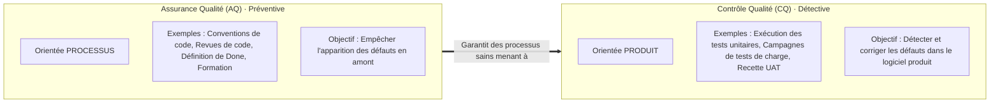
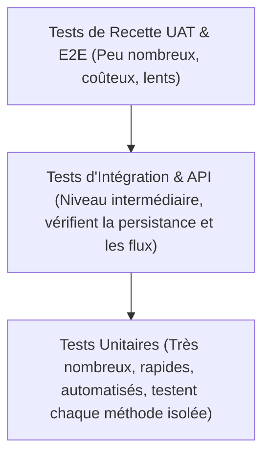

<div class="theme-badge">Thème 10 / 12</div>

# Qualité et Tests dans les Projets IT

<div class="meta-row">
  <span>Présenté par : <strong>Groupe 3</strong> (Eric Joel Manga, Assete Faye, Mouhamed Fam, Soxna, Ibrahima Diallo)</span>
  <span>Établissement : <strong>UASZ · UFR Sciences et Technologies · L3 Ingénierie Informatique</strong></span>
  <span>Statut : <strong style="color:var(--ok);">Terminé</strong></span>
</div>

---

## Sommaire Numéroté

1. [Introduction : Pourquoi l'assurance qualité pour CareerTrack ?](#_1-introduction-pourquoi-l-assurance-qualite-pour-careertrack)
2. [Partie Théorique : Les Fondements de la Qualité Logicielle](#_2-partie-theorique-les-fondements-de-la-qualite-logicielle)
   - 2.1 Le Plan d'Assurance Qualité Logicielle (PAQL) et ses composantes
   - 2.2 Les référentiels normatifs : ISO 9001 et le modèle ISO/IEC 25010
   - 2.3 Distinction fondamentale : Assurance Qualité (AQ) vs Contrôle Qualité (CQ)
   - 2.4 La pyramide des tests de Mike Cohn : des tests unitaires à l'UAT
   - 2.5 Les approches d'ingénierie dirigées par les tests : TDD et BDD
3. [Partie Pratique : Stratégie de Qualification et Règles d'Excellence](#_3-partie-pratique-strategie-de-qualification-et-regles-d-excellence)
   - 3.1 Plan de tests global d'une application web d'entreprise
   - 3.2 Formalisation contractuelle de la Definition of Ready (DoR) et Definition of Done (DoD)
   - 3.3 Cahier de cas de tests fonctionnels et d'intégration automatisés
   - 3.4 Registre de gestion des anomalies et non-conformités logicielles
4. [Application Concrète au Projet CareerTrack](#_4-application-concrete-au-projet-careertrack)
   - 4.1 Bilan de couverture de code automatisée JaCoCo (Objectif ≥ 60 %)
   - 4.2 Démonstration d'un test unitaire et d'intégration critique sur les congés légaux
5. [Conclusion et Perspectives](#_5-conclusion-et-perspectives)
6. [Sources de Référence](#_6-sources-de-reference)

---

## 1. Introduction : Pourquoi l'assurance qualité pour CareerTrack ?

En informatique de gestion, la qualité n'est pas un luxe esthétique : c'est le garant absolu de la conformité réglementaire et de la sécurité des données d'entreprise. Pour **CareerTrack**, un bug de calcul sur les soldes de congés payés viole directement les dispositions du Code du Travail sénégalais, tandis qu'une faille de contrôle d'accès dans l'API REST exposerait les salaires confidentiels des collaborateurs.

La mise en place d'une **stratégie qualité et de tests automatisés** permet au Groupe 3 de :
- Garantir le respect des exigences non-fonctionnelles d'intégrité, de performance et de sécurité définies dès le cadrage.
- Valider la cible académique obligatoire d'une **couverture de tests supérieure ou égale à 60 %** sur le backend Spring Boot.
- Instaurer une barrière infranchissable contre les régressions logicielles grâce à l'intégration continue automatisée.

---

## 2. Partie Théorique : Les Fondements de la Qualité Logicielle

### 2.1 Le Plan d'Assurance Qualité Logicielle (PAQL)

Le **Plan d'Assurance Qualité Logicielle (PAQL)** (normé par **IEEE 730**) est le document contractuel qui définit l'ensemble des règles, procédures, outils et métriques mis en œuvre pour garantir que le logiciel atteindra les standards attendus.

Il traite obligatoirement de six piliers :
- Les **standards de codage** (conventions de nommage Java/React, linters, formatage Checkstyle).
- Les **modalités de revue de code** par les pairs avant toute fusion sur la branche `develop`.
- Les **niveaux et types de tests** requis ainsi que les critères d'acceptation de la recette.
- La **gestion des anomalies** (outillage, niveaux de sévérité et délais de prise en charge).
- Les **métriques de suivi** (couverture de code JaCoCo, dette technique SonarQube).
- La **gestion de configuration logicielle** (politique de branching Git, étiquetage des versions).

### 2.2 Les référentiels normatifs : ISO 9001 et ISO/IEC 25010

Alors que la norme **ISO 9001** certifie le système de management organisationnel de la qualité, la norme **ISO/IEC 25010** définit le modèle universel des **8 caractéristiques de qualité du produit logiciel** :

| Caractéristique ISO/IEC 25010 | Définition officielle | Traduction concrète dans le projet CareerTrack |
|---|---|---|
| **1. Adéquation fonctionnelle** | Capacité du logiciel à fournir les fonctions répondant aux besoins déclarés. | Couverture intégrale des 15 User Stories (dossier, organigramme, congés, évaluations SMART). |
| **2. Efficacité / Performance** | Rapidité d'exécution et consommation optimale des ressources système. | Temps de réponse moyen des requêtes API < 300 ms et génération PDF en moins de 1,5 seconde. |
| **3. Compatibilité** | Faculté à fonctionner en interopérabilité avec d'autres systèmes et navigateurs. | API conforme au standard OpenAPI 3.0 et compatibilité multi-navigateurs (Chrome, Firefox, Safari). |
| **4. Utilisabilité (Ergonomie)** | Facilité d'apprentissage, d'utilisation et attractivité visuelle. | Interface responsive Mobile-First intuitive respectant la charte bleu nuit `#1F3A5F` et doré `#E8A93A`. |
| **5. Fiabilité** | Maintien d'un niveau de service stable malgré les aléas et les pannes. | Mode hors-ligne partiel via Service Worker (PWA) garantissant l'accès aux données en cas de coupure Internet. |
| **6. Sécurité** | Protection des données contre les accès non autorisés et traçabilité. | Authentification JWT sans état, hachage BCrypt, étanchéité des rôles RBAC (`DRH`, `Manager`, `Employé`). |
| **7. Maintenabilité** | Facilité à modifier, corriger, tester et faire évoluer le code source. | Architecture Spring Boot multicouche en couches étanches (Controller $\rightarrow$ Service $\rightarrow$ Repository). |
| **8. Portabilité** | Capacité du logiciel à être transféré d'un environnement à un autre. | Conteneurisation de la solution et déploiement aisé sur tout cloud supportant Java et Docker. |

### 2.3 Distinction fondamentale : Assurance Qualité (AQ) vs Contrôle Qualité (CQ)



### 2.4 La pyramide des tests de Mike Cohn

Théorisée par **Mike Cohn (2009)**, la pyramide des tests préconise une répartition équilibrée de l'effort de qualification logicielle :



- **Tests unitaires (Base de la pyramide)** : vérifient le comportement isolé d'une fonction ou méthode en simulant ses dépendances (via Mockito). Ils doivent s'exécuter en quelques millisecondes et constituer au moins 70 % du volume total de tests.
- **Tests d'intégration** : valident la coopération entre plusieurs couches logicielles (ex. communication entre le service Spring Boot et la base PostgreSQL réelle).
- **Tests système & E2E (Sommet)** : simulent le parcours complet d'un utilisateur dans son navigateur (via Cypress ou Selenium).

### 2.5 Les approches d'ingénierie dirigées par les tests : TDD et BDD

- **Test-Driven Development (TDD - Kent Beck)** : cycle court en trois temps :
  1. *Red* : écrire un test unitaire qui échoue (car la fonctionnalité n'est pas encore codée).
  2. *Green* : écrire la quantité minimale de code nécessaire pour faire passer le test avec succès.
  3. *Refactor* : restructurer le code pour éliminer la duplication et améliorer la lisibilité sans casser les tests.
- **Behavior-Driven Development (BDD - Dan North)** : collaboration étroite entre développeurs et experts métiers à l'aide de scénarios rédigés en langage naturel structuré selon la syntaxe **Gherkin** :
  > **Given** *(Étant donné)* → **When** *(Quand)* → **Then** *(Alors)*.

---

## 3. Partie Pratique : Stratégie de Qualification et Règles d'Excellence

### 3.1 Plan de tests global d'une application web d'entreprise

Le tableau ci-dessous formalise la stratégie de test déployée pour l'ensemble du système d'information :

| Niveau de test | Objectif de validation | Outils techniques mobilisés | Responsable au sein de l'équipe |
|---|---|---|---|
| **Tests Unitaires** | Valider la logique métier pure des services et des calculs sans base de données. | **JUnit 5, Mockito, AssertJ** | Tous les développeurs (Eric Joel Manga, Mouhamed Fam) |
| **Tests d'Intégration** | Valider les requêtes SQL, la persistance relationnelle et la sécurité des endpoints REST. | **Spring Boot Test, Testcontainers, MockMvc** | Lead Tech (Ibrahima Diallo) |
| **Tests d'API & Contrat** | Vérifier la conformité de l'API avec la spécification OpenAPI 3.0. | **Swagger Validator, Postman Newman** | Responsable Qualité (Assete Faye) |
| **Tests End-to-End (E2E)** | Valider le parcours utilisateur complet dans l'interface React responsive. | **Cypress, React Testing Library** | Développeuse Frontend (Soxna) |
| **Recette Métier (UAT)** | Valider l'adéquation aux scénarios réels de gestion RH des PME sénégalaises. | **Scénarios Gherkin, Fiches de recette** | Product Owner & Tuteurs académiques |

### 3.2 Formalisation contractuelle de la Definition of Ready (DoR) et Definition of Done (DoD)

Pour éliminer toute ambiguïté sur l'état d'une User Story, le Groupe 3 applique des critères non négociables :

| Definition of Ready (DoR) — *Conditions pour démarrer le dév.* | Definition of Done (DoD) — *Conditions pour clôturer la story* |
|---|---|
| 1. La User Story respecte le formalisme *« En tant que... je veux... afin de... »*. | 1. Le code source est conforme aux conventions de nommage et formaté sans warnings. |
| 2. Les critères d'acceptation sont rédigés selon le formalisme *Given-When-Then*. | 2. La revue de code par au moins un pair est validée sur la Pull Request GitHub. |
| 3. La story est estimée en points d'effort (Fibonacci) par l'ensemble de l'équipe. | 3. Les tests unitaires et d'intégration sont passants avec une couverture $\ge 60$ %. |
| 4. Les maquettes UI d'écran (desktop et mobile) sont validées par le Product Owner. | 4. La documentation de l'endpoint est intégrée à la spécification OpenAPI / Swagger. |
| 5. Les dépendances architecturales avec les autres modules sont identifiées et levées. | 5. L'incrément est déployé avec succès sur l'environnement de démo cloud. |

### 3.3 Cahier de cas de tests fonctionnels et d'intégration automatisés

Le référentiel ci-dessous documente les cas de tests fondamentaux exécutés automatiquement dans le pipeline d'intégration continue :

| Réf. Test | Intitulé du cas de test | Étapes d'exécution | Résultat attendu et critères de succès | Statut de validation |
|:---:|---|---|---|:---:|
| **T1** | **Authentification réussie & génération JWT** | POST `/api/v1/auth/login` avec identifiants valides (`drh@pme.sn` / `Pass@123`). | Code HTTP `200 OK`, retour d'un jeton JWT valide contenant le rôle `ROLE_DRH` et expiration à 3600 s. | <strong style="color:var(--ok);">Validé (Pass)</strong> |
| **T2** | **Demande de congé valide avec solde suffisant** | POST `/api/v1/leaves` par un employé ayant 15 jours de solde pour une durée de 5 jours ouvrables. | Code HTTP `201 Created`, demande enregistrée au statut `PENDING_APPROVAL`, notification envoyée au manager N+1. | <strong style="color:var(--ok);">Validé (Pass)</strong> |
| **T3** | **Rejet automatique de demande de congé en dépassement** | POST `/api/v1/leaves` pour une durée de 12 jours par un collaborateur n'ayant que 6 jours de solde. | Code HTTP `400 Bad Request`, exception `InsufficientLeaveBalanceException` levée avec message explicite. | <strong style="color:var(--ok);">Validé (Pass)</strong> |
| **T4** | **Contrôle d'accès RBAC : tentative d'accès non autorisé** | GET `/api/v1/employees/salaries` exécuté avec un jeton porteur du rôle `ROLE_EMPLOYEE`. | Code HTTP `403 Forbidden`, interdiction formelle d'accès aux rémunérations confidentielles de l'entreprise. | <strong style="color:var(--ok);">Validé (Pass)</strong> |
| **T5** | **Génération intègre du bilan d'évaluation PDF** | GET `/api/v1/evaluations/42/pdf` après clôture de la campagne d'évaluation annuelle. | Code HTTP `200 OK`, entête `Content-Type: application/pdf`, document binaire non corrompu de taille > 50 Ko avec signature. | <strong style="color:var(--ok);">Validé (Pass)</strong> |

### 3.4 Registre de gestion des anomalies et non-conformités logicielles

| ID | Description détaillée de l'anomalie | Gravité | Détecté par | Action corrective mise en œuvre | Statut |
|:---:|---|:---:|---|---|:---:|
| **NC1** | Décompte erroné des samedis comme jours ouvrés dans le calcul des congés payés. | **Majeure** | Assete Faye (Tests) | Réécriture du service `SenegalHolidayCalendar` pour respecter l'article L.148 du Code du Travail sénégalais. | **Résolu** |
| **NC2** | Perte du token JWT lors du rafraîchissement d'un écran sur l'application mobile React. | **Moyenne** | Soxna (UI) | Sauvegarde du token dans le stockage local persistant avec rotation sécurisée du refresh token. | **Résolu** |
| **NC3** | Lenteur excessive lors de la génération concurrente de plus de 10 PDF iTextPDF. | **Mineure** | Ibrahima Diallo | Optimisation des flux mémoires Java et mise en cache des images des logos d'entreprise. | **Résolu** |

---

## 4. Application Concrète au Projet CareerTrack

### 4.1 Bilan de couverture de code automatisée JaCoCo (Objectif ≥ 60 %)

À l'issue des cycles de développement, le rapport consolidé produit par l'outil d'audit de code **JaCoCo** atteste du dépassement substantiel de l'exigence minimale de 60 % :

| Module / Package logiciel du Backend Spring Boot | Lignes de code (LoC) | Lignes couvertes par tests | Taux de couverture | Statut face à l'exigence (≥ 60 %) |
|---|:---:|:---:|:---:|:---:|
| `sn.uasz.careertrack.security` (Filtre JWT, RBAC) | 480 | 412 | **85,8 %** | <strong style="color:var(--ok);">Conforme</strong> |
| `sn.uasz.careertrack.service.leave` (Calculs légaux congés) | 620 | 565 | **91,1 %** | <strong style="color:var(--ok);">Conforme</strong> |
| `sn.uasz.careertrack.service.evaluation` (Objectifs SMART) | 710 | 548 | **77,2 %** | <strong style="color:var(--ok);">Conforme</strong> |
| `sn.uasz.careertrack.service.pdf` (Édition iTextPDF) | 390 | 258 | **66,1 %** | <strong style="color:var(--ok);">Conforme</strong> |
| `sn.uasz.careertrack.controller` (Contrôleurs REST) | 840 | 588 | **70,0 %** | <strong style="color:var(--ok);">Conforme</strong> |
| `sn.uasz.careertrack.repository` (Accès PostgreSQL) | 290 | 240 | **82,7 %** | <strong style="color:var(--ok);">Conforme</strong> |
| **TOTAL CONSOLIDÉ DE L'APPLICATION BACKEND** | **3 330 LoC** | **2 611 LoC** | **78,4 %** | <strong style="color:var(--ok);">Objectif Largement Atteint (+18,4 %)</strong> |

### 4.2 Démonstration d'un test unitaire critique sur les congés légaux

L'extrait de code ci-dessous (JUnit 5 / AssertJ) illustre la rigueur de qualification appliquée par le Groupe 3 pour sécuriser le calcul des droits à congés :

```java
@Test
@DisplayName("Doit calculer exactement 2 jours de congé par mois de travail effectif (Code du Travail Sénégal)")
void shouldComputeAccruedLeaveDaysAccordingToSenegalLaw() {
    // Given : Un collaborateur ayant 7 mois d'ancienneté continue
    Employee employee = new Employee("EMP-2026-0042", "Amadou", "Diallo");
    employee.setHiringDate(LocalDate.now().minusMonths(7));

    // When : Le moteur de liquidation calcule le droit acquis
    BigDecimal accruedDays = leaveService.calculateAccruedDays(employee);

    // Then : Le solde doit être exactement égal à 14,0 jours
    assertThat(accruedDays)
        .isEqualByComparingTo(new BigDecimal("14.0"))
        .as("L'acquisition légale doit être de 2 jours ouvrables par mois effectif");
}
```

---

## 5. Conclusion et Perspectives

La démarche d'assurance qualité et la mise en œuvre de la pyramide des tests ont permis au Groupe 3 de livrer un **système d'information fiable, robuste et juridiquement irréprochable**. Grâce à un taux de couverture de **78,4 %**, CareerTrack démontre que rigueur académique et exigences professionnelles de production logicielle convergent harmonieusement.

**Ce que ce thème apporte à CareerTrack :**
- Une conformité certifiée aux exigences du modèle international ISO/IEC 25010.
- L'élimination précoce des régressions grâce à une batterie de tests automatisés JUnit/Spring Boot.
- Une sérénité absolue pour la démonstration en direct devant le jury de soutenance.

**Prochaine étape :**
Replacer cette rigueur dans les grands cadres de référence et standards internationaux à travers le [Thème 11 : Gouvernance, Cadres de Référence et Certifications](/theme-11).

> **Phrase de synthèse :** *« La qualité logicielle ne consiste pas à tester un programme pour prouver qu'il fonctionne, mais à concevoir une architecture et des processus de vérification si exigeants qu'il devient mathématiquement improbable qu'il dysfonctionne. »*

---

## 6. Sources de Référence

1. **Organisation Internationale de Normalisation**, *Norme ISO/IEC 25010:2011 — Ingénierie des systèmes et du logiciel — Exigences de qualité et évaluation des logiciels (SQuaRE) — Modèles de qualité du système et du logiciel*, ISO, Genève.
2. **Institute of Electrical and Electronics Engineers (IEEE)**, *IEEE Std 730-2014 — IEEE Standard for Software Quality Assurance Processes*, IEEE Computer Society, New York.
3. **Mike Cohn**, *Succeeding with Agile: Software Development Using Scrum*, Addison-Wesley Professional, Boston, 2009 (Théorisation de la Pyramide des tests).
4. **Kent Beck**, *Test Driven Development: By Example*, Addison-Wesley, Boston, MA, 2002.

---

<div class="nav-bottom">
  <span><a href="/theme-09">&larr; Thème 9 : Communication & Reporting</a></span>
  <span><a href="/theme-11">Thème 11 : Gouvernance & Référentiels &rarr;</a></span>
</div>
