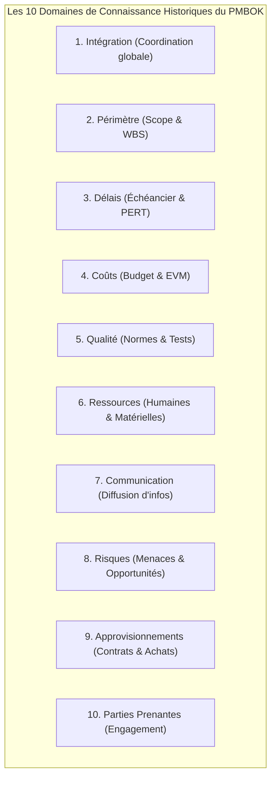
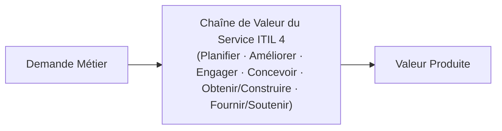
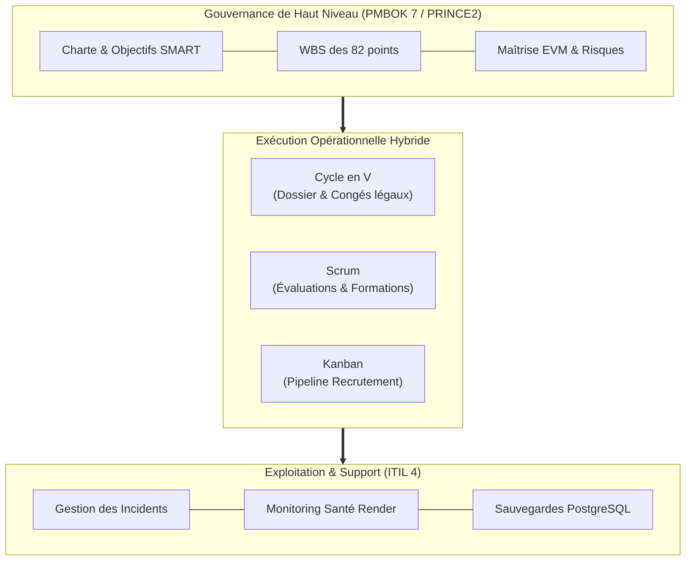

Thème 11 / 12

# Gouvernance, Cadres de Référence et Certifications

  Présenté par : <strong>Groupe 3</strong> (Eric Joel Manga, Assete Faye, Mouhamed Fam, Aminatou Touré, Ibrahima Diallo)
  Établissement : <strong>UASZ · UFR Sciences et Technologies · L3 Ingénierie Informatique</strong>
  Statut : <strong style="color:var(--ok);">Terminé</strong>

---

## Sommaire Numéroté

1. [Introduction : Pourquoi les grands référentiels pour CareerTrack ?](#_1-introduction-pourquoi-les-grands-referentiels-pour-careertrack)
2. [Partie Théorique : Les Grands Standards Internationaux](#_2-partie-theorique-les-grands-standards-internationaux)
   - 2.1 Le corpus PMBOK du PMI : domaines de connaissance et principes directeurs
   - 2.2 La méthode PRINCE2 : les 7 principes, 7 thèmes et 7 processus
   - 2.3 Le référentiel ITIL 4 : la gestion des services IT (ITSM) et la chaîne de valeur
   - 2.4 Le rôle stratégique du PMO (Project Management Office) dans l'organisation
   - 2.5 Panorama des certifications professionnelles (PMP, PRINCE2, ITIL, PSM)
3. [Partie Pratique : Étude Comparative et Recommandation d'Entreprise](#_3-partie-pratique-etude-comparative-et-recommandation-d-entreprise)
   - 3.1 Tableau comparatif approfondi : PMBOK vs PRINCE2 vs ITIL vs Agile
   - 3.2 Recommandation méthodologique formelle pour une PME en transformation
   - 3.3 Cartographie d'alignement des groupes de processus PMBOK sur CareerTrack
4. [Application Concrète au Projet CareerTrack](#_4-application-concrete-au-projet-careertrack)
   - 4.1 Justification de la gouvernance hybride retenue par le Groupe 3
   - 4.2 Passerelle vers l'exploitation et la maintenance (Run ITIL)
5. [Conclusion et Perspectives](#_5-conclusion-et-perspectives)
6. [Sources de Référence](#_6-sources-de-reference)

---

## 1. Introduction : Pourquoi les grands référentiels pour CareerTrack ?

Un projet d'ingénierie logicielle ne vit pas dans un vase clos technique : il s'insère au cœur des processus stratégiques d'une organisation. Pour concevoir **CareerTrack**, notre équipe ne pouvait se contenter d'improviser sa gestion : il était impératif de s'adosser aux **meilleures pratiques internationales de gouvernance**, éprouvées sur des décennies par l'industrie mondiale.

L'étude des **cadres de référence et des certifications professionnelles** permet au Groupe 3 de :
- Sélectionner les outils méthodologiques les plus pertinents sans dogmatisme (éviter le « tout-agile » ou le « tout-prédictif »).
- Comprendre les attentes de gouvernance des comités de direction et des bailleurs institutionnels.
- Préparer notre future insertion professionnelle d'ingénieurs informaticiens formés à l'UASZ aux standards les plus exigeants du marché international (PMP, Scrum, ITIL).

---

## 2. Partie Théorique : Les Grands Standards Internationaux

### 2.1 Le corpus PMBOK du PMI : domaines de connaissance et principes

Édité par le **Project Management Institute (PMI)**, le guide **PMBOK (Project Management Body of Knowledge)** est le référentiel de gestion de projet le plus largement reconnu au monde.

Historiquement structuré autour de **10 domaines de connaissance** et de 5 groupes de processus (PMBOK 6), il a évolué dans sa 7ème édition (2021) vers un cadre orienté principes et création de valeur :

- **Philosophie** : Un guide exhaustif de bonnes pratiques (*Good Practices*), hautement adaptable (*Tailoring*), applicable à tout secteur d'activité (BTP, industrie, énergie, numérique).

### 2.2 La méthode PRINCE2 : principes, thèmes et processus

Développée au Royaume-Uni par l'OGC et gérée par **Axelos / PeopleCert**, la méthode **PRINCE2 (PRojects IN Controlled Environments)** est une méthodologie prescriptive de gestion de projet centrée sur l'organisation et le contrôle.

Elle repose sur la règle d'or des « **3 fois 7** » :
- **7 Principes fondamentaux** (non négociables) : justification continue pour l'entreprise (*Business Case*), leçons apprises, rôles et responsabilités définis, management par séquences, management par exception, orientation produit, adaptation au contexte du projet.
- **7 Thèmes organisationnels** : Cas d'affaires, Organisation, Qualité, Plans, Risque, Changement, Progression.
- **7 Processus chronologiques** : Élaborer le projet, Diriger le projet, Initialiser le projet, Contrôler une séquence, Gérer la livraison des produits, Gérer une limite de séquence, Clôturer le projet.

> **Spécificité clé de PRINCE2 : Le management par exception.** Le chef de projet dispose d'une tolérance déléguée (en délai, coût, qualité, périmètre). Tant qu'il reste dans cette enveloppe, le comité de pilotage ne s'immisce pas dans les opérations quotidiennes.

### 2.3 Le référentiel ITIL 4 : la gestion des services IT (ITSM)

Contrairement à PMBOK et PRINCE2 qui gèrent des projets temporaires, **ITIL (Information Technology Infrastructure Library)** est le référentiel mondial de **gestion des services informatiques (ITSM)** en production continue (*Run*).

Sa version actuelle (**ITIL 4**) articule l'ensemble des activités technologiques autour du **Système de Valeur des Services (SVS - Service Value System)** et des **4 dimensions du service** :
1. *Organisations et personnes*.
2. *Information et technologie*.
3. *Partenaires et fournisseurs*.
4. *Flux de valeur et processus*.

Les pratiques opérationnelles clés d'ITIL 4 comprennent la **gestion des incidents**, la **gestion des problèmes (recherche de cause racine)**, la **gestion des changements** et la gestion des niveaux de service (**SLA - Service Level Agreements**).

### 2.4 Le rôle stratégique du PMO (Project Management Office)

Le **PMO (Bureau de Gestion de Projet)** est une entité organisationnelle permanente chargée de professionnaliser, standardiser et superviser la conduite des projets au sein d'une entreprise.

On distingue trois degrés de maturité de PMO :
- **PMO de Soutien (Supportive)** : rôle consultatif fournissant des modèles de documents, des formations et des bonnes pratiques (faible autorité).
- **PMO de Contrôle (Controlling)** : vérifie l'application effective des standards, audite les budgets et exige des reportings réguliers (autorité moyenne).
- **PMO Directif (Directive)** : prend directement en charge le management des projets et affecte les chefs de projet aux différentes directions (autorité forte).

### 2.5 Panorama des certifications professionnelles

| Certification | Organisme certificateur | Profil cible et prérequis | Rôle professionnel visé |
|---|---|---|---|
| **CAPM** (*Certified Associate in PM*) | PMI (États-Unis) | Étudiants et jeunes diplômés (aucun prérequis d'heures de gestion exigé). | Assistant chef de projet junior, coordinateur. |
| **PMP** (*Project Management Professional*) | PMI (États-Unis) | Chefs de projet confirmés (≥ 36 mois d'expérience avérée + formation). | Référence mondiale absolue des directeurs de projet. |
| **PRINCE2 Foundation & Practitioner** | PeopleCert / Axelos (Royaume-Uni) | Professionnels évoluant dans des structures à forte gouvernance publique ou privée. | Chef de projet certifié méthodes structurées. |
| **ITIL 4 Foundation** | PeopleCert / Axelos | Ingénieurs systèmes, exploitants d'infrastructures, responsables de support. | Gestionnaire de services IT, ingénieur DevOps. |
| **PSM I / PSM II** (*Professional Scrum Master*) | Scrum.org (Ken Schwaber) | Développeurs agiles, facilitateurs, coordinateurs de squads. | Scrum Master certifié, coach agile. |

---

## 3. Partie Pratique : Étude Comparative et Recommandation d'Entreprise

### 3.1 Tableau comparatif approfondi : PMBOK vs PRINCE2 vs ITIL vs Agile

| Critère d'analyse | PMBOK (PMI) | PRINCE2 (Axelos) | ITIL 4 (Axelos) | Agile / Scrum |
|---|---|---|---|---|
| **Nature du corpus** | Guide exhaustif de connaissances (*Body of Knowledge*). | Méthodologie prescriptive structurée de gestion de projet. | Référentiel de bonnes pratiques de services informatiques. | Cadre léger itératif et adaptatif (*Framework*). |
| **Origine géographique** | États-Unis (PMI, 1969). | Royaume-Uni (Gouvernement britannique, 1989). | Royaume-Uni (CCTA, 1989). | États-Unis (Communauté logicielle, 2001). |
| **Objet central** | Comment piloter efficacement un projet de A à Z. | Comment organiser la décision, le contrôle et le mandat projet. | Comment créer et pérenniser la valeur des services en production. | Comment développer un produit logiciel par incréments réguliers. |
| **Gestion du changement** | Comité de contrôle des changements formel (*CCB*). | Procédure formalisée d'arbitrage par le comité de pilotage. | Gestion des changements (*Enablement of changes*) avec audit des impacts. | Bienvenue continue des changements, priorisés dans le Backlog. |
| **Horizon temporel** | Temporaire (Cycle de vie du projet). | Temporaire (Séquences de gestion délimitées). | Continu (Cycle de vie complet du service - Run). | Itératif (Sprints courts de 2 à 4 semaines). |
| **Contexte idéal** | Grands projets d'ingénierie multidisciplinaires. | Projets d'entreprise exigeant une stricte justification économique. | Exploitation, infogérance, centres de services, helpdesk. | Développement de logiciels à forte incertitude métier. |

### 3.2 Recommandation méthodologique formelle pour une PME en transformation

Dans le cadre des travaux pratiques, nous analysons le cas d'une PME sénégalaise de 150 salariés opérant dans la logistique, souhaitant remplacer ses tableurs Excel par une solution RH intégrée :

| Dimension d'analyse | Diagnostic et recommandation argumentée |
|---|---|
| **Entreprise étudiée** | Société de transport et logistique de 150 employés basée à Dakar. |
| **Nature du besoin** | Remplacement d'une gestion RH manuelle par une plateforme collaborative avec suivi des congés et évaluations. |
| **Cadre méthodologique recommandé** | **Démarche Hybride articulée : Gouvernance PRINCE2 / PMBOK + Exécution SCRUM + Exploitation ITIL.** |
| **Arguments de la recommandation** | 1. **Direction générale rassurée par PRINCE2** : rédaction d'un Business Case garantissant la rentabilité de l'investissement et gestion par exception. 2. **Équipe technique réactive grâce à Scrum** : livraison d'incréments testables toutes les deux semaines pour recueillir les retours des chauffeurs et managers de terrain. 3. **Pérennité du système garantie par ITIL** : mise en place dès la livraison d'un catalogue de services et d'un support technique de premier niveau (*Service Desk*). |
| **Limites et vigilances** | Éviter la lourdeur bureaucratique : adapter la documentation au format PME sans générer des dizaines de formulaires inutiles. |

### 3.3 Cartographie d'alignement des groupes de processus PMBOK sur CareerTrack

Le tableau ci-dessous démontre comment notre projet d'études s'aligne fidèlement sur les cinq groupes de processus fondamentaux du PMBOK :

| Groupe de Processus PMBOK | Processus clés mis en œuvre | Livrables concrets produits sur le projet CareerTrack |
|---|---|---|
| **1. Initiation** | Développer la charte de projet · Identifier les parties prenantes. | **Charte de projet CareerTrack** · Matrice Pouvoir / Intérêt (Thème 2). |
| **2. Planification** | Définir le périmètre · Créer le WBS · Échéancier · Budget · Risques. | **Arborescence WBS** (Thème 5) · Réseau PERT & Gantt à 37 jours · Registre des risques (Thème 6) · CBS chiffré (Thème 7). |
| **3. Exécution** | Diriger les travaux · Développer l'équipe · Gérer la qualité. | **Code source Spring Boot / React** · Rituels agiles · Matrice RACI Groupe 3 (Thème 8). |
| **4. Surveillance & Maîtrise** | Maîtriser l'échéancier et les coûts · Contrôler la qualité. | **Calculs EVM** ($CPI, SPI$) · Rapports hebdomadaires (Thème 9) · Couverture de tests JaCoCo ≥ 60 % (Thème 10). |
| **5. Clôture** | Clôturer le projet ou la phase · Capitaliser les retours d'expérience. | **Procès-verbal de recette** · Rétrospective Start/Stop/Continue · Base de connaissances (Thème 12). |

---

## 4. Application Concrète au Projet CareerTrack

### 4.1 Justification de la gouvernance hybride retenue par le Groupe 3

Pour CareerTrack, notre choix méthodologique dépasse la confrontation stérile entre agile et prédictif :
- **Le chapeau PMBOK** structure la rigueur académique et la vision globale (objectifs SMART, WBS des 15 User Stories, estimation budgétaire de 5,9 millions FCFA, gestion des risques $P \times I$).
- **Le cœur battant Scrum** anime le rythme quotidien de l'équipe (sprints de 2 semaines, réunions quotidiennes de 15 min, Definition of Done).
- **Le flux Kanban** régule l'activité du pipeline de recrutement de talents.

### 4.2 Passerelle vers l'exploitation et la maintenance (Run ITIL)

Un logiciel n'a de valeur que s'il est exploité durablement. Pour la phase d'après-projet de CareerTrack, le Groupe 3 a défini des procédures inspirées d'**ITIL 4** :
- **Gestion des incidents (Incident Management)** : formulaire de signalement de bug intégré dans l'interface employé, classant automatiquement les incidents selon leur criticité (P1 bloquant : traitement sous 2 h ; P3 mineur : intégré au sprint suivant).
- **Gestion des déploiements (Deployment Management)** : intégration continue GitHub Actions garantissant qu'aucune version défaillante n'écrase la base de données de production.

---

## 5. Conclusion et Perspectives

Les grands cadres de référence internationaux ne sont pas des contraintes administratives : ils représentent le **patrimoine intellectuel consolidé de l'ingénierie de projet mondiale**. En combinant avec discernement la structure du PMBOK, la réactivité de Scrum et la pérennité d'ITIL, le Groupe 3 démontre sa maturité d'ingénieurs capables de dialoguer aussi bien avec des développeurs de code qu'avec des directeurs généraux.

**Ce que ce thème apporte à CareerTrack :**
- Une légitimité méthodologique reconnue par les standards professionnels mondiaux.
- Une articulation limpide entre la phase de projet (*Build*) et la phase d'exploitation opérationnelle (*Run*).
- Une préparation directe de notre équipe aux certifications internationales en génie logiciel.

**Prochaine étape :**
Achever formellement le projet et capitaliser les leçons apprises à travers le [Thème 12 : Clôture de Projet et Retour d'Expérience (REX)](/theme-12).

> **Phrase de synthèse :** *« Le véritable professionnalisme en gestion de projet ne consiste pas à appliquer aveuglément une méthode unique, mais à savoir composer avec discernement la juste alliance des référentiels internationaux pour servir au mieux la finalité de l'organisation. »*

---

## 6. Sources de Référence

1. **Project Management Institute (PMI)**, *A Guide to the Project Management Body of Knowledge (PMBOK Guide)*, 7ème édition, PMI, Newtown Square, PA, 2021.
2. **AXELOS**, *Managing Successful Projects with PRINCE2*, 6ème édition, The Stationery Office (TSO), Londres, 2017.
3. **AXELOS**, *ITIL Foundation: ITIL 4 Edition*, The Stationery Office (TSO), Londres, 2019.
4. **Scrum.org**, *Professional Scrum Master (PSM) Certification Competencies*, 2022.

---

  <a href="/theme-10">&larr; Thème 10 : Qualité & Tests IT</a>
  <a href="/theme-12">Thème 12 : Clôture & REX &rarr;</a>

