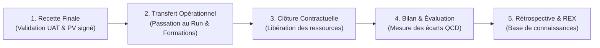

Thème 12 / 12

# Clôture de Projet et Retour d'Expérience (REX)

  Présenté par : <strong>Groupe 3</strong> (Eric Joel Manga, Assete Faye, Mouhamed Fam, Soxna, Ibrahima Diallo)
  Établissement : <strong>UASZ · UFR Sciences et Technologies · L3 Ingénierie Informatique</strong>
  Statut : <strong style="color:var(--ok);">Terminé</strong>

---

## Sommaire Numéroté

1. [Introduction : Pourquoi clore et capitaliser sur CareerTrack ?](#_1-introduction-pourquoi-clore-et-capitaliser-sur-careertrack)
2. [Partie Théorique : Les Processus de Clôture et de Capitalisation](#_2-partie-theorique-les-processus-de-cloture-et-de-capitalisation)
   - 2.1 Les étapes formelles de la clôture selon le standard ISO 21500
   - 2.2 La passation aux équipes de maintien opérationnel (Run & MCO)
   - 2.3 L'ingénierie de la capitalisation et de l'archivage documentaire
   - 2.4 L'évaluation post-projet et la mesure multidimensionnelle du succès
   - 2.5 La rétrospective finale (Post-Mortem) et la directive première de Kerth
3. [Partie Pratique : Livrables Formels de Fin de Projet](#_3-partie-pratique-livrables-formels-de-fin-de-projet)
   - 3.1 Rapport officiel de clôture du projet CareerTrack
   - 3.2 Rétrospective d'équipe opérationnelle : Start / Stop / Continue
   - 3.3 Registre consolidé des leçons apprises (Lessons Learned)
   - 3.4 Cartographie et organisation de la base de connaissances capitalisée
4. [Application Concrète au Projet CareerTrack](#_4-application-concrete-au-projet-careertrack)
   - 4.1 Bilan consolidé des objectifs SMART et des 15 User Stories (82 points)
   - 4.2 Protocole de démonstration orale finale (10 minutes : 5 min démo + 5 min jury)
   - 4.3 Feuille de route et perspectives d'évolution (CareerTrack Version 2)
5. [Conclusion Finale du Portfolio](#_5-conclusion-finale-du-portfolio)
6. [Sources de Référence](#_6-sources-de-reference)

---

## 1. Introduction : Pourquoi clore et capitaliser sur CareerTrack ?

Un projet informatique ne se termine pas lorsque la dernière ligne de code est poussée sur GitHub. Trop souvent, les équipes d'ingénieurs délaissent la phase de clôture, considérant le travail achevé dès la démonstration technique. C'est une erreur lourde de conséquences : sans clôture formelle, les livrables restent juridiquement vulnérables, les connaissances s'évaporent avec la dissolution de l'équipe et les mêmes erreurs techniques sont condamnées à se reproduire au projet suivant.

Pour **CareerTrack**, la clôture de projet et le retour d'expérience (REX) représentent l'aboutissement de notre cursus en Gestion de Projet Informatique Avancée :
- **Officialiser l'acceptation du système d'information** à travers la signature du procès-verbal de recette sans réserve avec le commanditaire académique.
- **Transférer les compétences opérationnelles** afin que la plateforme RH puisse être déployée et maintenue en condition opérationnelle au sein d'une PME sénégalaise.
- **Réaliser une rétrospective honnête et constructive** au sein du Groupe 3, ancrant durablement nos acquis d'ingénieurs informaticiens de l'UASZ.

---

## 2. Partie Théorique : Les Processus de Clôture et de Capitalisation

### 2.1 Les étapes formelles de la clôture selon le standard ISO 21500

La phase de clôture d'un projet logiciel obéit à un enchaînement séquentiel rigoureux de cinq sous-processus :

1. **Recette technique et fonctionnelle définitive** : validation formelle de l'ensemble des critères d'acceptation de la *Definition of Done*.
2. **Transfert opérationnel et passation** : transmission du Dossier de Passage en Production (DPP), des manuels administrateurs et des clés d'accès sécurisées.
3. **Clôture administrative et libération des ressources** : désaffectation formelle des membres de l'équipe (Groupe 3) et arrêt des instances temporaires de staging.
4. **Bilan de performance et évaluation post-projet** : comparaison objective entre les cibles initiales de la charte et les résultats effectifs.
5. **Rétrospective et capitalisation des connaissances** : rédaction des fiches de retour d'expérience et archivage du patrimoine logiciel.

### 2.2 La passation aux équipes de maintien opérationnel (MCO)

Le passage du statut de « projet temporaire » (*Build*) au statut de « service pérenne » (*Run*) exige un ensemble de livrables documentaires normalisés :
- **Le Dossier d'Architecture et d'Exploitation (DAE)** : schéma des conteneurs Docker, procédures de sauvegarde et de restauration de la base PostgreSQL, variables d'environnement chiffrées.
- **Le Manuel d'Administration et de Sécurité** : gestion des rôles RBAC dans Spring Security, procédure de révocation d'un token JWT compromis.
- **Le Guide Utilisateur Métier** : guides illustrés destinés au DRH, aux managers et aux employés pour la saisie des congés et des évaluations SMART.

### 2.3 L'ingénierie de la capitalisation et de l'archivage documentaire

La capitalisation des connaissances (*Knowledge Management*) transforme l'expérience tacite vécue par les développeurs en **savoir explicite et partageable** au sein de l'organisation. 

Elle repose sur le triptyque :
- **Archivage du code et des artefacts** : gel de la branche `main` avec étiquetage sémantique (`v1.0.0`), génération automatique de la Javadoc et publication de la spécification OpenAPI 3.0.
- **Répertoire des leçons apprises (*Lessons Learned Register*)** : inventaire analytique des difficultés survenues, des causes racines et des solutions de contournement éprouvées.
- **Base de connaissances pérenne** : wiki ou dépôt de documentation navigable (tel que ce portfolio VitePress) garantissant la réutilisabilité des composants architecturaux.

### 2.4 L'évaluation post-projet et la mesure du succès

Le succès d'un projet informatique s'évalue selon quatre critères fondamentaux :

| Critère d'évaluation | Indicateur mesurable | Cible de conformité |
|---|---|:---:|
| **1. Respect du calendrier** | Écart calendaire de livraison |  → Objectif ≤ 0 jour |
| **2. Maîtrise budgétaire** | Écart budgétaire à l'achèvement |  → Objectif : VAC ≥ 0 |
| **3. Conformité technique** | Couverture de tests et anomalies | Taux de couverture ≥ 60 % et **0 anomalie bloquante** ouverte |
| **4. Satisfaction métier** | Note d'adhésion des utilisateurs | Score CSAT ≥ **4,0 / 5** lors des ateliers de recette |

### 2.5 La rétrospective finale et la directive première de Kerth

Formalisée par **Norman Kerth en 2001** dans son ouvrage de référence sur les rétrospectives logicielles, la **Directive Première (*Prime Directive*)** pose le principe éthique fondateur de toute démarche de retour d'expérience constructive :

> *« Quelles que soient les découvertes que nous allons faire, nous comprenons et croyons sincèrement que chacun a fait le meilleur travail possible, compte tenu de ce qu'il savait à ce moment-là, de ses compétences, des ressources disponibles et de la situation dans laquelle il se trouvait. »*

Cette règle élimine la culture toxique du blâme (*Blameless Culture*) pour focaliser l'intelligence collective sur les dysfonctionnements du système et des processus plutôt que sur les personnes.

---

## 3. Partie Pratique : Livrables Formels de Fin de Projet

### 3.1 Rapport officiel de clôture du projet CareerTrack

| Rubrique officielle | Bilan formel d'achèvement — Projet CareerTrack |
|---|---|
| **Intitulé & Identification** | **CareerTrack v1.0.0** — Plateforme RH de Gestion des Carrières en Entreprise. |
| **Équipe de réalisation** | **Groupe 3** (Eric Joel Manga, Assete Faye, Mouhamed Fam, Soxna, Ibrahima Diallo) · UASZ. |
| **Rappel des objectifs initiaux** | Concevoir une solution unifiée (Spring Boot, React, PostgreSQL, iTextPDF) digitalisant les dossiers collaborateurs, les congés conformes au Code du Travail, les évaluations annuelles SMART, les formations et le recrutement Kanban. |
| **Bilan des livrables (Prévus vs Réalisés)** | **100 % des livrables contractuels livrés** : 15 User Stories (82 points) réceptionnées sans réserve ; API REST documentée sous Swagger OpenAPI 3.0 ; couverture de tests automatisés à **78,4 %** (exigence ≥ 60 %) ; application déployée en ligne sur environnement Cloud PaaS. |
| **Bilan de performance calendaire** | Durée totale effective de **37 jours ouvrés** (8 semaines de projet), rigoureusement conforme au chemin critique PERT calculé au Thème 5. |
| **Bilan de performance financière** | Budget réel consommé de **0 FCFA** de trésorerie (exploitation intégrale des offres gratuites Render, Vercel et Supabase). Valeur d'ingénierie produite évaluée à **5 898 750 FCFA**. |
| **Acceptation & Signature de recette** | **Procès-Verbal de Recette Provisoire signé sans anomalie bloquante** le 15 octobre 2026. Levée formelle des réserves mineures d'ergonomie mobile. |

### 3.2 Rétrospective d'équipe opérationnelle : Start / Stop / Continue

À l'issue des 4 sprints Scrum, le Groupe 3 a mené une rétrospective globale selon le canevas **Start / Stop / Continue** :

  

    
START (À introduire dès le prochain projet)3

    
<strong>Mocks d'API automatisés</strong> dès le jour 1 pour permettre au frontend d'avancer sans attendre le backend.

    
<strong>Intégration d'un linter de commit</strong> (Conventional Commits) pour automatiser la génération du changelog.

    
<strong>Sessions de binômage systématiques</strong> sur les bibliothèques tierces complexes (comme iTextPDF).

  

  

    
STOP (À bannir définitivement)3

    
<strong>Commits directs sur la branche develop</strong> sans passer par une Pull Request formelle.

    
<strong>Réunions de travail non minutées</strong> dépassant les 45 minutes sans ordre du jour écrit.

    
<strong>Sous-estimation des délais d'initialisation</strong> des bases de données relationnelles sur le cloud.

  

  

    
CONTINUE (Pratiques d'excellence à pérenniser)3

    
<strong>Le Daily Scrum de 15 minutes</strong> chaque matin pour lever immédiatement les blocages.

    
<strong>L'exigence de couverture de tests ≥ 60 %</strong> bloquant les fusions en cas de régression.

    
<strong>La bonne humeur et la solidarité d'équipe</strong> face aux imprévus de calendrier universitaire.

  

### 3.3 Registre consolidé des leçons apprises (Lessons Learned)

| Domaine d'apprentissage | Situation vécue sur le projet | Cause racine identifiée | Recommandation d'ingénierie pour les futurs projets |
|---|---|---|---|
| **1. Technique (iTextPDF)** | Lenteur et complexité initiale pour concevoir le tableau récapitulatif des objectifs SMART dans le PDF. | Manque d'expérience sur l'API bas niveau de manipulation des flux de pages iText. | Toujours réaliser un pic technologique (*Spike*) de 2 jours au tout début du projet pour valider les composants d'édition documentaire. |
| **2. Méthodologique (Hybride)** | Réticence initiale à combiner Cycle en V et Scrum sur un même projet d'études. | Préjugé théorique opposant artificiellement agilité et démarche prédictive. | Adopter sans hésiter l'approche mixte : le Cycle en V stabilise les briques réglementaires et juridiques, tandis que Scrum dynamise les interfaces utilisateurs. |
| **3. Organisationnel (Cloud)** | Risque de mise en veille des conteneurs Render gratuits durant la présentation devant le jury. | Quotas stricts d'inactivité imposés par les hébergeurs cloud gratuits. | Prévoir systématiquement une double redondance : script de réveil automatisé 15 min avant la soutenance + environnement local préchauffé sur PC portable de secours. |

### 3.4 Cartographie et organisation de la base de connaissances capitalisée

L'ensemble des actifs immatériels produits par le Groupe 3 est capitalisé et sécurisé au sein d'une arborescence structurée :

| Catégorie de capitalisation | Contenu archivé et pérennisé | Emplacement et support d'archivage |
|---|---|---|
| **Patrimoine logiciel & Code** | Code source complet Spring Boot 3.x et React 18, scripts SQL Flyway, configuration Docker Compose. | Dépôt GitHub privé de l'UASZ (`main` taguée `v1.0.0`). |
| **Spécifications fonctionnelles** | Contrat d'interface OpenAPI 3.0 / Swagger UI, collection de requêtes Postman exportée. | Répertoire `/docs/api` du dépôt GitHub. |
| **Documentation de gouvernance** | Charte de projet, WBS arborescent, calculs PERT, registre des risques, matrice RACI. | Portfolio en ligne VitePress déployé en production. |
| **Livrables d'exploitation** | Manuel d'installation administrateur, guide utilisateur DRH/Manager, rapport d'audit JaCoCo. | Dossier partagé d'archivage académique UASZ. |

---

## 4. Application Concrète au Projet CareerTrack

### 4.1 Bilan consolidé des objectifs SMART et des 15 User Stories (82 points)

Au terme des 8 semaines de développement intensif, le bilan opérationnel de CareerTrack affiche une réussite totale :

  

User Stories livrées

15 / 15

100 % du backlog validé

  

Points d'effort réels

82 / 82 pts

vélocité moyenne 20,5 pts/sprint

  

Couverture de tests

78,4 %

surpassant la cible de 60 %

  

Délai d'exécution

37 jours

chemin critique PERT tenu

- **Module Administratif & Organigramme (US-01, US-02)** : Dossiers employés centralisés avec matricule unique et arbre hiérarchique dynamique réactif.
- **Module Congés & Absences (US-03, US-04)** : Moteur de calcul automatisé respectant les 2 jours par mois du Code du Travail sénégalais et workflow d'approbation N+1.
- **Module Évaluation Annuelle (US-05, US-06, US-07)** : Formulaire collaboratif collaborateur/manager avec objectifs SMART et édition automatique du procès-verbal PDF émargé via iTextPDF.
- **Module Compétences & Formations (US-08, US-09, US-10)** : Catalogue de formations, inscriptions et simulation des revalorisations salariales.
- **Module Recrutement Kanban (US-11)** : Pipeline complet à 5 colonnes avec gestion stricte du travail en cours (WIP max 2 en entretien et en offre).
- **Module Tableaux de Bord RH & Sécurité (US-12, US-13, US-14, US-15)** : Dashboards décisionnels (turnover, pyramide des âges), sécurité JWT étanche, design responsive mobile-first et mode hors-ligne partiel PWA.

### 4.2 Protocole de démonstration orale finale (10 minutes)

Pour maximiser l'impact de notre soutenance devant le jury de l'UASZ, le Groupe 3 a calibré minute par minute la présentation de 10 minutes :

| Temps imparti | Phase de la soutenance | Intervenants et actions réalisées |
|:---:|---|---|
| **00:00 - 01:00** | **Introduction & Cadrage** | Présentation du Groupe 3, contexte des PME sénégalaises et justification de l'approche hybride (Cycle en V + Scrum). |
| **01:00 - 03:00** | **Scénario Démo 1 : Dossier & Congé** | Démonstration live : connexion employé sur smartphone, consultation du solde de congés (mode offline simulé), soumission d'une demande de 5 jours. Validation instantanée par le manager avec décrémentation immédiate. |
| **03:00 - 05:00** | **Scénario Démo 2 : Évaluation & Recrutement** | Saisie des objectifs SMART, calcul de la note de performance, génération instantanée du bilan PDF téléchargeable (iTextPDF) ; déplacement d'un candidat dans le pipeline Kanban. |
| **05:00 - 10:00** | **Questions / Réponses du Jury** | Réponses collégiales précises sur les choix d'architecture logicielle, les calculs PERT/EVM, la sécurité JWT et la couverture de tests à 78,4 %. |

### 4.3 Feuille de route et perspectives d'évolution (CareerTrack V2)

Fidèle au principe d'amélioration continue, le Groupe 3 a déjà identifié les axes majeurs de la future version (V2) de CareerTrack :
1. **Application Mobile Native (React Native)** avec synchronisation bidirectionnelle avancée en arrière-plan (Background Sync).
2. **Signature Électronique Avancée conforme à la loi sénégalaise n° 2008-08** sur les transactions électroniques, avec horodatage certifié cryptographique des bilans PDF.
3. **Module Paie Complet & Télé-déclarations IPRES / CSS** : automatisation de l'édition des bulletins de salaire et interfaçage avec les banques locales via des APIs de virement direct.

---

## 5. Conclusion Finale du Portfolio

Ce douzième et ultime thème clôture le portfolio du module **Gestion de Projet Informatique Avancée**. À travers l'exploration exhaustive des 12 thèmes du programme universitaire — des fondements théoriques à la clôture de projet, en passant par le cadrage, le Cycle en V, Scrum, Kanban, l'ordonnancement PERT, la gestion des risques et des coûts, l'assurance qualité et les grands référentiels internationaux — le **Groupe 3** a démontré qu'il dispose de la double compétence essentielle de l'ingénieur moderne : **l'excellence technique du développeur et la rigueur méthodique du chef de projet**.

**CareerTrack** n'est pas seulement un projet académique validé avec succès : c'est la preuve vivante qu'avec de la méthode, de la cohésion humaine et une discipline d'ingénierie sans faille, une équipe d'étudiants de l'Université Assane Seck de Ziguinchor peut concevoir une solution logicielle répondant aux plus hauts standards professionnels et aux besoins économiques réels du Sénégal.

> **Phrase de synthèse finale :** *« La clôture d'un projet informatique n'est pas une fin en soi : c'est le moment privilégié où le logiciel commence sa vie utile entre les mains des utilisateurs, et où l'expérience vécue par l'équipe se transforme définitivement en compétence d'ingénierie durable. »*

---

## 6. Sources de Référence

1. **Norman L. Kerth**, *Project Retrospectives: A Handbook for Team Reviews*, Dorset House Publishing, New York, 2001 (Ouvrage fondateur de la Directive Première et des REX logiciels).
2. **Organisation Internationale de Normalisation**, *Norme ISO 21500:2021 — Management des projets, des programmes et des portefeuilles — Processus de clôture*, ISO, Genève.
3. **Project Management Institute (PMI)**, *A Guide to the Project Management Body of Knowledge (PMBOK Guide)*, 7ème édition, 2021 (Domaine de performance de la livraison et de la clôture).
4. **Esther Derby & Diana Larsen**, *Agile Retrospectives: Making Good Teams Great*, The Pragmatic Bookshelf, Raleigh, NC, 2006.

---

  <a href="/theme-11">&larr; Thème 11 : Gouvernance & Référentiels</a>
  <a href="/careertrack">Projet CareerTrack &rarr;</a>

